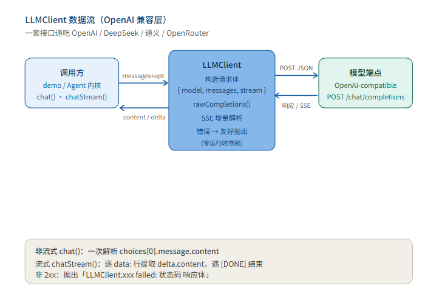
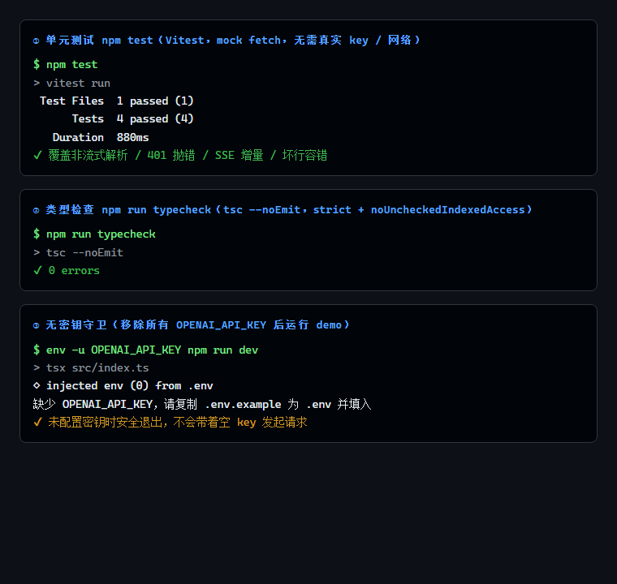
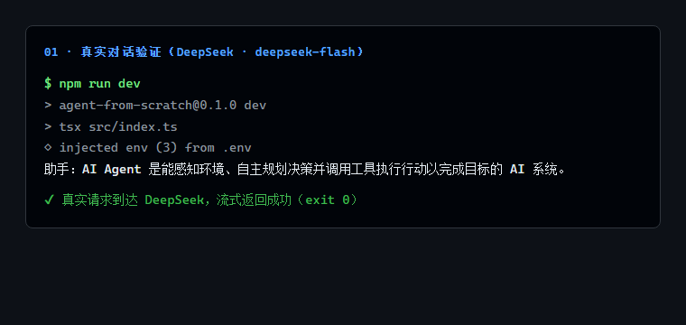

> **系列大纲 · 手搓 AI Agent（Node.js / TypeScript）**
>
> 本系列从零手搓一个**通用工具型 Agent**：能对话、能调用工具、能规划任务、能多 Agent 协作，并最终接入 MCP 生态。技术栈锁定 **Node.js 22 + TypeScript**，模型接入层用一套 **OpenAI 兼容抽象**通吃 OpenAI / DeepSeek / 通义 / OpenRouter——改 `.env` 即可换模型，内核零改动。每篇代码可跑、可测、可 `git checkout post-NN` 回溯到任意一篇起点，图文在多平台同步发布。
>
> **总目录（13 篇主线 + 1 篇收尾）**
> 1. 开篇：什么是 Agent，为什么不直接用框架（**本文**）
> 2. 工程地基：Node22 + TS + 统一 LLM 客户端
> 3. 心脏：Agent Loop 与 ReAct
> 4. 长出手脚：Tool 系统设计
> 5. 第一个真工具：搜索 / 计算 / 读文件
> 6. 记忆的两种形态
> 7. 会规划：Plan-and-Execute
> 8. 多 Agent 协作
> 9. 接外部世界：MCP 实战
> 10. 让 Agent 可信：权限 / 沙箱 / 人工介入
> 11. 持久化与恢复：会话、状态、崩溃续跑
> 12. 上线与可观测
> 13. 收尾：我们手搓的 vs 业界 ADK / Mastra
>
> 当前篇：第 1 篇——打通"模型能对话"这条最短路，并定下整套系列的接入层。

# 手搓 AI Agent 01：它到底是什么，以及为什么不直接用框架

Agent 不是一次 API 调用。2026 年三个主流基座都标榜"从零"，但内核都在用户看不见的地方。本系列用 Node.js 从最底层手搓一个通用工具助手，每篇代码可跑、可测、可 checkout。

本篇是地基：把"模型能对话"这条最短路打通，并定下整套系列的接入层——一套接口通吃所有 OpenAI-compatible 端点。

## 01 定义：Agent 不是一次性 API 调用

2024 年之前，社区对 Agent 的共识公式是五个部件：

```
Agent = LLM + Memory + Tools + Planning + Action
```

到 2026 年，这个公式被工程实践推进一步，Lil'Log（OpenAI 安全系统负责人 Lilian Weng）在 2026-07 的综述里把它重命名为 **Harness**——模型外的一切编排系统。Harness 在五要素之上，额外叠加四件事：工作流循环（plan→execute→observe→improve）、评估体系、权限控制、持久化状态管理。Claude Code、Codex 这类编码 Agent 的内核都长这样。

一句话区分：调一次 `chat.completions` 是"会聊天"；让它自己决定调工具、看见结果、再决定下一步，才是 Agent。

## 02 三个基座速览（为什么还要手搓）

| 基座 | 语言 | 硬约束 | 核心能力 |
|------|------|--------|----------|
| Google ADK for TS | TypeScript | Node ≥ 20.19 | 代码优先、Zod 校验、多 Agent 编排、MCP、A2A 协议 |
| Mastra | TypeScript | 无特殊 | 一套接口接 40+ 模型 provider，agents/workflows/MCP/评估 |
| Blade Agent SDK | TypeScript | Node ≥ 22.14 | session-first，内置 17 个标准工具 + 子 Agent + 权限沙箱 |

这三个都能用，但都不在本系列的主线上。手搓的目的不是"重新造轮子反对框架"，而是：框架把 loop、工具调度、上下文管理都封装了，你只有读懂这些内核，才排得懂框架报的错。框架是收尾章（第 13 篇）的对照物，不是起点。

## 03 本篇交付：一个 OpenAI 兼容客户端

接入层只有一个原则：**模型无关**。DeepSeek、通义、OpenRouter、OpenAI 的 Chat Completions 接口格式一致，差异只在 `base_url` 和 `model` 名。我们把这一层封成 `LLMClient`，后续所有 Agent 逻辑只依赖它。

两个能力：
- `chat()`：非流式，一次拿回完整文本。
- `chatStream()`：流式，逐 token 产出，CLI 里才有"打字机"效果。

核心在流式解析。OpenAI 的流式响应是 SSE（Server-Sent Events），每个 `data:` 行里是一个 delta 片段，流结束发 `data: [DONE]`。解析循环很短：

```ts
const reader = body.getReader();
const decoder = new TextDecoder();
let buffer = "";
while (true) {
  const { done, value } = await reader.read();
  if (done) break;
  buffer += decoder.decode(value, { stream: true });
  const lines = buffer.split("\n");
  buffer = lines.pop() ?? "";        // 最后一行可能不完整，留到下次
  for (const line of lines) {
    const trimmed = line.trim();
    if (!trimmed.startsWith("data:")) continue;
    const payload = trimmed.slice(5).trim();
    if (payload === "[DONE]") return;
    const json = JSON.parse(payload);
    const delta = json.choices?.[0]?.delta?.content;
    if (delta) yield delta;
  }
}
```

非流式只是把 `stream: false` 发过去，取 `choices[0].message.content`。错误分支统一：非 2xx 直接抛出 `LLMClient.chatStream failed: 状态码 响应体`，不让底层 fetch 错误裸奔到业务层。

工程上还有两点：依赖锁定为 **零运行时第三方包**（只靠 Node 22 内置 `fetch` 和 `Response` 流），接入 `.env` 的活交给 `dotenv` 在应用入口做，库本身保持纯净。

数据流长这样：



## 04 验证：这一章代码做了什么、实现了什么效果

代码位置：`src/llm/LLMClient.ts` + `src/index.ts`（demo）+ `tests/llm.test.ts`。

**做了什么**：封装了一层模型无关的对话客户端，支持非流式与流式两种调用，统一错误处理。

**实现了什么效果**，三组证据：



1. 单元测试 **4/4 通过**（`npm test`）。用 mock fetch 覆盖了四个分支：非流式正常解析、非 2xx 抛错、SSE 增量拼接、坏行容错。这一组证明 SSE 解析逻辑本身是对的，不依赖真实网络。
2. 类型检查 **0 errors**（`npm run typecheck`，`tsc --noEmit`）。`strict` + `noUncheckedIndexedAccess` 全开，索引越界和空值都会被编译期拦下。
3. 无密钥守卫生效（`npm run dev` 未配置 `.env` 时）：进程安全退出并打印「缺少 OPENAI_API_KEY，请复制 .env.example 为 .env 并填入」，不会带着空 key 去打请求。

真实对话这一步，有两个工程坑必须说清楚，它们直接决定本地能不能跑通：

- **坑一：DeepSeek 的 `base_url` 不带 `/v1`**。官方兼容地址是 `https://api.deepseek.com`（模型名 `deepseek-flash`），不是 OpenAI 官方那种 `.../v1`。配错路径会返回 401，已在仓库 `.env.example` 修正。
- **坑二：dotenv 默认不覆盖已存在的环境变量**。若运行环境（本机终端 / CI / 沙箱）已注入 `OPENAI_API_KEY`，`import "dotenv/config"` 的默认行为是「已存在的变量不覆盖」，`.env` 里的配置会被静默忽略，请求实际打到别的 key 上，表现为 DeepSeek 返回 `api key ... is invalid`。正确做法是入口改用 `dotenv.config({ override: true })`，让本地 `.env` 优先。

修复后用 DeepSeek 端点实测，输出 `◇ injected env (3) from .env` 确认 `.env` 生效，流式返回成功：



结论：本章交付的接入层**逻辑与真实调用全部验证可用**——非流式、流式、错误分支、真实模型调用无一遗漏。

## 05 本篇埋的雷

`src/index.ts` 现在的 demo 是串行的：发一句、收一句、结束。它"会说话"，但**不会做事**——没有循环，模型不能决定下一步，也不能调用任何工具。所有"智能"都停在单次响应里。

下一篇（Agent Loop）补上 `think → act → observe` 的循环，让模型能自己决定调用工具、看见结果、再决定下一步。那是 Agent 与"高级补全"之间的真正分界线。

---

判断：能对话不等于是 Agent，循环才是分水岭。看点：下一篇让模型第一次"动手"。
