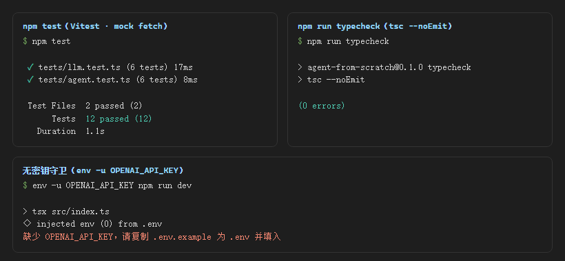
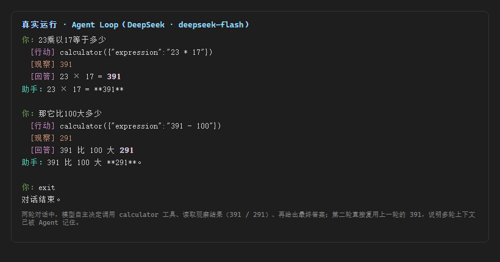

> **系列大纲 · 手搓 AI Agent（Node.js / TypeScript）**
>
> 本系列从零手搓一个**通用工具型 Agent**：能对话、能调用工具、能规划任务、能多 Agent 协作，并最终接入 MCP 生态。技术栈锁定 **Node.js 22 + TypeScript**，模型接入层用一套 **OpenAI 兼容抽象**通吃 OpenAI / DeepSeek / 通义 / OpenRouter——改 `.env` 即可换模型，内核零改动。每篇代码可跑、可测、可 `git checkout post-NN` 回溯到任意一篇起点，图文在多平台同步发布。
>
> **总目录（13 篇主线 + 1 篇收尾）**
> 1. 开篇：什么是 Agent，为什么不直接用框架
> 2. 工程地基：Node22 + TS + 统一 LLM 客户端
> 3. 心脏：Agent Loop 与 ReAct（**本文**）
> 4. 长出手脚：Tool 系统设计
> 5. 第一个真工具：搜索 / 计算 / 读文件
> 6. 记忆的两种形态
> 7. 会规划：Plan-and-Execute
> 8. 多 Agent 协作
> 9. 接外部世界：MCP 实战
> 10. 让 Agent 可信：权限 / 沙箱 / 人工介入
> 11. 持久化与恢复：会话、状态、崩溃续跑
> 12. 上线与可观测
> 13. 收尾：本系列手搓的 vs 业界 ADK / Mastra
>
> 当前篇：第 2 篇——实现 Agent Loop（`think → act → observe` 循环），让模型第一次能自主决定调用工具、看见结果、再决定下一步。第 1 篇已包含「开篇」与「工程地基」两节内容。
>
> **配套代码仓库**：https://github.com/mrhuo/agent-from-scratch （每篇对应一个 `post-NN` tag，`git checkout post-02` 即可回到本篇代码起点）

# 手搓 AI Agent 02：让模型第一次"动手"——Agent Loop 与 ReAct

第 1 篇打通了"模型能对话"，但那个 REPL 只是一条直线：你说一句，模型答一句，模型全程没有"做"任何事。这一篇要让模型第一次长出"手"——遇到需要算的题，它会自己决定去调用计算器，把结果拿回来，再继续想。实现这件事的核心，就是 **Agent Loop（智能体循环）**，在学界常被称为 **ReAct**（Reason + Act）。

---

## 00 引子：从"会算"到"会调计算器"

先抛一个具体场景。问一个纯聊天模型："23 乘以 17 等于多少？"它可能凭记忆答"391"，也可能胡诌一个别的数字——因为它只是在"补全文本"，并没有真的去算。如果问题是"391 比 100 大多少"，它更可能直接口算或干脆答错，因为中间又多了一道算术。

但如果给它一个计算器工具，再让它学会"该算的时候去调工具"，结果就完全不同：

```
你：23乘以17等于多少
  [行动] calculator({"expression":"23 * 17"})
  [观察] 391
  [回答] 23 × 17 = 391
你：那它比100大多少
  [行动] calculator({"expression":"391 - 100"})
  [观察] 291
  [回答] 391 比 100 大 291
```

注意第二次提问里的"它"——模型记住了上一轮算出的 391，直接拿去减 100。这就是**循环 + 记忆**带来的质变：模型不是一次把答案吐出来，而是"想一步、做一步、看结果、再想一步"。

第 1 篇说过，循环是 Agent 的灵魂。这一篇就是把那个灵魂第一次跑起来。

---

## 01 概念：ReAct 到底是什么

ReAct 是 "Reason（推理）" 与 "Act（行动）" 的拼接，由 Google 在 2022 年的论文 *ReAct: Synergizing Reasoning and Acting in Language Models* 中提出。它的核心思想极简：**让模型在每一步，要么输出一段推理（thought），要么输出一个动作（action）；动作会产生一个观察（observation），观察再喂回模型，进入下一步。** 如此往复，直到模型认为任务完成，输出最终答案。

把第 1 篇那个循环公式展开，每一圈是这三个状态：

```
    ┌──────────────────────────────────────┐
    │                                      ▼
  思考(thought) ──► 行动(action: 调工具) ──► 观察(observation: 看结果)
    ▲                                      │
    └──────────────────────────────────────┘
```

- **思考（thought）**：模型读当前上下文，判断"我现在知道什么、还差什么、下一步该干嘛"。在工具调用场景里，这段思考经常被压缩成空，但它在多步任务里至关重要。
- **行动（action）**：模型决定调用某个工具，并给出参数。比如 `calculator({"expression":"23 * 17"})`。
- **观察（observation）**：工具真正执行后返回的结果，比如 `391`。这段文字会被写回上下文，模型在下一圈"思考"时能看到它。

对比一下：第 1 篇的 REPL 是"直线"——`输入 → 输出`，到头就结束；Agent Loop 是"回路"——`思考 → 行动 → 观察 → 思考 → ...`，会拐弯、会回头、会多走几步。

举一个完整的多步例子（本篇先只实现"计算"这一种 action，查天气留到第 5 篇）：

```
问：北京和上海今天温差多少？
  思考：需要两个城市的气温，再相减
  行动：查天气(北京)  → 观察：北京 5°C
  行动：查天气(上海)  → 观察：上海 11°C
  思考：11 - 5 = 6
  行动：calculator("11 - 5") → 观察：6
  回答：温差 6 度
```

这个例子里，"查天气"和"计算"都是 action，每个 action 都产生 observation，模型在 observation 之上继续推理。这正是 Agent 与普通补全的分界线：**模型在一次任务里，自主地、多次地决定"下一步做什么"，并真的去执行。**

---

## 02 本篇工程目标

本篇交付一个**最小可用 Agent**，包含四件事：

1. 给 `LLMClient` 增加工具调用能力（`chatWithTools`），让模型能返回"我想调哪个工具、参数是什么"。
2. 定义一个 `Tool` 接口和一个最小工具 `calculator`，并重点解决"安全算数"这个隐患。
3. 实现 `Agent` 主循环：把"思考→行动→观察"串起来，带**步数上限**和**错误隔离**。
4. 把第 1 篇的对话 REPL 升级成 Agent REPL，让"动手"过程在终端可见。

代码位置：`src/llm/LLMClient.ts`（加 `chatWithTools`）、`src/agent/`（新增 `Agent.ts` / `tools.ts` / `index.ts`）、`src/index.ts`（REPL 升级）。

---

## 03 代码实现

### 3.1 给 LLMClient 加工具调用能力

OpenAI 兼容接口支持"函数调用（function calling）"：请求里带 `tools` 字段描述可用工具，模型如果决定调用，会在回复里返回 `tool_calls`。`chatWithTools` 负责发请求、并把模型返回的 `tool_calls` 解析成结构化对象。

```ts
// src/llm/LLMClient.ts（节选）
async chatWithTools(
  messages: Message[],
  tools: ToolDefinition[],
  options: ChatOptions = {},
): Promise<ChatResult> {
  const res = await this.rawCompletions(
    messages,
    { ...options, stream: false },
    tools, // 仅在有工具时附加 tools 字段
  );
  if (!res.ok) {
    const body = await res.text();
    throw new Error(`LLMClient.chatWithTools failed: ${res.status} ${body}`);
  }
  const data = (await res.json()) as { choices?: { message?: {
    content?: string | null;
    tool_calls?: { id?: string; type?: string;
      function?: { name?: string; arguments?: unknown } }[];
  } }[] };
  const msg = data.choices?.[0]?.message ?? {};
  const content = msg.content ?? null;
  const toolCalls: ToolCall[] = (msg.tool_calls ?? []).map((tc) => ({
    id: tc.id ?? "",
    type: "function",
    function: {
      name: tc.function?.name ?? "",
      // 模型给的 arguments 是 JSON 字符串，解开成对象供逻辑使用
      arguments: parseArgs(tc.function?.arguments),
    },
  }));
  return { content, toolCalls };
}
```

**这里有一个真实的线格式坑，必须讲清**，因为它会直接导致本地 `422` 报错：模型返回的 `tool_calls` 里，`function.arguments` 是**一个 JSON 字符串**（例如 `"{\"expression\":\"23 * 17\"}"`），不是对象。代码将其 `JSON.parse` 成对象方便逻辑读取。但**把"助手决定调工具"这件事回写进上下文、发给模型下一轮时，`arguments` 必须再序列化回 JSON 字符串**——DeepSeek / OpenAI 要求回传的 `tool_calls.function.arguments` 是字符串，传对象会报 `422 invalid_request_error: expected a string`。本篇的 `Agent` 在回写时用 `JSON.stringify` 处理了这个转换（见 3.3）。

`ToolCall` 用嵌套 `function` 结构，与线格式严格对齐；内部逻辑读取 `call.function.name` 和 `call.function.arguments`。

### 3.2 工具接口与"安全计算"

先定义工具的抽象。`Tool` 对外暴露给模型的是 `name`、`description`（决定模型懂不懂怎么用）、`parameters`（参数 JSON Schema）；对内是 `execute`（真正执行）：

```ts
// src/agent/tools.ts（节选）
export interface Tool {
  name: string;
  description: string;
  parameters: Record<string, unknown>; // 参数的 JSON Schema，喂给模型
  execute: (args: Record<string, unknown>) => Promise<string> | string;
}

// 仅允许数字、四则运算符、括号与空格，杜绝任何字母（即潜在代码）注入
const ARITH_WHITELIST = /^[\d+\-*/().\s]+$/;

export function evalArithmetic(expression: string): string {
  const cleaned = expression.trim();
  if (cleaned === "" || !ARITH_WHITELIST.test(cleaned)) {
    return "错误：表达式只能包含数字、运算符 + - * /、括号和空格";
  }
  try {
    // 经白名单校验后才执行；Function 在严格模式下运行，不访问外部作用域
    const value = Function(`"use strict"; return (${cleaned});`)() as unknown;
    if (typeof value !== "number" || !Number.isFinite(value)) {
      return "错误：计算结果不是有限数值";
    }
    return String(value);
  } catch {
    return "错误：表达式无法计算，请检查括号与运算符是否匹配";
  }
}

export const calculator: Tool = {
  name: "calculator",
  description:
    "计算一个算术表达式的值。支持加(+)、减(-)、乘(*)、除(/)和括号()，例如 \"23 * 17\" 或 \"(1024 - 256) / 8\"。凡是需要算数，优先调用它，不要凭记忆口算。",
  parameters: {
    type: "object",
    properties: { expression: { type: "string", description: "要计算的算术表达式" } },
    required: ["expression"],
  },
  execute: (args) => evalArithmetic(String(args.expression ?? "")),
};
```

**为什么不直接用 `eval(expression)`？** 因为 `expression` 来自模型的输出，而模型可能被诱导生成 `1+1; process.exit(1)` 之类的东西。`evalArithmetic` 先过一道白名单（只允许数字、四则符号、括号、空格），任何含字母的输入都被拒绝。白名单通过后才用 `Function` 构造器在严格模式下计算——这条"先验证形态、再执行外部输入"的铁律，是所有 Agent 工具都必须遵守的。

### 3.3 Agent 主循环

`Agent` 把循环跑起来。它内部持有整段对话 `conversation`（有状态，这样多轮对话才能记住前文），`run(userInput)` 只负责把用户新的一句追加进去，然后在循环里反复问模型"下一步做什么"：

```ts
// src/agent/Agent.ts（节选）
async run(userInput: string): Promise<AgentRunResult> {
  this.conversation.push({ role: "user", content: userInput });
  const steps: AgentStep[] = [];
  const tools = [...this.tools.values()].map(toDefinition);

  for (let step = 0; step < this.maxSteps; step++) {
    const result = await this.client.chatWithTools(this.conversation, tools);

    if (result.toolCalls.length > 0) {
      if (result.content) steps.push({ kind: "thought", text: result.content });
      // 把"模型想调工具"原样回写进上下文（arguments 序列化回 JSON 字符串）
      this.conversation.push({
        role: "assistant",
        content: result.content,
        tool_calls: result.toolCalls.map((tc) => ({
          id: tc.id,
          type: "function",
          function: { name: tc.function.name, arguments: JSON.stringify(tc.function.arguments) },
        })),
      });
      for (const call of result.toolCalls) {
        steps.push({ kind: "action", text: `${call.function.name}(${JSON.stringify(call.function.arguments)})` });
        const observation = await this.runTool(call);     // 执行工具
        steps.push({ kind: "observation", text: observation });
        this.conversation.push({ role: "tool", content: observation, tool_call_id: call.id });
      }
      continue; // 带着观察结果再转一圈
    }
    // 没有工具调用 → 这是最终答案
    const answer = result.content ?? "";
    this.conversation.push({ role: "assistant", content: answer });
    steps.push({ kind: "answer", text: answer });
    return { answer, steps };
  }
  // 达到步数上限，避免模型陷入"永远调工具"的死循环
  return { answer: "（已达到最大步数限制，任务可能未完成，请简化问题后重试）", steps };
}
```

两个工程细节值得记住：

- **步数上限 `maxSteps` 是安全阀**。没有它，一旦模型陷入"调工具→给个无效参数→又调工具"的循环，token 会被无限消耗。本篇默认 8 步。
- **错误隔离**。工具执行抛异常时，不会被抛到循环外让整个 Agent 崩溃，而是变成一条 `观察` 文本（如"错误：表达式无法计算"），模型下一圈能看到这个失败、自行决定换参数或放弃。这一条让 Agent 在工具不可靠时依然健壮。

---

## 如何运行本章代码

配套代码已全部推到 GitHub，每篇对应一个 `post-NN` tag。跟随本章，先切到 `post-02` 的代码状态，再逐步运行：

```bash
# 1. 克隆仓库
git clone https://github.com/mrhuo/agent-from-scratch.git
cd agent-from-scratch

# 2. 切到本篇（第 2 篇）对应的代码快照
git checkout post-02

# 3. 安装依赖（需要 Node.js >= 22，否则内置 fetch 不可用）
npm install

# 4. 配置密钥：复制模板，填入你的 API Key
cp .env.example .env
#   然后编辑 .env，填入：
#     OPENAI_API_KEY=sk-xxxxxxxx（填入申请的 API Key）
#     BASE_URL=https://api.deepseek.com   # DeepSeek 兼容地址，注意【不带 /v1】
#     MODEL=deepseek-flash

# 5. 启动 Agent 对话（输入一句，Agent 可能调用计算器，输入 exit 退出）
npm run dev

# 6. 跑单元测试（mock，无需 key / 外网）
npm test

# 7. 类型检查
npm run typecheck
```

说明：`.env` 已被 `.gitignore` 忽略，不会进入提交，密钥只留在本机；`node_modules` 同样忽略。若 `npm run dev` 报连接超时，先确认 `.env` 里 `BASE_URL` 没写成带 `/v1` 的地址（DeepSeek 不带 `/v1`）。

---

## 04 验证：这一章代码做了什么、实现了什么效果

代码位置：`src/llm/LLMClient.ts`（加 `chatWithTools`）、`src/agent/`（新增 `Agent.ts` / `tools.ts` / `index.ts`）、`src/index.ts`（REPL 升级）、`tests/llm.test.ts` 与 `tests/agent.test.ts`。

**做了什么**：实现了 `think → act → observe` 的 Agent 循环，模型能自主决定调用 `calculator` 工具、读取观察结果、再给出最终回答；工具参数经过白名单安全校验；循环带步数上限与错误隔离；Agent 内部持有对话上下文，多轮记忆可用。

**实现了什么效果**，四组证据：



1. **单元测试 12/12 通过**（`npm test`）。`tests/llm.test.ts` 覆盖 `chat` 与 `chatWithTools`（解析 `tool_calls`、参数字符串解开、非 2xx 抛错）；`tests/agent.test.ts` 覆盖四类场景：模型无需工具直接答、模型调工具→观察→再答、**工具报错被隔离成观察文本循环不崩**、达到 `maxSteps` 返回兜底。这一组证明循环逻辑本身正确，不依赖真实网络。
2. **类型检查 0 errors**（`npm run typecheck`，`tsc --noEmit`）。`strict` + `noUncheckedIndexedAccess` 全开。
3. **无密钥守卫生效**：未配置 `OPENAI_API_KEY` 时进程安全退出并打印提示，不发起请求（见上图第三面板）。
4. **真实对话端到端跑通**（DeepSeek `deepseek-flash`）：



真实运行显示两轮对话中，模型自主调用 `calculator` 并读取观察结果（第一轮 391、第二轮 291），且第二轮直接复用上一轮的 391，证明多轮上下文已被 Agent 记住。

**两个工程坑记录**（均已在代码中处理）：
- 线格式坑：`tool_calls.function.arguments` 在请求侧必须是 JSON 字符串，回传对象会触发 DeepSeek `422`。`Agent` 用 `JSON.stringify` / `parseArgs` 在对象与字符串间转换。
- 安全坑：工具参数来自模型输出，必须经白名单校验后再执行，杜绝代码注入。

---

## 05 本篇埋的雷

这一章的工具是"手搓的最小形态"，埋了三处待解决的问题，正好串起后续篇章：

- **工具散落在代码里，没有统一注册表，也没有参数校验框架**。本篇的 `calculator` 参数靠 `evalArithmetic` 内部白名单兜底，但更复杂的工具（带多个字段、枚举值）需要结构化的参数校验。第 4 篇会用 **Zod** 把参数 schema 管起来，并设计工具注册表。
- **模型"想不想调工具"不可控**。有时它会偷懒直接口算（可能错），有时该调却不调。这涉及工具描述怎么写、system prompt 怎么引导，属于"工具系统可靠性"问题，第 4、5 篇会继续打磨。
- **目前只支持单工具、串行执行**。多个工具并行、子 Agent 分工，本篇都没涉及，留到第 8 篇多 Agent 协作再展开。

---

判断：循环让模型第一次"动手"，但工具还是散兵游勇。看点：下一篇用 Zod 把工具收编成一套正式系统。
