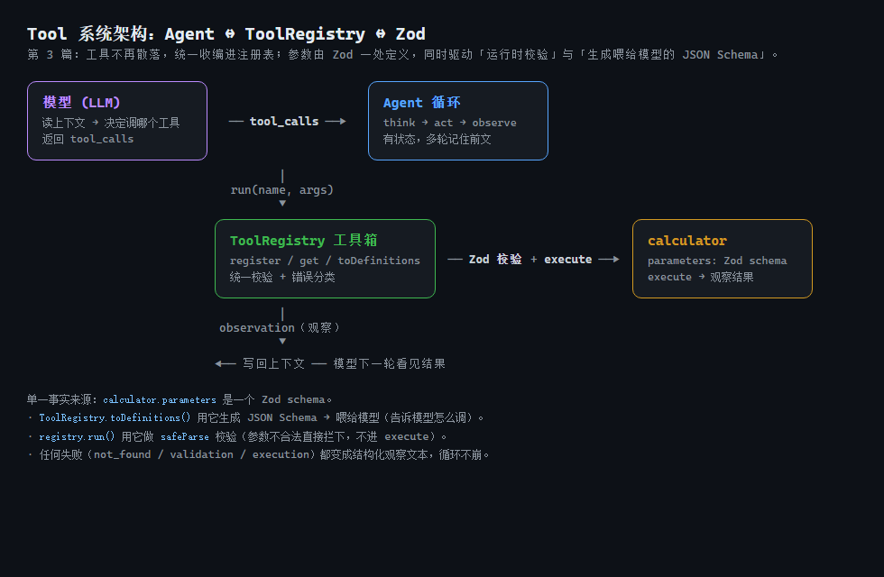
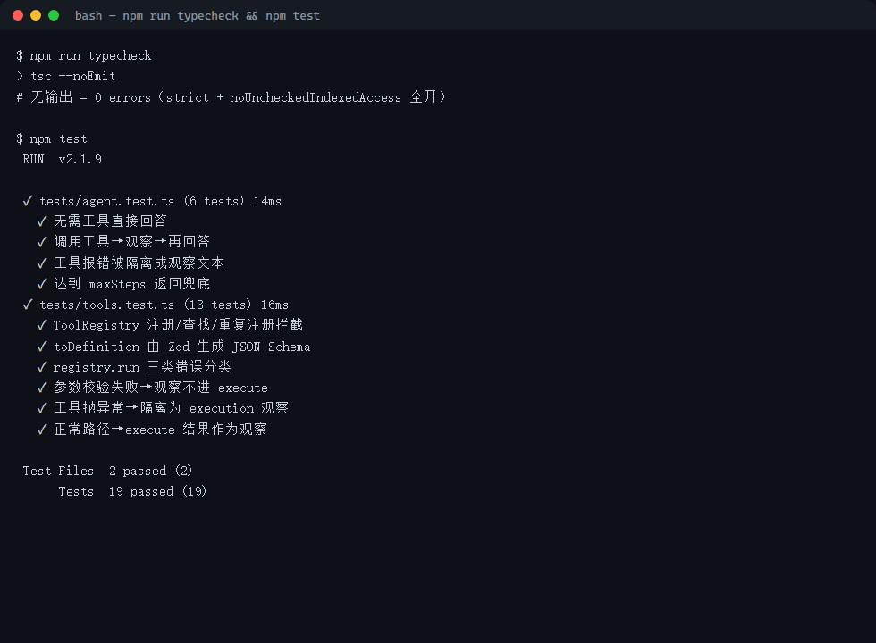
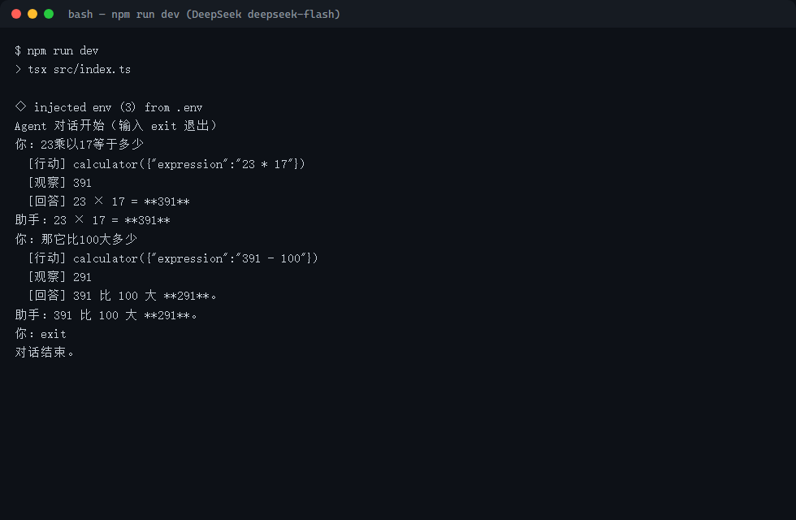

> **系列大纲 · 手搓 AI Agent（Node.js / TypeScript）**
>
> 本系列从零手搓一个**通用工具型 Agent**：能对话、能调用工具、能规划任务、能多 Agent 协作，并最终接入 MCP 生态。技术栈锁定 **Node.js 22 + TypeScript**，模型接入层用一套 **OpenAI 兼容抽象**通吃 OpenAI / DeepSeek / 通义 / OpenRouter——改 `.env` 即可换模型，内核零改动。每篇代码可跑、可测、可 `git checkout post-NN` 回溯到任意一篇起点，图文在多平台同步发布。
>
> **总目录（13 篇主线 + 1 篇收尾）**
> 1. 开篇：什么是 Agent，为什么不直接用框架
> 2. 工程地基：Node22 + TS + 统一 LLM 客户端
> 3. 心脏：Agent Loop 与 ReAct
> 4. 长出手脚：Tool 系统设计（**本文**）
> 5. 第一个真工具：搜索 / 计算 / 读文件
> 6. 记忆的两种形态
> 7. 会规划：Plan-and-Execute
> 8. 多 Agent 协作
> 9. 接外部世界：MCP 实战
> 10. 让 Agent 可信：权限 / 沙箱 / 人工介入
> 11. 持久化与恢复：会话、状态、崩溃续跑
> 12. 上线与可观测
> 13. 收尾：本系列手搓的 vs 业界 ADK / Mastra
>
> 当前篇：第 3 篇——把上一章"散落各处的工具"收编成一套正式系统：用 Zod 一处定义参数、自动生成喂给模型的 JSON Schema，并用注册表统一管理、统一校验、统一错误分类。第 1、2 篇已打通"对话"与"循环"。
>
> **配套代码仓库**：https://github.com/mrhuo/agent-from-scratch （每篇对应一个 `post-NN` tag，`git checkout post-03` 即可回到本篇代码起点）

# 手搓 AI Agent 03：长出手脚——Tool 系统设计

第 2 篇让模型第一次"动手"了：它能自主决定调用 `calculator`、看见结果、再继续推理。但那一章的工具是"最小形态"——定义散落在 Agent 构造函数里，参数校验靠 `evalArithmetic` 内部的白名单兜底，出错信息也只是混在观察文本里。一旦工具变多（搜索、读文件、发邮件……），这种写法会迅速失控：模型拿到的参数描述可能和代码里的真实校验对不上，错误原因也说不清。

这一篇把"工具"从零散代码升级成一个**系统**：统一的注册表、统一的参数 schema、统一的错误分类。它是 Agent 真正"长出手脚"的地基——后面每一章加的新能力，几乎都是往这个系统里再塞一个工具。

---

## 00 引子：一个工具为什么会"长歪"

先想一个现实问题。假设你想给 Agent 加一个"查天气"工具，它的参数长这样：

```
城市：字符串，必填
单位：枚举，只能是 "celsius" 或 "fahrenheit"，可选，默认 celsius
```

你至少要写两份东西：

1. **给模型看的说明**：告诉模型"这个工具叫什么、参数是什么、怎么填"。这份通常写成 JSON Schema，塞进 `tools` 字段发给模型。
2. **运行时校验**：模型真的调了，你还得在代码里检查"城市是不是字符串、单位是不是合法枚举"，不合法直接拦下。

如果这两份是**分别手写**的，灾难就埋下了：你改了校验逻辑，却忘了同步更新给模型的 JSON Schema，模型就会一直按旧格式传参，然后你永远在修"参数不合法"的 bug。这种"两份真相"是工具系统最大的坑。

第 2 篇的 `calculator` 已经有这个苗头：`parameters` 是手写的 JSON Schema，`execute` 里又用白名单再校验一遍。这一篇要用一个原则根治它——**单一事实来源**：参数只定义一次，校验和说明都由它生成。

---

## 01 概念：好的工具系统长什么样

一个能撑住后续所有篇章的工具系统，至少要有四样东西：

- **统一的定义形态**。每个工具都有名字、说明、参数、执行函数，且参数用同一套机制描述。
- **单一事实来源的参数 schema**。定义一次，既生成喂给模型的 JSON Schema，又做运行时校验，两者永不漂移。
- **注册表（Registry）**。所有工具先登记进一个"工具箱"，按名字查找，避免散落各处。Agent 只跟注册表打交道。
- **结构化的错误分类**。工具调失败太常见了——名字拼错、参数不合法、执行时抛异常。每类错误要能明确区分，并转成模型看得懂的观察文本，让循环继续而不是崩溃。

这四样，正好对应本篇要落地的四个代码模块。下面逐个实现。

---

## 02 本篇工程目标

本篇交付一个**工具系统**，而不是单个工具，包含四件事：

1. 用 **Zod** 接管工具参数：一处定义，自动生成 JSON Schema + 运行时校验。
2. 定义 **`ToolError`** 错误分类（找不到 / 参数不合法 / 执行异常），把失败变成结构化观察。
3. 实现 **`ToolRegistry`** 注册表：集中登记、查找、生成工具定义。
4. 让 **`Agent`** 接入注册表，所有"找工具 → 校验 → 执行"都走统一入口，错误被隔离在循环外。

代码位置：`src/agent/schema.ts`（Zod→JSON Schema 转换）、`src/agent/tools.ts`（Tool 定义 + 错误分类）、`src/agent/registry.ts`（新增注册表）、`src/agent/Agent.ts`（接入注册表）、`src/index.ts`（demo 改造）。

---

## 03 代码实现

### 3.1 Zod 接管参数：单一事实来源

先定义工具的抽象。和第 2 篇最大的区别是 `parameters` 不再是手写的 JSON Schema，而是一个 **Zod schema**：

```ts
// src/agent/tools.ts（节选）
import { z } from "zod";

export interface Tool<T extends z.ZodTypeAny = z.ZodTypeAny> {
  name: string;
  /** 给模型看的自然语言描述，决定模型懂不懂、什么时候用这个工具 */
  description: string;
  /** 参数 Zod schema：既是运行时校验器，也是生成 JSON Schema 的来源 */
  parameters: T;
  /** 执行工具，返回字符串形式的观察结果（喂回模型）；args 已经过 Zod 校验 */
  execute: (args: z.infer<T>) => Promise<string> | string;
}
```

`calculator` 现在是这样定义的：

```ts
// src/agent/tools.ts（节选）
const calculatorParams = z.object({
  expression: z.string().describe('要计算的算术表达式，例如 "23 * 17" 或 "(1024 - 256) / 8"'),
});

export const calculator: Tool<typeof calculatorParams> = {
  name: "calculator",
  description:
    "计算一个算术表达式的值。支持加(+)、减(-)、乘(*)、除(/)和括号()，例如 \"23 * 17\"。凡是需要算数，优先调用它，不要凭记忆口算。",
  parameters: calculatorParams,
  execute: (args) => evalArithmetic(args.expression),
};
```

注意 `execute` 收到的 `args` 类型是 `z.infer<typeof calculatorParams>`，也就是 `{ expression: string }`——**类型在编译期就帮你约束好了**，写 `args.expression` 不会是 `any`。这是手写 JSON Schema 做不到的。

**关键一步：从 Zod 生成 JSON Schema。** 模型需要的是 JSON Schema，不是 Zod。社区有现成库 `zod-to-json-schema`，本系列坚持"零运行时第三方依赖"的原则（只有 `zod` 一个依赖），所以自己写一个覆盖本系列用到的子集（`string / number / boolean / array / enum / object / optional / union`）：

```ts
// src/agent/schema.ts（节选）
export function zodToJsonSchema(schema: z.ZodTypeAny): JsonSchema {
  // 递归转换；处理 optional 时保留外层 .describe() 的描述，避免被剥离时丢失
  ...
  if (s instanceof z.ZodObject) {
    const shape = getShape(s);
    const properties: Record<string, JsonSchema> = {};
    const required: string[] = [];
    for (const [key, val] of Object.entries(shape)) {
      const unwrapped = unwrapOptional(val as z.ZodTypeAny);
      properties[key] = convert(val as z.ZodTypeAny); // 用原始属性，保留 optional 上的描述
      if (!unwrapped.optional) required.push(key);
    }
    return withDesc(s, { type: "object", properties, required });
  }
  ...
}
```

`toDefinition` 用它把工具转成发给模型的定义：

```ts
// src/agent/tools.ts（节选）
export function toDefinition(tool: Tool): ToolDefinition {
  return {
    type: "function",
    function: {
      name: tool.name,
      description: tool.description,
      parameters: zodToJsonSchema(tool.parameters), // 由 Zod 生成，与校验逻辑同源
    },
  };
}
```

这样就做到了"参数只定义一次"：`calculator` 的 `expression` 字段，既决定了模型看到的描述（`describe(...)`），又决定了运行时校验（必须是字符串）。你改了 Zod，两边一起变。

### 3.2 错误分类：让失败可说清

工具执行会失败，而且失败原因天差地别。把它们归成三类，每类给出明确的观察文本，模型下一圈才能对症下药：

```ts
// src/agent/tools.ts（节选）
export type ToolErrorKind = "not_found" | "validation" | "execution";

export class ToolError extends Error {
  readonly kind: ToolErrorKind;
  constructor(kind: ToolErrorKind, message: string) {
    super(message);
    this.kind = kind;
    this.name = "ToolError";
  }
}
```

- **not_found**：模型叫了一个不存在的工具（多半是名字拼错）。
- **validation**：参数没过 Zod 校验（比如该给字符串的给了数字、缺了必填字段）。
- **execution**：工具执行时抛了异常（比如读文件时文件不存在）。

三类信息都会以 `[工具错误·kind]` 前缀写进观察文本，模型能直接读到"是参数错了还是执行错了"，而不是面对一句含糊的"出错了"。

### 3.3 ToolRegistry：工具的"工具箱"

第 2 篇工具就放在 Agent 的一个 `Map` 里，没有任何边界保护。本篇把它升级成正式的注册表：

```ts
// src/agent/registry.ts（节选）
export class ToolRegistry {
  private readonly tools = new Map<string, Tool>();

  /** 注册一个工具；同名重复注册直接报错，避免悄悄覆盖 */
  register(tool: Tool): this {
    if (this.tools.has(tool.name)) {
      throw new Error(`ToolRegistry: 工具名 "${tool.name}" 已存在，不能重复注册`);
    }
    this.tools.set(tool.name, tool);
    return this;
  }

  registerAll(tools: Tool[]): this {
    for (const t of tools) this.register(t);
    return this;
  }

  get(name: string): Tool | undefined { return this.tools.get(name); }
  has(name: string): boolean { return this.tools.has(name); }
  list(): Tool[] { return [...this.tools.values()]; }
  toDefinitions(): ToolDefinition[] { return this.list().map(toDefinition); }

  /** 统一执行入口：找工具 → Zod 校验 → 执行，失败分类成观察文本 */
  async run(name: string, rawArgs: unknown): Promise<string> {
    const tool = this.tools.get(name);
    if (!tool) return `[工具错误·not_found] 找不到名为 "${name}" 的工具`;

    const parsed = tool.parameters.safeParse(rawArgs);
    if (!parsed.success) {
      return `[工具错误·validation] 参数校验失败：${formatZodError(parsed.error)}`;
    }
    try {
      return String(await tool.execute(parsed.data));
    } catch (err) {
      const message = err instanceof Error ? err.message : String(err);
      return `[工具错误·execution] 工具 "${name}" 执行异常：${message}`;
    }
  }
}
```

重点在 `run`：它把"找工具、校验参数、执行、错误分类"**全都收口**了。注意 `safeParse`——参数不合法时，`execute` 根本不会被调用，危险输入在进业务逻辑之前就被拦下。这正是 Agent 使用外部（模型生成）输入时的铁律：**先验证形态，再执行**。

### 3.4 Agent 接入注册表

`Agent` 不再自己维护 `Map`，而是持有注册表，循环里执行工具时直接委托给它：

```ts
// src/agent/Agent.ts（节选）
constructor(
  client: LLMClient,
  options: { tools?: Tool[]; registry?: ToolRegistry; maxSteps?: number; systemPrompt?: string } = {},
) {
  this.client = client;
  // 既可直接传 tools 数组（内部收编进注册表），也可复用外部已建好的注册表
  this.registry = options.registry ?? new ToolRegistry().registerAll(options.tools ?? []);
  ...
}

// 循环里生成喂给模型的工具定义，统一取自注册表
const tools = this.registry.toDefinitions();
...
// 执行单个工具调用：委托注册表，错误隔离在循环外
private async runTool(call: ToolCall): Promise<string> {
  return this.registry.run(call.function.name, call.function.arguments);
}
```

向后兼容仍然保留：老代码 `new Agent(client, { tools: [calculator] })` 依旧能跑——`tools` 数组会被内部自动收编进一个注册表。后面第 5 篇加搜索、读文件等真工具时，只要多 `register` 一个，Agent 内核一行都不用改。

### 3.5 demo 改造

`src/index.ts` 的入口先把工具收编进注册表，再交给 Agent：

```ts
// src/index.ts（节选）
const registry = new ToolRegistry().register(calculator);
const agent = new Agent(client, { registry, maxSteps: 6 });
```

整个数据流变成：



模型拿到的 `tools` 来自 `registry.toDefinitions()`（Zod 生成的 JSON Schema）；模型决定调用后，`registry.run()` 做校验与执行；结果作为观察写回上下文，模型下一轮继续。一切围绕注册表转。

---

## 如何运行本章代码

配套代码已全部推到 GitHub，每篇对应一个 `post-NN` tag。跟随本章，先切到 `post-03` 的代码状态，再逐步运行：

```bash
# 1. 克隆仓库
git clone https://github.com/mrhuo/agent-from-scratch.git
cd agent-from-scratch

# 2. 切到本篇（第 3 篇）对应的代码快照
git checkout post-03

# 3. 安装依赖（需要 Node.js >= 22，否则内置 fetch 不可用）
npm install

# 4. 配置密钥：复制模板，填入你的 API Key
cp .env.example .env
#   然后编辑 .env，填入：
#     OPENAI_API_KEY=sk-xxxxxxxx（填入申请的 API Key）
#     BASE_URL=https://api.deepseek.com   # DeepSeek 兼容地址，注意【不带 /v1】
#     MODEL=deepseek-flash

# 5. 启动 Agent 对话（输入一句，Agent 可能调用工具，输入 exit 退出）
npm run dev

# 6. 跑单元测试（mock，无需 key / 外网）
npm test

# 7. 类型检查
npm run typecheck
```

说明：`.env` 已被 `.gitignore` 忽略，不会进入提交，密钥只留在本机；`node_modules` 同样忽略。新增的 `zod` 依赖已写入 `package.json`，`npm install` 会一并安装。若 `npm run dev` 报连接超时，先确认 `.env` 里 `BASE_URL` 没写成带 `/v1` 的地址（DeepSeek 不带 `/v1`）。

---

## 04 验证：这一章代码做了什么、实现了什么效果

代码位置：`src/agent/schema.ts`（Zod→JSON Schema）、`src/agent/tools.ts`（Tool + ToolError）、`src/agent/registry.ts`（注册表）、`src/agent/Agent.ts`（接入）、`src/index.ts`（demo）、`tests/tools.test.ts`（新增 13 个用例）。

**做了什么**：把工具从"散落代码"升级成"正式系统"——Zod 一处定义参数并同时驱动 JSON Schema 生成与运行时校验；注册表统一管理工具的登记、查找与定义导出；所有工具执行经统一入口做校验与错误分类，失败被隔离成结构化观察文本。

**实现了什么效果**，三组证据：



1. **单元测试 19/19 通过**（`npm test`，2 个文件共 19 用例）。新增 `tests/tools.test.ts` 覆盖：注册表登记/查找/重复拦截、Zod→JSON Schema 转换（含 enum/array/optional/required）、`registry.run` 三类错误分类（not_found / validation / execution）、参数不合法时 `execute` 不被调用、工具抛异常被隔离。这一组证明工具系统逻辑正确，不依赖真实网络。
2. **类型检查 0 errors**（`npm run typecheck`，`tsc --noEmit`，`strict` + `noUncheckedIndexedAccess` 全开）。`Tool<T>` 泛型让 `execute` 的入参在编译期就是 `{ expression: string }`，不是 `any`。
3. **真实对话端到端跑通**（DeepSeek `deepseek-flash`，见下）：



真实运行显示两轮对话中，模型经注册表调用 `calculator`（`registry.run`），拿到观察 391、291，且第二轮直接复用上一轮的 391——证明新工具系统与 Agent 多轮记忆协同工作正常。

**两个工程坑记录**（均已在代码中处理）：
- **Zod→JSON Schema 的 optional 描述丢失**：`z.string().optional().describe("x")` 这种写法，描述挂在外层 optional 上；转换时若先剥离 optional 再转换内层，描述会丢。修复方式是"用原始属性（保留 optional 包裹）去转换，仅用 unwrap 判断 required"，让外层描述保留。
- **参数校验必须在 execute 之前**：`registry.run` 用 `safeParse` 先校验，不合法直接返回 validation 观察，`execute` 不执行。这堵住了"模型传脏参数进业务逻辑"的口子。

---

## 05 本篇埋的雷

这一章把工具收编成了系统，但还有三处待解的问题，串起后续篇章：

- **工具还是太少，且都是"确定性"的**。目前只有 `calculator` 一个，而且它不碰外部世界。第 5 篇要加真正的"外部工具"：搜索、读文件。它们带来新问题——网络请求超时怎么办、读文件要不要权限校验、返回太大怎么截断。
- **工具执行没有"安全边界"**。现在 `execute` 想干什么就干什么。一旦真去读文件、发请求，就需要沙箱和权限控制，否则一个恶意 prompt 可能诱导 Agent 删库。这是第 10 篇（权限 / 沙箱 / 人工介入）的主线。
- **工具一多，模型就"选不准"**。注册表里有十个工具时，模型可能调错、或者该串行调的并行调了。这涉及工具描述怎么写、以及第 7 篇的 Plan-and-Execute（先规划再执行）。

---

判断：工具系统让 Agent 第一次有了可扩展的"手脚"接口，但真去碰外部世界前，还差安全与规划两道防线。看点：下一篇给这套接口装上第一个真工具——搜索、读文件。
