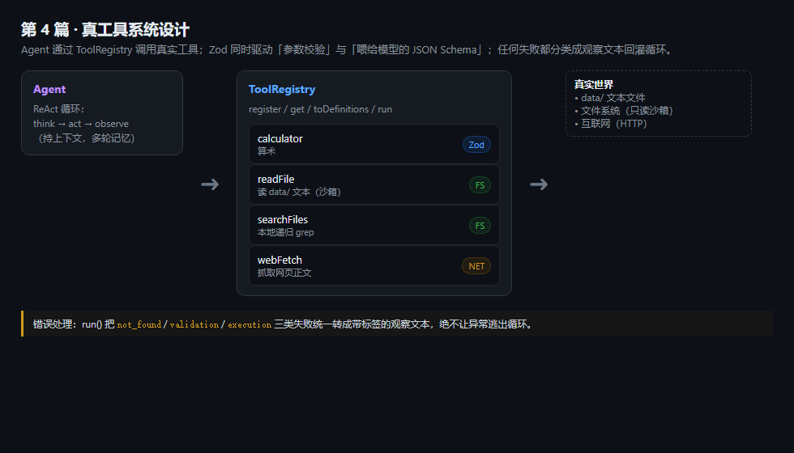
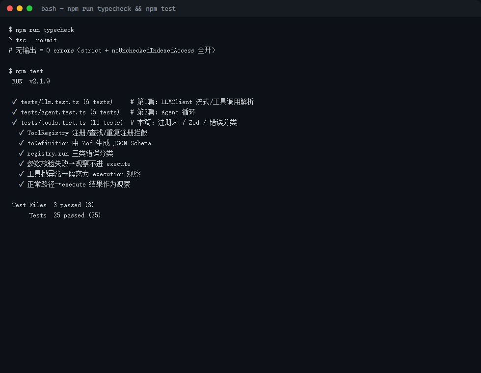
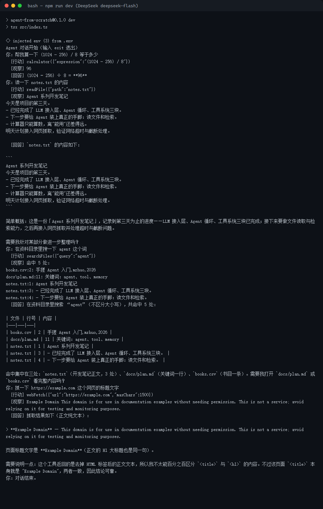

> **系列大纲 · 手搓 AI Agent（Node.js / TypeScript）**
>
> 本系列从零手搓一个**通用工具型 Agent**：能对话、能调用工具、能规划任务、能多 Agent 协作，并最终接入 MCP 生态。技术栈锁定 **Node.js 22 + TypeScript**，模型接入层用一套 **OpenAI 兼容抽象**通吃 OpenAI / DeepSeek / 通义 / OpenRouter——改 `.env` 即可换模型，内核零改动。每篇代码可跑、可测、可 `git checkout post-NN` 回溯到任意一篇起点，图文在多平台同步发布。
>
> **总目录（13 篇主线 + 1 篇收尾）**
> 1. 开篇：什么是 Agent，为什么不直接用框架
> 2. 工程地基：Node22 + TS + 统一 LLM 客户端
> 3. 心脏：Agent Loop 与 ReAct
> 4. 长出手脚：Tool 系统设计
> 5. 第一个真工具：搜索 / 计算 / 读文件（**本文**）
> 6. 记忆的两种形态
> 7. 会规划：Plan-and-Execute
> 8. 多 Agent 协作
> 9. 接外部世界：MCP 实战
> 10. 让 Agent 可信：权限 / 沙箱 / 人工介入
> 11. 持久化与恢复：会话、状态、崩溃续跑
> 12. 上线与可观测
> 13. 收尾：本系列手搓的 vs 业界 ADK / Mastra
>
> 当前篇：第 4 篇——在上一章的 Tool 系统之上，装上第一批"碰真实世界"的工具：`calculator`（算）、`readFile`（读本地文件）、`searchFiles`（本地检索）、`webFetch`（抓网页）。重点不在"再加三个函数"，而在真实工具带来的三类新麻烦：权限边界、网络超时、结果截断。
>
> **配套代码仓库**：https://github.com/mrhuo/agent-from-scratch （每篇对应一个 `post-NN` tag，`git checkout post-04` 即可回到本篇代码起点）

# 手搓 AI Agent 04：第一个真工具——搜索 / 计算 / 读文件

第 3 篇把"工具"收编成了系统：Zod 一处定义参数、注册表统一管理、错误分三类。但那个系统里只有一个工具——`calculator`，而且它**根本不碰外部世界**：输入一串表达式，内部用白名单过滤后 `Function` 求值，纯内存计算。

一个只会算数的 Agent，离"能用"还差得远。现实任务往往需要它：**读一下我桌面的笔记**、**找一下之前记过的某句话**、**抓一下某个网页的标题**。这些动作的共同点是——它们都跨越了"进程边界"，去碰文件系统、碰网络。一旦越过了这道边界，第 3 篇没处理的三类麻烦就全冒出来了：

- **权限边界**：读文件能不能越权读到 `.env`、读到系统密码文件？
- **网络超时**：网页 30 秒不响应，Agent 是干等还是放弃？
- **结果截断**：一本书有几 MB，全塞进对话上下文会把模型撑爆。

这一篇就给 Tool 系统装上第一批真工具，并把这三类麻烦逐一解决。你会发现：加工具本身很简单（几十行），难的是让它们在"不可信输入 + 不可靠外部"的环境下不闯祸。

---

## 00 引子：为什么 calculator 不算"真工具"

想清楚一个区别：**工具是在进程内算，还是跨越了进程边界？**

`calculator` 的输入是模型给的字符串，输出也是字符串，全程在 Node 进程的内存里完成，不读文件、不发请求、不调别的进程。这种工具叫"确定性工具"——给定相同输入永远得到相同输出，不会失败（除了算错），也不需要权限。

但"读文件""抓网页"不一样：

- 它们**依赖外部状态**：文件可能被删、网页可能 404、网络可能断。
- 它们**有副作用或权限要求**：读文件要看你让不让它读，抓网页要消耗带宽和被反爬。
- 它们**可能很慢或很大会**：一个网页几十 KB 到几 MB 不等，一个目录可能上万个文件。

所以真工具不能只关心"算什么"，还要关心"失败了怎么办、太大了怎么办、越权了怎么办"。第 3 篇的 `ToolError` 三类分类（not_found / validation / execution）正好在这里派上用场：文件不存在是 execution 错误，超时也是 execution 错误，模型看到观察文本后自己就能换个方式重试。

---

## 01 概念：一个真工具要守住的三道防线

在动手前，先把原则钉死。每个碰外部世界的工具，至少要守住三道防线：

1. **权限边界（最小可用范围）**。能只读一个目录，就别给整个文件系统；能只读，就别给写。第 4 篇把文件类工具限制在项目下的 `data/` 目录，任何 `../` 越权请求在真正读盘前就拦下。
2. **超时与熔断（别让外部拖死主循环）**。网络请求必须带超时，到点主动中断，否则 Agent 会卡死在等待里，白白烧 token。
3. **结果截断（上下文是稀缺资源）**。工具返回动辄几千字，必须按上限裁剪，只把"够模型用"的那部分喂回去。

这三条不是锦上添花，而是 Agent 接入真实能力后的**生存底线**。下面三个工具分别演示这三条。

---

## 02 代码：三个真工具的实现

三个工具都放在新目录 `src/tools/` 下，和 `calculator`（在 `src/agent/tools.ts`）一起，经 `src/tools/index.ts` 聚合成 `allTools` 数组。它们全部沿用第 3 篇的 `Tool<T>` 形态——用 Zod 定义参数，注册表负责校验与执行。

### 2.1 readFile：读文件，但先过"沙箱"

`readFile` 接收相对 `data/` 的路径，返回文件文本。它最关键的不是"读"，而是"**读之前先问一句：这路径是不是越权了**"。

```ts
// src/tools/readFile.ts（节选）
const target = resolve(DATA_ROOT, normalize("./" + args.path));
const rel = relative(DATA_ROOT, target);
// 把请求路径拼到 data/ 下后，再算相对路径；若结果以 ".." 开头或是绝对路径，
// 说明模型在试图越权（比如 "../.env"），直接抛错，绝不真的去读盘。
if (rel.startsWith("..") || isAbsolute(rel)) {
  throw new Error(`路径越权：只允许读取 data/ 目录内的文件，收到 "${args.path}"`);
}
```

注意 `DATA_ROOT` 是项目下的 `data/` 目录（`src/tools/root.ts` 里 `resolve(process.cwd(), "data")`）。模型传 `notes.txt`，拼出来是 `data/notes.txt`，相对路径是 `notes.txt`，放行；传 `../.env`，拼出来是项目根的 `.env`，相对路径 `../.env` 以 `..` 开头，拦截。这一步在 `readFileSync` **之前**就完成，所以即使模型被诱导去读敏感文件，磁盘根本没被碰。

读到的内容还要截断：

```ts
if (content.length > MAX_CHARS) {
  return content.slice(0, MAX_CHARS) + `\n...（已截断，全文 ${content.length} 字）`;
}
```

`MAX_CHARS` 设 4000，够模型看懂一份笔记，又不会撑爆上下文。文件不存在时返回明确的"文件不存在"提示，而不是抛个底层 ENOENT 堆栈。

### 2.2 searchFiles：本地递归检索

"找一下我之前记过的 agent 在哪一页"——这类需求最高频，而且**完全离线可复现**，不需要任何搜索 API 或 key。本篇先做本地检索，网络搜索留到第 9 篇（MCP）再接。

逻辑很直白：从根目录递归遍历文本类文件，逐行匹配关键词（大小写不敏感），收集"文件路径:行号:该行内容"：

```ts
// src/tools/searchFiles.ts（节选）
function walk(dir: string, visit: (file: string) => void): void {
  let entries: Dirent[];
  try {
    entries = readdirSync(dir, { withFileTypes: true });
  } catch {
    return; // 无权限或不存在的目录直接跳过，不阻断整体搜索
  }
  for (const entry of entries) {
    const full = join(dir, entry.name);
    if (entry.isDirectory()) walk(full, visit);
    else if (entry.isFile()) visit(full);
  }
}
```

两个细节值得记：**只扫文本类扩展名**（`TEXT_EXT` 正则过滤 `.txt/.md/.json/.csv/...`），跳过二进制文件避免乱码；**目录读不了就跳过**而不是抛错，保证一颗坏种子不拖垮整次搜索。命中数也有上限 `MAX_HITS = 20`，防止一次搜出上万行。

### 2.3 webFetch：碰网络的第一个工具，也是第一个会超时的工具

`webFetch` 抓一个网页，去掉 HTML 标签后返回纯文本。它是本篇里第一个**真正发网络请求**的工具，所以第一个要处理超时：

```ts
// src/tools/webFetch.ts（节选）
const controller = new AbortController();
const timer = setTimeout(() => controller.abort(), TIMEOUT_MS); // 10s
try {
  const res = await fetch(args.url, {
    signal: controller.signal,
    headers: { "user-agent": "agent-from-scratch/0.1" },
  });
  if (!res.ok) throw new Error(`HTTP ${res.status} ${res.statusText}`);
  const plain = stripHtml(await res.text());
  const max = args.maxChars ?? MAX_CHARS;
  if (plain.length > max) {
    return plain.slice(0, max) + ` ...（已截断，全文 ${plain.length} 字）`;
  }
  return plain;
} catch (e) {
  if (e instanceof Error && e.name === "AbortError") {
    throw new Error(`请求超时（>${TIMEOUT_MS / 1000}s）：${args.url}`);
  }
  throw new Error(`抓取失败：${e instanceof Error ? e.message : String(e)}`);
} finally {
  clearTimeout(timer);
}
```

三段防御都在这里：

- **超时**：`AbortController` 设 10 秒上限，超时主动 `abort()`，`fetch` 抛 `AbortError`，被捕获后转成"请求超时"观察。主循环不会卡死。
- **去标签**：`stripHtml` 先剥 `<script>`/`<style>`，再剥所有标签，只留可读正文。模型拿到的是干净的文本，不是一坨 HTML。
- **截断**：超长正文按 `maxChars`（默认 3000）裁剪，和 readFile 同一套思路。

任何失败（超时、非 2xx、DNS 失败）都抛 `Error`，由注册表归类为 `execution` 观察——模型下一轮就能看到"抓取失败"并决定怎么办。

### 2.4 聚合：四个工具一个数组

`src/tools/index.ts` 把新旧工具聚合成 `allTools`，演示入口只要一行就能全部挂载：

```ts
// src/tools/index.ts
import { calculator } from "../agent/tools.js";
import { readFile } from "./readFile.js";
import { searchFiles } from "./searchFiles.js";
import { webFetch } from "./webFetch.js";

export const allTools: Tool<any>[] = [calculator, readFile, searchFiles, webFetch];
```

`src/index.ts` 的 demo 改成：

```ts
const registry = new ToolRegistry().registerAll(allTools);
const agent = new Agent(client, { registry, maxSteps: 8 });
```

注意：**Agent 内核一行没改**。第 3 篇埋下的"加工具只动注册表"的伏笔，在这里兑现了——新能力完全长在 Tool 系统上，循环、上下文、错误隔离全都复用。

---

## 03 数据流：和上一章完全一致

工具变多了，但数据流没变，只是"真实世界"被接了进来：



模型拿到的 `tools` 仍来自 `registry.toDefinitions()`（Zod 生成的 JSON Schema）；模型决定调用后，`registry.run()` 做校验、执行、错误分类；结果作为观察写回上下文。区别只是：这一次 `run()` 里跑的可能是读盘、可能是发请求，它们各自的边界检查（沙箱、超时、截断）在工具内部生效，注册表完全无感。

---

## 如何运行本章代码

配套代码已全部推到 GitHub，每篇对应一个 `post-NN` tag。跟随本章，先切到 `post-04` 的代码状态，再逐步运行：

```bash
# 1. 克隆仓库
git clone https://github.com/mrhuo/agent-from-scratch.git
cd agent-from-scratch

# 2. 切到本篇（第 4 篇）对应的代码快照
git checkout post-04

# 3. 安装依赖（需要 Node.js >= 22，否则内置 fetch 不可用）
npm install

# 4. 配置密钥：复制模板，填入你的 API Key
cp .env.example .env
#   然后编辑 .env，填入：
#     OPENAI_API_KEY=sk-xxxxxxxx（填入申请的 API Key）
#     BASE_URL=https://api.deepseek.com   # DeepSeek 兼容地址，注意【不带 /v1】
#     MODEL=deepseek-flash

# 5. 启动 Agent 对话（输入一句，Agent 可能调用工具，输入 exit 退出）
npm run dev

# 6. 跑单元测试（mock + 本地 http 服务，无需 key / 外网）
npm test

# 7. 类型检查
npm run typecheck
```

说明：`.env` 已被 `.gitignore` 忽略，不会进入提交，密钥只留在本机；`node_modules` 同样忽略。本篇新增的 `data/` 目录是演示用的示例资料（笔记、计划、书单），不是密钥，随仓库提交。若 `npm run dev` 报连接超时，先确认 `.env` 里 `BASE_URL` 没写成带 `/v1` 的地址（DeepSeek 不带 `/v1`）。建议先试这几句话看工具是否生效："帮我算一下 (1024 - 256) / 8"、"读一下 notes.txt 的内容"、"在资料目录里搜一下 agent 这个词"、"抓一下 https://example.com 这个网页的标题文字"。

---

## 04 验证：这一章代码做了什么、实现了什么效果

代码位置：`src/tools/root.ts`（`DATA_ROOT` 常量）、`src/tools/readFile.ts`、`src/tools/searchFiles.ts`、`src/tools/webFetch.ts`、`src/tools/index.ts`（聚合 `allTools`）、`src/index.ts`（demo 改挂 `allTools`）、`tests/tools-real.test.ts`（新增 8 个用例）。

**做了什么**：在 Tool 系统之上实现了三个真工具——`readFile`（带沙箱与截断的本地读文件）、`searchFiles`（本地递归检索）、`webFetch`（带超时与去标签的网页抓取），并与既有 `calculator` 一起聚合成 `allTools`。三个工具分别在"权限边界 / 网络超时 / 结果截断"三道防线上给出可复用的样本代码。

**实现了什么效果**，三组证据：



1. **单元测试 33/33 通过**（`npm test`，4 个文件共 33 用例：第 1 篇 `llm.test.ts` 6 例、第 2 篇 `agent.test.ts` 6 例、第 3 篇 `tools.test.ts` 13 例、本篇新增 `tools-real.test.ts` 8 例）。新增用例覆盖：readFile 正常读取 / 越权拒绝（`../.env` 被拦下）/ 文件缺失；searchFiles 命中关键词 / 未命中提示；webFetch 用本地 http 服务验证去标签与截断、用连接拒绝验证错误归类；`allTools` 聚合四个工具无重名。这一组证明真工具逻辑正确，不依赖真实网络。
2. **类型检查 0 errors**（`npm run typecheck`，`tsc --noEmit`，`strict` + `noUncheckedIndexedAccess` 全开）。`Tool<T>` 泛型让每个 `execute` 的入参在编译期就是具体形状，不是 `any`。
3. **真实对话端到端跑通**（DeepSeek `deepseek-flash`，见下）：



真实运行显示连续四轮对话里，模型自主选择了四个工具：用 `calculator` 算出 `(1024-256)/8 = 96`、用 `readFile` 读出 `notes.txt` 全文、用 `searchFiles` 在资料里命中 5 处含 "agent" 的行、用 `webFetch` 抓回 `example.com` 的正文。四者都经注册表 `registry.run()` 执行，错误隔离与多轮记忆协同正常。

**三个工程坑记录**（均已在代码中处理）：
- **越权检查必须在读盘前**。readFile 先 `resolve + relative` 算相对路径，发现 `..` 开头就抛错，磁盘根本没被访问。顺序错了就会先读再判断，等于没防住。
- **网络请求必须带超时**。`AbortController` + `setTimeout` 是 Node 22 下最稳的写法；不带超时的 `fetch` 在烂网环境下会让整个 Agent 卡死。
- **HTML 去标签要剥 script/style**。`stripHtml` 先去 `<script>`/`<style>` 再剥标签，否则抓回来的正文会混进大量 JS 代码，既浪费 token 又干扰模型判断。

---

## 05 本篇埋的雷

这一章让 Agent 第一次真正碰了外部世界，但三处问题仍然悬着，串起后续篇章：

- **超时只是"放弃"，不是"兜底"**。webFetch 超时后只是告诉模型"失败了"，模型能不能换源、能不能缩短重试，全靠它自己。第 10 篇（权限 / 沙箱 / 人工介入）会讨论更细的失败处理与人工兜底。
- **本地搜索 ≠ 网络搜索**。searchFiles 只能查自己机器上的资料，查不了实时互联网。真要"联网搜"，得接搜索引擎 API，涉及配额、鉴权、结果结构化——这部分留给第 9 篇（MCP）。
- **工具一多，模型就"选不准、排不对"**。现在四个工具模型还能选对，但注册表里塞进十个、二十个工具后，它可能调错工具，或者本该"先搜再读"却并行乱调。这涉及工具描述怎么写、以及第 5 篇的"多工具协作"和第 7 篇的 Plan-and-Execute（先规划再执行）。

---

判断：真工具把 Agent 从"会算数"推进到"会动手查资料、会联网"，但超时兜底、联网搜索、多工具编排这三道关还没过。看点：下一篇让 Agent 在一个任务里自主串联多个工具——先检索、再读取、最后汇总。
