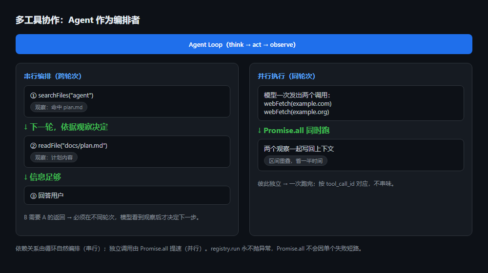
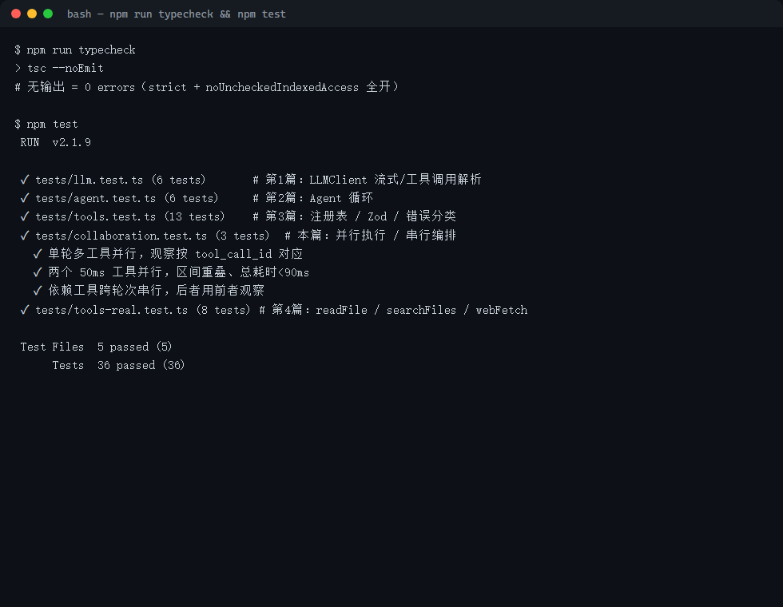
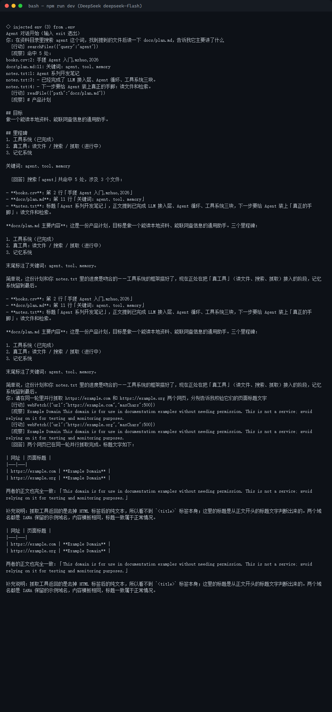

> **系列大纲 · 手搓 AI Agent（Node.js / TypeScript）**
>
> 本系列从零手搓一个**通用工具型 Agent**：能对话、能调用工具、能规划任务、能多 Agent 协作，并最终接入 MCP 生态。技术栈锁定 **Node.js 22 + TypeScript**，模型接入层用一套 **OpenAI 兼容抽象**通吃 OpenAI / DeepSeek / 通义 / OpenRouter——改 `.env` 即可换模型，内核零改动。每篇代码可跑、可测、可 `git checkout post-NN` 回溯到任意一篇起点，图文在多平台同步发布。
>
> **总目录（14 篇主线 + 1 篇收尾）**
> 1. 开篇：什么是 Agent，为什么不直接用框架
> 2. 工程地基：Node22 + TS + 统一 LLM 客户端
> 3. 心脏：Agent Loop 与 ReAct
> 4. 长出手脚：Tool 系统设计
> 5. 第一个真工具：搜索 / 计算 / 读文件
> 6. 多工具协作：串行编排与并行执行（**本文**）
> 7. 记忆的两种形态
> 8. 会规划：Plan-and-Execute
> 9. 多 Agent 协作
> 10. 接外部世界：MCP 实战
> 11. 让 Agent 可信：权限 / 沙箱 / 人工介入
> 12. 持久化与恢复：会话、状态、崩溃续跑
> 13. 上线与可观测
> 14. 收尾：本系列手搓的 vs 业界 ADK / Mastra
>
> 当前篇：第 5 篇（对应总目录第 6 项·多工具协作）——在第 4 篇四个真工具（calculator / readFile / searchFiles / webFetch）的基础上，让 Agent 在一个任务里**自主串联、并行多个工具**。重点是两种协作形态：依赖型必须串行跨轮次编排，独立型可以在同一轮里并行执行；以及代码层如何让并行真正提速而不破坏 `tool_call_id` 的对应。
>
> **配套代码仓库**：https://github.com/mrhuo/agent-from-scratch （每篇对应一个 `post-NN` tag，`git checkout post-05` 即可回到本篇代码起点）

# 手搓 AI Agent 05：多工具协作——让 Agent 自己决定先搜再读、还能并行抓网页

第 4 篇给 Agent 装上了四个真工具，它能"算、读、搜、抓"。但"有工具"和"会用工具协作"是两回事。给模型一个 `calculator`，它能算出 96；给模型四个工具，它也能在**一次对话里连续调用**它们。可一旦任务变复杂——"在资料里搜一下 agent、把命中的计划文件读出来、再告诉我它讲了什么"——就不再是"调一个工具"能解决的了：任务被拆成了**一连串有先后、有依赖的动作**，而且其中某些动作彼此独立，本可以**同时做**。

这一篇要解决的，正是"协作"两个字：**谁来决定工具调用的顺序？多个独立调用能不能一起跑？** 你会发现，真正要改的代码极少（十几行），难的还是把"并行"这件事做对、不破坏已有的错误隔离与上下文结构。

---

## 00 引子：为什么"会调工具"还不够

先区分两个层次：

- **单工具调用**：模型决定"这一步调谁、传什么参数"。第 2、3、4 篇已经解决——循环负责转、注册表负责校验与执行、错误隔离负责不崩。
- **多工具协作**：模型决定"先调谁、后调谁、哪几个可以一起调"。这一步的顺序和并发，不是写死在代码里的，而是**由模型在每一轮自己判断**，循环的"转圈"只是把它的判断落地。

为什么这值得单独写一篇？因为一旦涉及多个工具，**顺序和依赖**就变成头等大事：

- "先 `searchFiles` 找到文件名，再 `readFile` 读它"——这两步有依赖，必须一前一后；让模型并行发，第二个还没拿到文件名就调 `readFile`，必然失败。
- "同时抓 `example.com` 和 `example.org` 两个网页"——这两步各跑各的，谁先谁后无所谓，一起发能省一半时间。

把这两类混为一谈，要么慢（明明能并行却一个个等），要么错（明明有依赖却并行乱调）。下面先把形态钉死，再改代码。

---

## 01 概念：多工具协作的两种形态

一个任务里的多个工具调用，按"有没有依赖"分成两类：

### 1.1 串行编排（跨轮次，因为有依赖）

当**后一个工具需要前一个的返回**时，它们只能在不同的模型轮次里发生。原因是：模型在发出工具调用时，还不知道前一个工具会返回什么——它必须先看到第一轮的观察（比如"命中了 `docs/plan.md`"），才能在第二轮决定"那我读 `docs/plan.md`"。

这种编排**不需要写任何代码**：它就是 Agent Loop 的自然行为。模型第一轮调 `searchFiles` → 观察写回上下文 → 第二轮模型读到观察 → 调 `readFile` → 观察再写回 → 第三轮信息够了，给答案。循环每转一圈，上下文就多一份观察，模型的决策就往前推一步。代码要做的只是"别拦住它转圈"，而第 2 篇的循环本来就支持。

### 1.2 并行执行（同轮次，因为独立）

当多个工具调用**彼此独立**时，模型可以在**同一次回复里一次性发出多个 `tool_calls`**。OpenAI / DeepSeek 的接口本来就支持一个回复带多个 `tool_calls`——问题在旧代码的执行环节：它用 `for` 循环**一个一个串行**地跑，两个各耗 1 秒的抓取会被串成 2 秒。

这一篇的核心改动，就是把这个串行执行换成**并行执行**。

### 1.3 谁来决定"串行还是并行"

关键认知：**编排者是模型，引擎是循环**。代码不预知任务，也不写"先搜后读"的流程；代码只保证两件事——

- 依赖型调用，因为观察要等上一轮，天然被循环拆成两轮（串行由数据结构保证）；
- 独立型调用，如果模型一次发了多个，代码就并行执行（并发由 `Promise.all` 保证）。

你只需要**告诉模型这件事的可能性**（写在系统提示里），它自己会在合适的任务上选择并行。

---

## 02 代码：把同一轮的多个工具调用并行起来

改动只落在 `src/agent/Agent.ts` 里，且只动"执行工具调用"那一小段。

### 2.1 旧逻辑：串行 for 循环

第 4 篇留下的是这样：

```ts
// 旧：一次回复里的多个 tool_calls，逐个串行执行
for (const call of result.toolCalls) {
  const observation = await this.runTool(call); // 等这一个跑完，才跑下一个
  this.conversation.push({ role: "tool", content: observation, tool_call_id: call.id });
}
```

两个各 1 秒的抓取会被串成 2 秒。更糟的是，模型明明在一条消息里说了"我同时抓这两个"，执行端却偷偷排了队。

### 2.2 新逻辑：Promise.all 并行

```ts
// src/agent/Agent.ts（节选）
// 一次回复可能要求调用多个工具。彼此独立的调用（如并行抓取两个网页）
// 用 Promise.all 同时跑，省时间；彼此依赖的调用模型会自动拆成两轮，
// 依赖关系的编排由上面的 for 循环自然完成。registry.run 永不抛异常
// （失败转成观察文本），所以 Promise.all 不会因单个工具失败而短路。
const executed = await Promise.all(
  result.toolCalls.map(async (call) => {
    const actionText = `${call.function.name}(${JSON.stringify(call.function.arguments)})`;
    const observation = await this.runTool(call);
    return { id: call.id, actionText, observation };
  }),
);
for (const { id, actionText, observation } of executed) {
  steps.push({ kind: "action", text: actionText });
  steps.push({ kind: "observation", text: observation });
  this.conversation.push({
    role: "tool",
    content: observation,
    tool_call_id: id,
  });
}
```

三点要讲清楚：

1. **并发由 `Promise.all` 完成**。多个 `runTool` 同时被 `await`，谁先返回谁先算完，墙钟时间约等于最慢那一个，而不是相加。
2. **`tool_call_id` 的对应没被破坏**。每个观察都带着自己对应的 `id`，写回上下文时分别挂到正确的 `tool_call_id` 上。模型下一次看到的是"调用 a1 得到 x、调用 a2 得到 y"，不会串味——这是 OpenAI function calling 协议的硬性要求，并行时尤其容易写错，这里用"先收集、再按原顺序回写"绕开了竞态。
3. **不会因单个失败而短路**。`registry.run()` 内部 `try/catch` 把任何异常转成观察文本，所以 `Promise.all` 拿到的永远是已解析的值，不存在某个工具抛 reject 导致其余观察丢失的情况。错误隔离这一篇仍然成立。

### 2.3 系统提示：给模型"并行"的许可

代码能并行，但模型未必会发多个 `tool_calls`。在第 4 篇的默认系统提示里补一段编排指引，把"什么时候并行、什么时候串行"明说：

```ts
// src/agent/Agent.ts（DEFAULT_SYSTEM_PROMPT 追加）
"关于多工具协作：如果多个工具调用彼此独立（例如同时抓取两个网页、同时读两个文件），" +
"请在同一次回复里一次性发出，我会并行执行它们；如果后一个工具需要前一个的返回结果" +
"（例如先 searchFiles 找到文件名、再 readFile 读它），就分两轮，先拿到观察再决定下一步。";
```

这段提示不改变任何代码路径，只是降低模型"默认一个一个发"的倾向。实测里加上它之后，遇到"同时抓两个网页"这种明显独立的任务，模型会主动在同一条消息里发两个 `webFetch`。

---

## 03 数据流：循环形态没变，只是转得更快

工具还是那四个，注册表还是那个注册表，变化的只是"一次模型回复里的多个调用怎么落地"：



- **串行路径**：模型第一轮发 `searchFiles` → `registry.run` 执行 → 观察写回 → 第二轮模型读观察发 `readFile` → 再写回 → 第三轮给答案。每一步的"下一步"都由模型基于上一轮的观察决定，循环只是反复调用 `chatWithTools`。
- **并行路径**：模型一条消息发两个 `webFetch` → `Promise.all` 同时执行 → 两个观察按 `id` 分别写回 → 下一轮模型拿到两份结果一起总结。

两条路径共用同一套 `registry.run()` 与错误隔离，新增的只是"并行"这一个加速器。

---

## 如何运行本章代码

配套代码已全部推到 GitHub，每篇对应一个 `post-NN` tag。跟随本章，先切到 `post-05` 的代码状态，再逐步运行：

```bash
# 1. 克隆仓库
git clone https://github.com/mrhuo/agent-from-scratch.git
cd agent-from-scratch

# 2. 切到本篇（第 5 篇）对应的代码快照
git checkout post-05

# 3. 安装依赖（需要 Node.js >= 22，否则内置 fetch 不可用）
npm install

# 4. 配置密钥：复制模板，填入你的 API Key
cp .env.example .env
#   然后编辑 .env，填入：
#     OPENAI_API_KEY=sk-xxxxxxxx（填入申请的 API Key）
#     BASE_URL=https://api.deepseek.com   # DeepSeek 兼容地址，注意【不带 /v1】
#     MODEL=deepseek-flash

# 5. 启动 Agent 对话（输入一句，Agent 可能连续调用多个工具，输入 exit 退出）
npm run dev

# 6. 跑单元测试（mock，无需 key / 外网）
npm test

# 7. 类型检查
npm run typecheck
```

说明：`.env` 已被 `.gitignore` 忽略，不会进入提交，密钥只留在本机。想直观看到协作效果，可以试这两句（前者触发串行编排，后者触发并行）："在资料目录里搜索 agent 这个词，找到提到的文件后读一下 docs/plan.md，告诉我它主要讲了什么"、"请在同一轮里并行抓取 https://example.com 和 https://example.org 两个网页，分别告诉我校验它们的页面标题文字"。若 `npm run dev` 报连接超时，先确认 `.env` 里 `BASE_URL` 没写成带 `/v1` 的地址（DeepSeek 不带 `/v1`）。

---

## 04 验证：这一章代码做了什么、实现了什么效果

代码位置：`src/agent/Agent.ts`（`run()` 内工具执行由串行 `for` 改为 `Promise.all` 并行；`DEFAULT_SYSTEM_PROMPT` 追加编排指引）、`tests/collaboration.test.ts`（新增 3 个用例）。

**做了什么**：把"同一轮模型回复里的多个工具调用"从串行执行改为并行执行，并将"串行编排 / 并行执行"两种协作形态讲透。Agent 内核之外没有新增任何抽象——并行只是把 `runTool` 包进 `Promise.all`，顺序与 `tool_call_id` 对应靠"先收集再回写"保证。第 4 篇埋下的"模型是编排者、循环是引擎"的认知，在这里被显式兑现。

**实现了什么效果**，三组证据：



1. **单元测试 36/36 通过**（`npm test`，5 个文件共 36 用例：第 1 篇 `llm.test.ts` 6 例、第 2 篇 `agent.test.ts` 6 例、第 3 篇 `tools.test.ts` 13 例、第 4 篇 `tools-real.test.ts` 8 例、本篇新增 `collaboration.test.ts` 3 例）。新增用例专门覆盖协作：单轮多工具并行时每个观察按 `tool_call_id` 对应；两个各耗时 50ms 的假工具同轮调用，断言它们的时间区间**重叠**且总耗时远低于 100ms（证明确实并发而非排队）；依赖型工具跨轮次串行时，后一个工具拿到的参数确实来自前一个工具的观察。
2. **类型检查 0 errors**（`npm run typecheck`，`tsc --noEmit`，`strict` + `noUncheckedIndexedAccess` 全开）。`Promise.all` 收集的是 `{ id, actionText, observation }` 结构，回写时类型闭合。
3. **真实对话端到端跑通**（DeepSeek `deepseek-flash`，见下）：



真实运行显示两轮对话：第一轮用户要求"搜 agent、读 plan.md、总结"，模型自主走出 `searchFiles` → `readFile` → 回答的**串行编排**，第二步 `readFile` 的路径正是第一步观察给出的 `docs/plan.md`；第二轮用户要求"并行抓两个网页"，模型在**同一条消息里发出两个 `webFetch`**，由 `Promise.all` 同时抓回，再一并总结标题。串行与并行两种形态在同一会话里都得到了验证。

**三个工程坑记录**（均已在代码中处理）：
- **并行必须用 `Promise.all` 收集后再按序回写**。`runTool` 内部有 `await`，若边跑边 `push` 到步骤日志和上下文，多个调用的日志会交错、且 `tool_call_id` 容易挂错。先收集成数组、再统一 `for` 回写，既保证顺序可读，又保证 id 对应。
- **并行不会因单个失败短路，是因为 `registry.run` 永不抛异常**。这一点是第 3 篇"错误隔离"的红利：工具执行异常被转成观察文本，`Promise.all` 拿到的都是正常值。如果哪天有人把 `run` 改成 `throw`，并行就会因为一个工具出错而丢掉其余所有观察。
- **步骤日志里并行调用看着像"挨个执行"**。`[行动]`/`[观察]` 在终端里是按顺序打印的，这只是日志展示顺序，不代表墙钟上的执行顺序——两个 `webFetch` 其实是同时发的。理解这一点，才不会误以为"并行没生效"。

---

## 05 本篇埋的雷

这一章让 Agent 能在一个任务里自主串联、并行多个工具，但三处问题仍然悬着，串起后续篇章：

- **模型未必每次都选对"串行还是并行"**。提示写明了规则，但模型仍可能在有依赖时也一次性发出（比如没等 `searchFiles` 返回就并行 `readFile`），结果第二个工具拿到空参数、触发 `validation` 观察，靠循环重试才纠正。更稳妥的"先规划再执行"是第 7 篇（Plan-and-Execute）的主题。
- **`maxSteps` 在复杂任务里会更早触顶**。原来一个工具一回合，现在一个任务可能要"搜→读→算→总结"好几步，原先 8 步的预算在长任务里会不够，触发兜底回答。步数上限该不该按任务动态给，是第 7 篇规划拆子任务时要一起考虑的。
- **工具越多，模型越容易"选错、排乱"**。本篇四个工具模型还能驾驭，但注册表塞到二十个工具后，它可能在"该用 searchFiles 还是 webFetch"上纠结，或者并行发了一堆不相关的调用。这涉及工具描述怎么写得更区分度强、以及是不是该引入"先想清楚步骤"的规划层——同样指向第 7 篇。

---

判断：多工具协作让 Agent 从"会调单个工具"进到"会在任务里自己排顺序、能并行提速"，但依赖误判、步数预算、工具膨胀这三类问题还没根治。看点：下一篇给 Agent 装上"记忆"——短期记住本轮上下文、长期记住跨会话的偏好与事实，否则每开一次对话它都像失忆。
