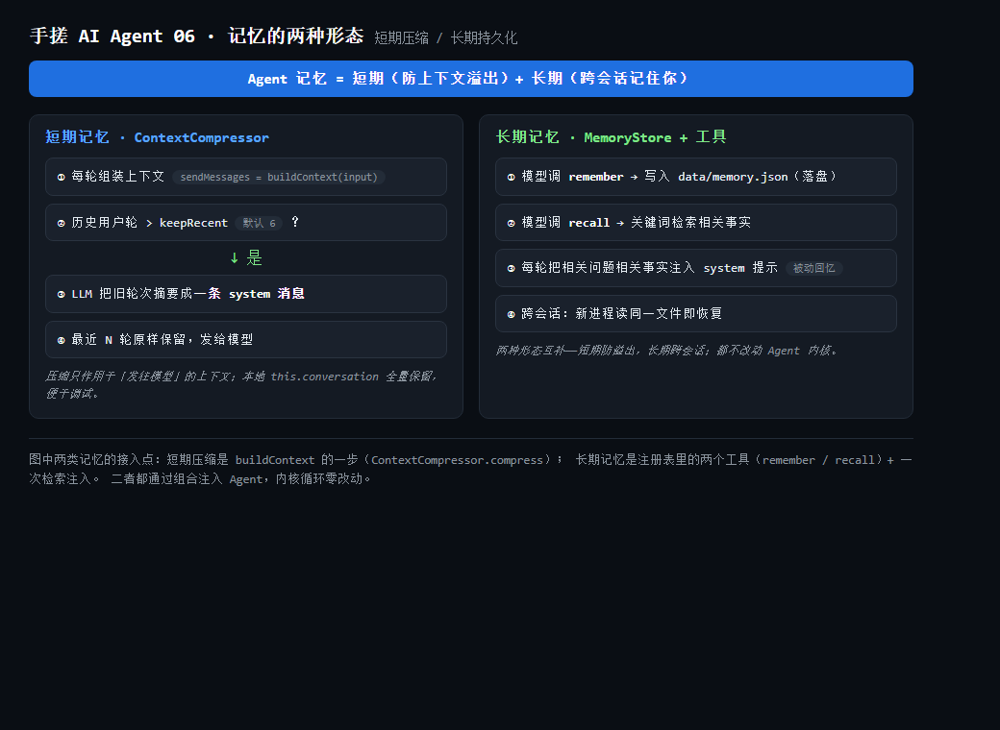
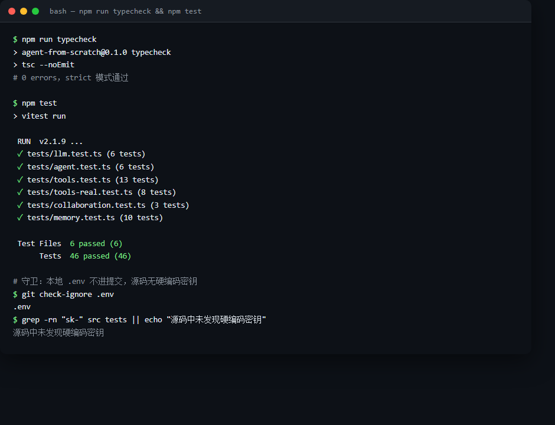
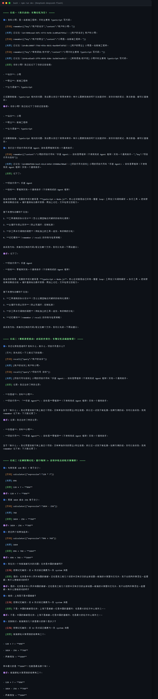

> **系列大纲 · 手搓 AI Agent（Node.js / TypeScript）**
>
> 本系列从零手搓一个**通用工具型 Agent**：能对话、能调用工具、能规划任务、能多 Agent 协作，并最终接入 MCP 生态。技术栈锁定 **Node.js 22 + TypeScript**，模型接入层用一套 **OpenAI 兼容抽象**通吃 OpenAI / DeepSeek / 通义 / OpenRouter——改 `.env` 即可换模型，内核零改动。每篇代码可跑、可测、可 `git checkout post-NN` 回溯到任意一篇起点，图文在多平台同步发布。
>
> **总目录（14 篇主线 + 1 篇收尾）**
> 1. 开篇：什么是 Agent，为什么不直接用框架
> 2. 工程地基：Node22 + TS + 统一 LLM 客户端
> 3. 心脏：Agent Loop 与 ReAct
> 4. 长出手脚：Tool 系统设计
> 5. 第一个真工具：搜索 / 计算 / 读文件
> 6. 多工具协作：串行编排与并行执行
> 7. 记忆的两种形态（**本文**）
> 8. 会规划：Plan-and-Execute
> 9. 多 Agent 协作
> 10. 接外部世界：MCP 实战
> 11. 让 Agent 可信：权限 / 沙箱 / 人工介入
> 12. 持久化与恢复：会话、状态、崩溃续跑
> 13. 上线与可观测
> 14. 收尾：本系列手搓的 vs 业界 ADK / Mastra
>
> 当前篇：第 6 篇（对应总目录第 7 项·记忆的两种形态）——在「思考 → 行动 → 观察」循环之上，补齐 Agent 的两种记忆：**短期记忆**（历史轮次超阈值时自动摘要，防止上下文溢出窗口）与**长期记忆**（remember / recall 两个工具把事实落盘到文件，并自动把相关事实注入每一轮提示，跨会话都记得住）。
>
> **配套代码仓库**：https://github.com/mrhuo/agent-from-scratch （每篇对应一个 `post-NN` tag，`git checkout post-06` 即可回到本篇代码起点）

# 手搓 AI Agent 06：记忆的两种形态——短期压缩防溢出，长期存储跨会话

第 5 篇让 Agent 能在一次任务里自主串联、并行多个工具。但「会调用工具」离「像个能共事的助手」还差一件事：**记忆**。有两个现象会反复出现：一是长对话越聊越长，最终撞上模型的上下文窗口上限；二是关掉进程再打开，Agent 把之前说过的话全忘了。

这一篇把记忆拆成两种形态分别解决：

- **短期记忆**：一次对话内部的上下文管理。历史轮次超过阈值时，把旧轮次压成一段摘要，只把最近几轮原样发给模型——解决上下文溢出。
- **长期记忆**：跨进程的持久化。把「用户叫什么、偏好什么、项目代号是什么」这类事实写进文件，下次启动还能读出来——解决失忆。

代码层面，两者都通过组合注入 Agent，**内核循环一行不用改**：短期压缩是「组装上下文」这一步里的一个可选环节；长期记忆是注册表里的两个工具加一次检索注入。

---

## 00 引子：为什么「有上下文」不等于「有记忆」

先区分两层：

- **对话历史（conversation）**：这一轮之前的全部消息。第 2 篇起 Agent 就持有它，`run()` 只追加新一句，循环在它之上叠加。这是「短期」的载体。
- **持久化记忆（memory）**：进程之外的状态。关掉再开还在，才是真正的「记住」。

只靠对话历史会撞两堵墙：

1. **窗口墙**：模型一次能吃的 token 有限。一个几十轮的任务，把每一轮原样堆进上下文，迟早超限，要么报错，要么前端截断丢信息。
2. **重启墙**：`conversation` 是内存里的数组，进程一退出就没了。下个进程是「全新的脑子」。

短期记忆对付第一堵墙，长期记忆对付第二堵墙。

---

## 01 概念：两种记忆各自解决什么

| 形态 | 生命周期 | 解决的问题 | 实现手段 |
|---|---|---|---|
| 短期记忆 | 单次会话内 | 上下文过长溢出窗口 | 旧轮次摘要 + 最近轮次保真 |
| 长期记忆 | 跨会话、跨进程 | Agent 重启后失忆 | 文件持久化 + 检索注入 |

一个常见的误区：把长期记忆当成「把对话历史写进数据库」。二者的关键差异在**检索方式**。对话历史是「按顺序全给」；长期记忆是「按需取用」——模型在推理中主动 `recall`，或系统在每轮把相关问题相关的事实**被动**喂进提示。后者才是「记住你」的体感来源：你不用每次重复背景，Agent 自己把旧知识摆到眼前。

---

## 02 短期记忆：为什么要压缩，而不是无限堆

最朴素的做法是「把 `conversation` 全发给模型」。它在短对话里没问题，但有两个代价：

- **成本随轮次线性增长**：每多一轮，输入 token 翻倍式累积（因为历史每次都重发）。
- **逼近窗口上限**：到第 N 轮，历史本身就可能超过 `max_tokens`，模型直接拒答或前端截断。

压缩的核心思路是**丢细节、留主干**：把旧的、信息密度低的轮次交给 LLM 压成一段摘要，只保留最近的若干轮原样。模型看到的是「摘要 + 最近几轮」，既控制住了长度，又不丢关键事实。

关键约束：**不能从中间切断一轮工具调用**。一轮工具调用在上下文里是一组连续消息——`user → assistant(tool_calls) → tool → tool → ...`。如果按固定条数硬切，可能把 `assistant` 的工具调用和它的 `tool` 观察结果拆到摘要两侧，破坏 `tool_call_id` 的对应关系，模型会困惑。所以用「用户轮」对齐切分点：被摘要的旧块永远是若干个**完整轮次**，保留块也总是从一条 `user` 消息开始。

---

## 03 实现：ContextCompressor（短期记忆）

`src/memory/ContextCompressor.ts` 只做一件事：给定完整上下文，返回「发往模型」的压缩版。

```ts
export class ContextCompressor {
  constructor(
    private readonly summarizer: Summarizer,
    private readonly keepRecentTurns = 6, // 保留最近 6 个用户轮原样
  ) {}

  async compress(messages: Message[]): Promise<CompressResult> {
    const system = messages.filter((m) => m.role === "system");
    const rest = messages.filter((m) => m.role !== "system");

    // 数用户轮：没超阈值就整段原样发，不丢任何信息
    const userIdx: number[] = [];
    rest.forEach((m, i) => { if (m.role === "user") userIdx.push(i); });
    if (userIdx.length <= this.keepRecentTurns) {
      return { messages, dropped: 0, summary: null };
    }

    // 按用户轮对齐：boundary 是第一个被保留的用户轮下标
    const boundary = userIdx[userIdx.length - this.keepRecentTurns]!;
    const older = rest.slice(0, boundary);   // 完整旧轮次，交给摘要器
    const recent = rest.slice(boundary);     // 最近轮次，原样保留

    const summary = await this.summarizer.summarize(older);
    const summaryMsg: Message = {
      role: "system",
      content: `【对话历史摘要】\n${summary}`,
    };
    return { messages: [...system, summaryMsg, ...recent], dropped: older.length, summary };
  }
}
```

摘要器是一个接口 `Summarizer`，真实实现用 LLM 把旧消息拼成对话记录再压摘要（`LLMSummarizer`，依赖 `LLMClient.chat`）；测试与兜底用 `NoopSummarizer`（返回固定占位，不调模型）。这种「能力靠接口、实现可替换」的结构，和第 3 篇的 `Tool` 同源——便于单测，也便于以后换更便宜的摘要模型。

注意 `keepRecentTurns` 默认 6 是按「用户轮」算，不是按消息条数。一轮可能含多条消息（工具调用尤其多），按轮对齐才稳。

---

## 04 实现：MemoryStore（长期记忆的落地）

长期记忆的本质是「进程外的笔记本」。本篇用一份 JSON 文件实现，零依赖、逻辑直白。

`src/memory/MemoryStore.ts`：

```ts
export class MemoryStore {
  constructor(private readonly path: string) {}

  async save(key: string, content: string): Promise<MemoryEntry> {
    const entries = await this.load();
    const entry = { id: randomUUID(), key, content, createdAt: new Date().toISOString() };
    entries.push(entry);
    await this.persist(entries);
    return entry;
  }

  async search(query: string, limit = 5): Promise<MemoryEntry[]> {
    const entries = await this.load();
    const q = query.trim().toLowerCase();
    if (!q) return entries.slice(-limit).reverse();
    const tokens = tokenize(q);                 // 中英文混合分词
    return entries
      .map((e) => {
        const hay = `${e.key} ${e.content}`.toLowerCase();
        const score = tokens.reduce((s, t) => (hay.includes(t) ? s + 1 : s), 0);
        return { e, score };
      })
      .filter((x) => x.score > 0)
      .sort((a, b) => b.score - a.score || b.e.createdAt.localeCompare(a.e.createdAt))
      .slice(0, limit)
      .map((x) => x.e);
  }
  // load / update / remove / persist 略
}
```

两个工程要点：

1. **全量读写**：文件通常很小（几百条以内），每次 `save` 重写整份，逻辑简单、不易出并发脏写。真要上量再换 SQLite / 向量库。
2. **中文检索**：`search` 不能直接按空格切词——中文没有空格，整句成一个 token 几乎永远匹配不上。这里的 `tokenize` 把 ASCII 词原样取出，把连续中文字符切成**二元组（bigram）**，于是「小明喜欢什么语言」里的「小明」能命中一条主题叫「用户的名字」的记忆。这是一个轻量但有效的折中：英文精确、中文靠字重叠，够用在「记得住、想得起来」，语义向量检索留到后面按需替换。

`load` 对文件不存在、解析失败一律返回空库，不让读盘错误崩掉 Agent；`persist` 写失败有限重试，规避受限环境的瞬时写错误。

---

## 05 两种长期记忆机制：工具 + 自动注入

长期记忆在代码里以两种互补形态出现：

**形态 A——主动工具（agentic）**：`src/tools/memory.ts` 导出 `createRememberTool(store)` 和 `createRecallTool(store)`，闭包绑定同一个 `MemoryStore`。模型在推理中**自己决定**什么时候记、记什么、什么时候查。这是记忆与「固定提示词」最不同的地方：记忆不是写死在系统提示里，而是模型按需存取的状态。

**形态 B——被动注入**：Agent 每轮组装上下文时，用本轮用户输入去 `store.search`，把命中的相关事实拼进 system 提示的「长期记忆·相关事实」段。模型不必主动 `recall`，相关背景已经摆在眼前。

二者互补：形态 A 让模型能「主动记」，形态 B 保证「记了就不会白记」。演示入口把两个工具收编进注册表，并把 store 同时交给 Agent 做注入。

```ts
const memoryStore = new MemoryStore(join(process.cwd(), "data", "memory.json"));
const compressor = new ContextCompressor(new LLMSummarizer(client), 6);
const registry = new ToolRegistry().registerAll([
  ...allTools,
  createRememberTool(memoryStore),
  createRecallTool(memoryStore),
]);
const agent = new Agent(client, { registry, maxSteps: 8, compressor, memoryStore });
```

---

## 06 接入 Agent：buildContext 是唯一的汇合点

Agent 内核改动极小。`run()` 不再直接把 `this.conversation` 发给模型，而是先过一遍 `buildContext`：

```ts
private async buildContext(currentUserInput: string): Promise<Message[]> {
  const base = this.conversation.map((m) => ({ ...m })); // 拷贝，不动原件

  // 1) 长期记忆注入：把相关事实塞进 system 提示
  if (this.memoryStore) {
    const hits = await this.memoryStore.search(currentUserInput, 5);
    if (hits.length > 0) {
      const brief = hits.map((h) => `- [${h.key}] ${h.content}`).join("\n");
      const idx = base.findIndex((m) => m.role === "system");
      const augmented = `${base[idx]!.content}\n\n【长期记忆·相关事实】\n${brief}`;
      if (idx >= 0) base[idx]!.content = augmented;
      else base.unshift({ role: "system", content: augmented });
    }
  }

  // 2) 短期记忆压缩：旧轮次摘要，最近轮次保真
  if (this.compressor) return (await this.compressor.compress(base)).messages;
  return base;
}
```

关键设计：**压缩只发生在「发往模型」这一步，本地 `this.conversation` 永远保留全量历史**。好处是简单、可调试；代价是本地内存仍随对话增长。真要无限对话，可把压缩后的摘要回写进 `this.conversation`，第 12 篇持久化时再处理。

`compressor` 与 `memoryStore` 都是**可选**注入，不传就退化为第 5 篇的行为，所有旧测试无需改动。

---

## 07 运行验证

仓库配套 `scripts/demo-memory.ts` 跑三段对话：先让模型记住用户信息与项目代号，再「重启进程」（新 Agent 实例、共享同一记忆文件）回忆，最后连续多轮触发短期压缩。

架构与验证截图：



*图 1：短期压缩（ContextCompressor）与长期持久化（MemoryStore + remember/recall）在 Agent 循环中的接入点。*



*图 2：`npm run typecheck` 零报错；`npm test` 6 个文件 46 例全绿；守卫确认本地 `.env` 被忽略、源码无硬编码密钥。*

真实模型（DeepSeek `deepseek-flash`）跑出的轨迹节选：



*图 3：会话一模型自主 `remember` 了姓名、职业、语言栈、项目代号；会话二「重启」后无需重复背景即 `recall` 出关键信息；会话三连续多轮后短期压缩反复触发，模型仍能从摘要里答对「前面算的几个数里最大的是 1664」。*

三张图共同说明：两种记忆都落地且可观测，且**没有改动 Agent 内核循环**。

---

## 08 坑与权衡

- **摘要会丢细节**：压缩是「保主干、丢枝叶」，旧轮次里某个精确数字可能只在摘要里留下近似描述。对要求零误差的任务（如长链式算术），应调大 `keepRecentTurns` 或干脆关掉压缩。本篇会话三正是靠「最近轮次保真」才答对了 1664——被摘要的旧轮次若含关键数字，模型可能只能凭摘要近似回答。
- **中文分词是近似**：bigram 检索会误命中（「明明」能命中「小明」），但配合打分排序与 `limit` 截断，演示场景足够。生产要语义检索，应换 embedding + 向量库，接口不用动（仍是 `search`）。
- **记忆不是银弹**：模型可能记错、漏记、或把过时信息当真。真实产品需要「记忆可信度 / 来源 / 时间戳」与人工校正，这正是第 11 篇权限与人工介入要补的。
- **文件锁**：单进程演示用全量重写没问题；多进程并发写同一份 `memory.json` 会互相覆盖，落地到服务要加锁或换数据库。

---

## 09 小结与下一步

本篇补齐了 Agent 的两种记忆：**短期记忆**用 `ContextCompressor` 在上下文超阈值时把旧轮次摘要、最近轮次保真，解决上下文溢出；**长期记忆**用 `MemoryStore` 把事实落盘，并通过 remember/recall 工具（主动）与 system 提示注入（被动）两种形态让 Agent「跨会话记得住你」。两者都通过组合注入，`Agent` 内核循环零改动，`post-05` 的全部测试继续有效。

下一步（第 7 篇）要解决的是：**当任务复杂到一轮装不下时，Agent 怎么自己拆解步骤、分步执行、再汇总**。也就是 Plan-and-Execute——记忆负责「不忘」，规划负责「不乱」。

---

## 如何运行本章代码

```bash
# 1. 克隆
git clone https://github.com/mrhuo/agent-from-scratch.git
cd agent-from-scratch

# 2. 安装依赖
npm install

# 3. 配置密钥（复制模板后填入申请的 API Key）
cp .env.example .env
#   编辑 .env：
#     OPENAI_API_KEY=sk-xxxxxxxx
#     BASE_URL=https://api.deepseek.com   # DeepSeek 兼容地址【不带 /v1】
#     MODEL=deepseek-flash

# 4. 回到本篇代码起点
git checkout post-06

# 5. 启动交互式对话（已带记忆：会主动 remember，也会跨会话 recall）
npm run dev

# 6. 跑单元测试（mock，无需 key / 外网）
npm test

# 7. 类型检查
npm run typecheck

# 8. 跑记忆演示（真实模型，需联网与 key）：先后三段对话展示长/短期记忆
npx tsx scripts/demo-memory.ts
```

> 注意：DeepSeek 的 OpenAI 兼容地址是 `https://api.deepseek.com`（**不带 `/v1`**），与 OpenAI 官方的 `https://api.openai.com/v1` 不同。本地 `.env` 已被 `.gitignore` 忽略，不会进入提交；`data/memory.json` 是运行期记忆文件，同样被忽略。
