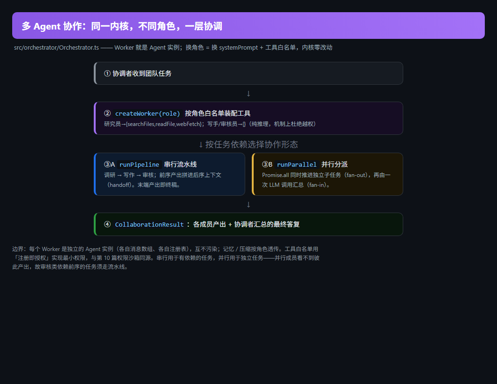
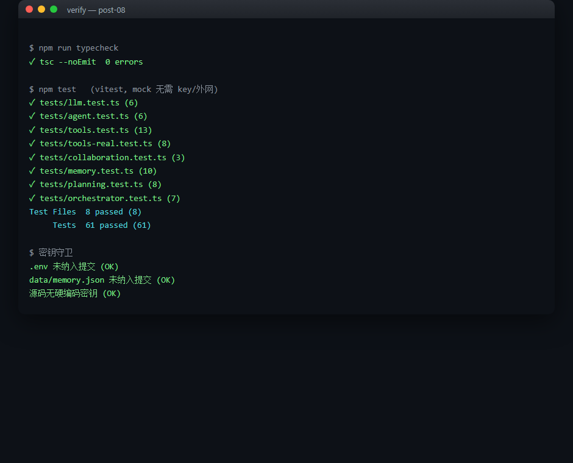
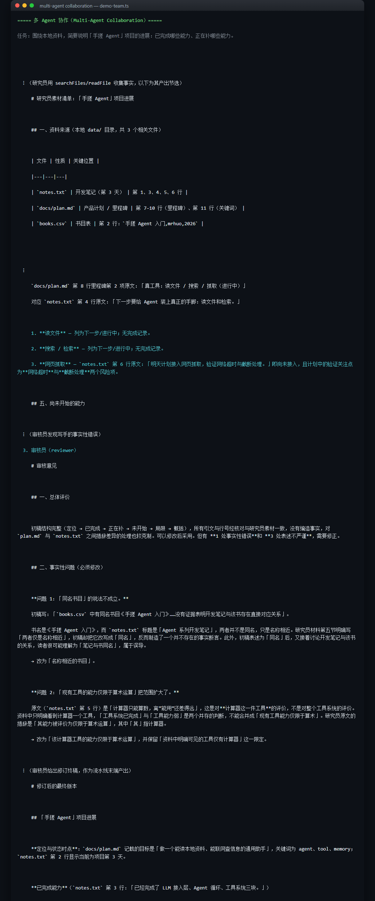

> **系列大纲 · 手搓 AI Agent（Node.js / TypeScript）**
>
> 本系列从零手搓一个**通用工具型 Agent**：能对话、能调用工具、能规划任务、能多 Agent 协作，并最终接入 MCP 生态。技术栈锁定 **Node.js 22 + TypeScript**，模型接入层用一套 **OpenAI 兼容抽象**通吃 OpenAI / DeepSeek / 通义 / OpenRouter——改 `.env` 即可换模型，内核零改动。每篇代码可跑、可测、可 `git checkout post-NN` 回溯到任意一篇起点，图文在多平台同步发布。
>
> **总目录（14 篇主线 + 1 篇收尾）**
> 1. 开篇：什么是 Agent，为什么不直接用框架
> 2. 工程地基：Node22 + TS + 统一 LLM 客户端
> 3. 心脏：Agent Loop 与 ReAct
> 4. 长出手脚：Tool 系统设计
> 5. 第一个真工具：搜索 / 计算 / 读文件
> 6. 多工具协作：串行编排与并行执行
> 7. 记忆的两种形态
> 8. 会规划：Plan-and-Execute
> 9. 多 Agent 协作（**本文**）
> 10. 接外部世界：MCP 实战
> 11. 让 Agent 可信：权限 / 沙箱 / 人工介入
> 12. 持久化与恢复：会话、状态、崩溃续跑
> 13. 上线与可观测
> 14. 收尾：本系列手搓的 vs 业界 ADK / Mastra
>
> 当前篇：第 8 篇（对应总目录第 9 项·多 Agent 协作）——在单个 Agent 之上叠加一层**协调者**，把任务分派给多个各司其职的专家 Worker。核心主张：**复用同一个 Agent 内核，换 systemPrompt 与工具白名单就是换角色**；协调者只负责两种基本协作形态——串行流水线（有依赖）与并行分派（无依赖）。
>
> **配套代码仓库**：https://github.com/mrhuo/agent-from-scratch （每篇对应一个 `post-NN` tag，`git checkout post-08` 即可回到本篇代码起点）

# 手搓 AI Agent 08：多 Agent 协作——同一内核，不同角色，一层协调

第 7 篇让 Agent 会规划：先把任务拆成步骤，再分步执行。但单个 Agent 再强，也有两堵墙：**能力宽度**（一个人既擅长检索、又擅长写作、又擅长审核，很难都做好）与**视角盲区**（自己写的东西自己审，容易漏掉自己的错误）。

这一篇把单个 Agent 变成一个**团队**：研究员负责收集事实，写手负责成文，审核员负责挑错，协调者负责分派与汇总。实现上刻意保持克制——不引入新的 Agent 内核，每个成员就是已有的 `Agent` 实例，只是注入了不同的职责提示与工具白名单；新增的只有一层薄薄的协调者。

---

## 00 引子：为什么「一个更聪明的 Agent」不等于「一个团队」

把职责混在一个 Agent 身上，有两个可观察的问题：

1. **角色冲突**：同一个 systemPrompt 里既写「大胆创作」又写「严格核对事实」，模型会在两种指令间摇摆。拆成写手与审核员两个角色，各自提示单一，行为更稳定。
2. **自我审核失效**：让写手自己检查初稿，它倾向于维护自己的产出；换一个独立的审核员，才可能发现真实存在的错误。

真实演示里第二点确实发生了：写手在初稿里把「名称相近的书目」写成了「同名书目」，审核员独立比对素材后指出这是一处事实性错误并要求改正。这类交叉校验，是单 Agent 很难自给的。

---

## 01 概念：多 Agent 协作的两种基本形态

团队协作归纳起来就两种形态，其余都是组合：

| 形态 | 英文名 | 适用任务 | 信息流 |
|---|---|---|---|
| 串行流水线 | handoff / pipeline | 步骤间有依赖（先调研、再写作、后审核） | 前序产出拼进后序上下文 |
| 并行分派 | fan-out / fan-in | 子任务彼此独立（同时查两个方向） | 各成员独立执行，最后汇总 |

本篇的 `Orchestrator` 只暴露两个方法对应这两种形态：`runPipeline` 与 `runParallel`。没有更多抽象——够用即可。

---

## 02 核心设计：换角色 = 换两样配置

先看角色定义（`src/orchestrator/types.ts`）：

```ts
export interface AgentRole {
  name: string;          // 标识，如 researcher
  title: string;         // 中文显示名
  systemPrompt: string;  // 职责边界
  tools: string[];       // 工具白名单；空数组 = 纯推理角色
}
```

一个角色只有四项，**没有 `run` 方法、没有循环逻辑**。这就是关键：角色不是一个新的 Agent 类，而是给现有 Agent 准备的一组配置。换角色，等于换 `systemPrompt` 和 `tools` 两样东西。

`runLoop` / `runPlan` / `buildContext` 全部原样复用。上一篇的规划能力、第 6 篇的记忆能力，团队成员自动继承，无需重新实现。

---

## 03 实现：工具白名单即最小权限

`createWorker` 把一个角色装配成 Agent（`src/orchestrator/Orchestrator.ts`）：

```ts
createWorker(role: AgentRole): Agent {
  const registry = new ToolRegistry();
  for (const tool of this.options.tools ?? []) {
    if (role.tools.includes(tool.name)) {
      registry.register(tool);
    }
  }
  return new Agent(this.client, {
    registry,                          // 只含白名单工具
    systemPrompt: role.systemPrompt,   // 职责提示
    maxSteps: this.options.maxSteps ?? 8,
    memoryStore: this.options.memoryStore,
    compressor: this.options.compressor,
  });
}
```

工具隔离在这里落地得极简：**只把点名的工具注册进该成员的注册表**。没注册的工具，对模型来说根本不存在——它连定义都看不到，自然无从调用。这是「机制上限制」，比在提示词里写一句「写手不准改文件」可靠得多。

预定义三个角色（`roles.ts`）：研究员拿 `searchFiles / readFile / webFetch`；写手与审核员拿空数组。于是从能力层面就杜绝了「写手擅自读盘」「审核员擅自联网」这类越权。这与第 10 篇要讲的权限沙箱是同一思路，这里先用角色白名单做轻量版。

---

## 04 实现：串行流水线（runPipeline）

有依赖的任务走流水线。核心是**把前序产出拼进后序的上下文**：

```ts
async runPipeline(task: string, roles: AgentRole[]): Promise<CollaborationResult> {
  const results: WorkerResult[] = [];
  let prior = "";
  for (const role of roles) {
    const worker = this.createWorker(role);
    const assignment = prior
      ? `团队任务：${task}\n\n前序成员产出：\n${prior}\n\n当前职责：${role.title}——...`
      : `团队任务：${task}\n\n当前职责：${role.title}——...`;
    const { answer, steps } = await worker.run(assignment);
    results.push({ role: role.name, title: role.title, task: assignment, answer, steps });
    prior = `${prior}\n\n【${role.title}】${answer}`.trim();  // 累积交接
  }
  return { results, finalAnswer: results[results.length - 1]!.answer };
}
```

`prior` 是整条流水线的「接力棒」。每轮把它附加到新任务的 user 消息里，后序成员因此看得到前序的全部产出。最终答复取末端角色的产出——演示里末端是审核员，其职责提示要求它输出「修订后的最终版本」，于是终稿直接可用。

一个工程细节：每个成员是**独立**的 Agent 实例，各自持有消息数组、各自持有注册表，互不污染。成员之间的信息传递完全靠 `prior` 这段文本，显式、可检视、可断点。

---

## 05 实现：并行分派（runParallel）

无依赖的子任务走并行。用 `Promise.all` 同时启动多个 Worker，再由一次 LLM 调用汇总：

```ts
async runParallel(assignments: Assignment[]): Promise<CollaborationResult> {
  const results = await Promise.all(
    assignments.map(async ({ role, task }) => {
      const worker = this.createWorker(role);
      const { answer, steps } = await worker.run(`任务上下文：${task}\n\n当前职责：${role.title}——...`);
      return { role: role.name, title: role.title, task, answer, steps };
    }),
  );
  const finalAnswer = await this.synthesize(assignments.map(a => a.task).join("；"), results);
  return { results, finalAnswer };
}
```

汇总（`synthesize`）同样用中性提示，避免把工具说明带进去诱导模型误发工具调用——这与第 7 篇终步合成的坑同源。

**必须明确的边界**：并行成员只拿到各自的子任务，看不到彼此的产出。所以「审核」这种依赖前序草稿的任务，不能放进并行分派。真实演示印证了这一点——并行模式里的审核员因为没有收到初稿，如实回答「材料完整性不足，无法完成事实一致性审核」，而没有凭空编造结论。这不是缺陷，是诚实的失败：它提示调用方该用流水线而不是并行。

---

## 06 接入演示入口

`src/index.ts` 新增 `/team` 命令：输入任务后可选 `1`（串行流水线）或 `2`（并行分派）。协调者与全部工具的装配方式：

```ts
const orchestrator = new Orchestrator(client, {
  tools: [...allTools, createRememberTool(memoryStore), createRecallTool(memoryStore)],
  memoryStore,
  compressor,
  maxSteps: 8,
});
// 串行：研究员 → 写手 → 审核员
const result = await orchestrator.runPipeline(task, [RESEARCHER, WRITER, REVIEWER]);
```

`Agent` 内核、`Planner`、`MemoryStore` 全部不改动，协调者是纯增量的一层。

---

## 07 运行验证

仓库配套 `scripts/demo-team.ts` 跑两种模式，任务都是「围绕本地资料，简要说明手搓 Agent 项目的进展」。真实模型（DeepSeek `deepseek-flash`）跑出的轨迹：

架构与验证截图：



*图 1：协调者按角色白名单装配 Worker，再按任务依赖选择串行流水线或并行分派。Worker 就是 Agent 实例，内核零改动。*



*图 2：`npm run typecheck` 零报错；`npm test` 8 个文件 61 例全绿（新增 orchestrator 7 例）；密钥守卫确认 `.env` 与 `data/memory.json` 未纳入提交、源码无硬编码密钥。*

真实模型轨迹节选：



*图 3：串行流水线里，研究员用工具从 `data/` 收集事实，写手据此成文，审核员独立比对素材后发现写手把「名称相近」误写成「同名」，给出修订后的终稿；并行分派里，各成员同时推进，协调者再汇总。*

---

## 08 坑与权衡

- **上下文随流水线膨胀**：`prior` 累积全部前序产出，角色一多就接近窗口上限。缓解手段是只传摘要或结构化字段，而非全文；第 6 篇的短期压缩可直接复用。
- **并行成员彼此不可见**：这是 fan-out 的固有约束，也是它的优势（独立、不互相污染）。但凡后序依赖前序，就必须走流水线。选错形态不会报错，只会得到「材料不足」这类诚实但无用的答复。
- **角色提示要单一**：一个角色塞太多职责，行为会摇摆。研究员就只收集事实，不下结论；审核员就只挑错与修订，不重新调研。边界越清楚，交叉校验越有效。
- **白名单是粗粒度隔离**：本篇按「工具名」控制可见性，控制不了参数级操作（例如 readFile 能读 `data/` 下任意文件）。更细的权限要等第 10 篇的沙箱与人工介入。
- **多 Agent 成本更高**：三个角色意味着至少三次模型调用，token 与延迟都上升。简单任务用单 Agent 更划算；团队协作的价值体现在需要交叉校验或多视角的任务上。
- **汇总仍是一次 LLM 调用**：协调者汇总可能丢失成员产出里的精确细节。要求零误差的场景，应把结构化结果直接返回给上层，而不是让模型复述。

---

## 09 小结与下一步

本篇用一层薄薄的 `Orchestrator` 实现了多 Agent 协作：每个 Worker 就是已有的 `Agent` 实例，换 systemPrompt 与工具白名单即是换角色；`runPipeline` 用前序产出交接实现串行流水线，适合有依赖的任务；`runParallel` 用 `Promise.all` 并行推进独立子任务再汇总。真实演示里，审核员独立发现并纠正了写手的事实性错误，验证了多角色交叉校验的价值。所有既有能力（Loop / Tool / 记忆 / 规划）均零改动复用，`post-07` 的 54 例测试全部保留，并新增 7 例协作测试。

下一步（第 9 篇）要解决的是：**Agent 如何接入外部世界**——本篇的 `webFetch` 只是最朴素的 HTTP 抓取，真正开放的是 MCP（Model Context Protocol）。下篇手写 MCP 客户端与服务端，让 Agent 以统一协议发现并调用外部工具。

---

## 如何运行本章代码

```bash
# 1. 克隆
git clone https://github.com/mrhuo/agent-from-scratch.git
cd agent-from-scratch

# 2. 安装依赖
npm install

# 3. 配置密钥（复制模板后填入申请的 API Key）
cp .env.example .env
#   编辑 .env：
#     OPENAI_API_KEY=sk-xxxxxxxx
#     BASE_URL=https://api.deepseek.com   # DeepSeek 兼容地址【不带 /v1】
#     MODEL=deepseek-flash

# 4. 回到本篇代码起点
git checkout post-08

# 5. 启动交互式对话；输入 /team 进入多 Agent 协作模式
npm run dev
#   进入后输入：/team
#   输入任务，例如：围绕本地资料，简要说明「手搓 Agent」项目的进展
#   再输入 1（串行流水线）或 2（并行分派）

# 6. 跑单元测试（mock，无需 key / 外网）
npm test

# 7. 类型检查
npm run typecheck

# 8. 跑协作演示（真实模型，需联网与 key）：串行流水线 + 并行分派
npx tsx scripts/demo-team.ts
```

> 注意：DeepSeek 的 OpenAI 兼容地址是 `https://api.deepseek.com`（**不带 `/v1`**），与 OpenAI 官方的 `https://api.openai.com/v1` 不同。本地 `.env` 已被 `.gitignore` 忽略，不会进入提交；`data/memory.json` 是运行期记忆文件，同样被忽略。
