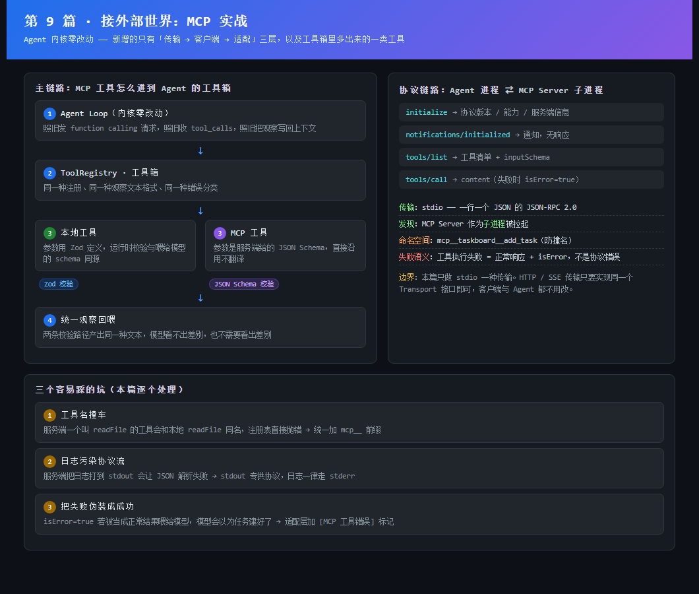
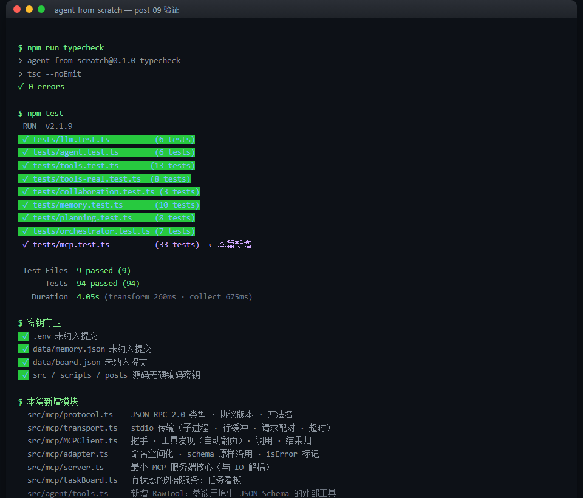
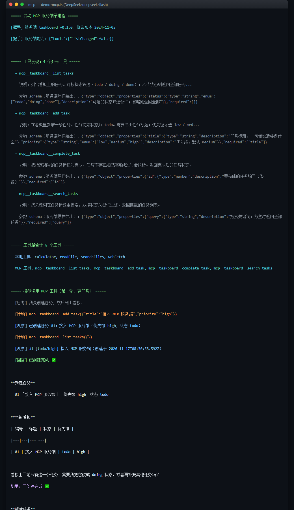

> **系列大纲 · 手搓 AI Agent（Node.js / TypeScript）**
>
> 本系列从零手搓一个**通用工具型 Agent**：能对话、能调用工具、能规划任务、能多 Agent 协作，并最终接入 MCP 生态。技术栈锁定 **Node.js 22 + TypeScript**，模型接入层用一套 **OpenAI 兼容抽象**通吃 OpenAI / DeepSeek / 通义 / OpenRouter——改 `.env` 即可换模型，内核零改动。每篇代码可跑、可测、可 `git checkout post-NN` 回溯到任意一篇起点，图文在多平台同步发布。
>
> **总目录（14 篇主线 + 1 篇收尾）**
> 1. 开篇：什么是 Agent，为什么不直接用框架
> 2. 工程地基：Node22 + TS + 统一 LLM 客户端
> 3. 心脏：Agent Loop 与 ReAct
> 4. 长出手脚：Tool 系统设计
> 5. 第一个真工具：搜索 / 计算 / 读文件
> 6. 多工具协作：串行编排与并行执行
> 7. 记忆的两种形态
> 8. 会规划：Plan-and-Execute
> 9. 多 Agent 协作
> 10. 接外部世界：MCP 实战（**本文**）
> 11. 让 Agent 可信：权限 / 沙箱 / 人工介入
> 12. 持久化与恢复：会话、状态、崩溃续跑
> 13. 上线与可观测
> 14. 收尾：本系列手搓的 vs 业界 ADK / Mastra
>
> 当前篇：第 9 篇（对应总目录第 10 项·MCP 实战）——把 Agent 从「只能调用自己写的工具」扩展到「能用统一协议调用外部服务」。核心主张：**MCP 的底座就是 JSON-RPC 2.0，薄到能手写**；真正需要动脑的不是协议本身，而是两件事——外部工具的参数 schema 是服务端给定的、不是本地能改的；以及外部工具「执行失败」在协议里的表达方式与本地工具完全不同。
>
> **配套代码仓库**：https://github.com/mrhuo/agent-from-scratch （每篇对应一个 `post-NN` tag，`git checkout post-09` 即可回到本篇代码起点）

# 手搓 AI Agent 09：接外部世界——MCP 实战，从 JSON-RPC 到工具箱

前八篇把 Agent 的内部能力补齐了：会调工具、会记东西、会规划、会组队。但它的能力边界始终卡在同一处——**工具都是自己写的**。想接一个现成的外部服务（任务系统、数据库、监控平台），就得为它单独写一个工具函数，写一个 HTTP 请求，再写一套参数校验。

MCP（Model Context Protocol）要解决的就是这件事：让外部服务按统一协议暴露工具，客户端按统一协议发现并调用，双方都不必为彼此写胶水代码。本篇不引入任何 MCP SDK——**手写客户端与服务端**，把协议到底有多薄这件事看清楚。

---

## 00 引子：一个协议值不值得手写

判断标准很简单：如果协议的核心是几十行 JSON-RPC 的编排，手写一遍收获大于依赖一个 SDK；如果核心是一堆历史兼容包袱，那不如用 SDK。

MCP 属于前者。它的完整工具交互只有四个方法：

| 方法 | 方向 | 作用 |
|---|---|---|
| `initialize` | 客户端 → 服务端 | 握手，协商协议版本与能力 |
| `notifications/initialized` | 客户端 → 服务端 | 握手完成通知，无响应 |
| `tools/list` | 客户端 → 服务端 | 列出工具清单与各自的 `inputSchema` |
| `tools/call` | 客户端 → 服务端 | 调用某个工具 |

传输用 **stdio**：服务端作为独立进程运行，双方在标准输入输出上收发「一行一个 JSON」的消息。手写它需要的只是：会 spawn 子进程、会按行切分缓冲、会配对请求与响应。

本篇产出的源码分布：

```
src/mcp/
├─ protocol.ts    JSON-RPC 2.0 类型 · 协议版本 · 方法名 · 内容块解析
├─ transport.ts   stdio 传输：子进程 · 行缓冲 · 请求配对 · 超时
├─ MCPClient.ts   握手 · 工具发现（自动翻页）· 调用 · 结果归一
├─ adapter.ts     命名空间化 · schema 原样沿用 · isError 标记
├─ server.ts      最小 MCP 服务端核心（与 IO 解耦，可单测）
├─ taskBoard.ts   一个有状态的外部服务：任务看板
└─ localServer.ts 本地服务端启动参数
```

---

## 01 协议层：JSON-RPC 2.0 的最小实现

JSON-RPC 2.0 只有三种消息：请求（带 `id`，必须回响应）、通知（不带 `id`，不回）、响应（带 `id`，带 `result` 或 `error`）。MCP 全部建在这三种之上。

```ts
export interface JsonRpcRequest {
  jsonrpc: "2.0";
  id: number | string;
  method: string;
  params?: Record<string, unknown>;
}

export interface JsonRpcResponse {
  jsonrpc: "2.0";
  id: number | string;
  result?: unknown;
  error?: { code: number; message: string; data?: unknown };
}
```

握手的服务端侧实现只有十几行（`src/mcp/server.ts`）：

```ts
case MCP_METHOD.INITIALIZE: {
  return this.ok(id, {
    protocolVersion: MCP_PROTOCOL_VERSION,
    capabilities: { tools: { listChanged: false } },
    serverInfo: { name: this.options.name, version: this.options.version },
  });
}
```

注意 `initialize` 响应里有两处容易看错的位置：**协议版本与能力在顶层，服务端名称与版本在 `serverInfo` 里**。本篇实现最初把 `name` 读成了顶层字段，结果所有 MCP 工具都被命名成 `mcp__unknown-server__xxx`——这类错误靠单测一眼就能发现，比手写协议本身更值得先写测试。

**协议版本是协商出来的，不是客户端单方面定的。** 客户端在 `initialize` 里声明自己支持的版本，服务端回一个双方都能接受的版本；客户端应当以服务端回传的为准（降级运行），而不是直接报错。本篇客户端的实现：

```ts
this.serverInfo = {
  name: serverInfo?.name ?? "unknown-server",
  version: serverInfo?.version ?? "0.0.0",
  // 以服务端回传的版本为准——这就是「协商」
  protocolVersion: result?.protocolVersion ?? MCP_PROTOCOL_VERSION,
  capabilities: result?.capabilities ?? {},
};
```

---

## 02 传输层：三个必须处理的工程细节

stdio 传输的实现集中在 `StdioTransport`。真正需要小心的地方有三处。

**第一，按行切分。** 管道上的分块是任意的：一次 `data` 事件可能只到半条消息，也可能挤进三条消息。不能假设「一次 data 一条消息」，必须自己维护缓冲区：

```ts
private onStdout(chunk: string): void {
  this.buffer += chunk;
  let index = this.buffer.indexOf("\n");
  while (index >= 0) {
    const line = this.buffer.slice(0, index).trim();
    this.buffer = this.buffer.slice(index + 1);
    if (line.length > 0) this.onLine(line);
    index = this.buffer.indexOf("\n");
  }
}
```

**第二，stdout 专供协议，日志一律走 stderr。** 服务端随手打一行调试日志到 stdout，就会让整条 JSON 流解析失败。这是 MCP 服务端最常见的翻车点。本篇的服务端脚本里所有日志都写 `process.stderr.write`，并在文档注释里写明这条约定。

**第三，请求配对与超时。** 每个请求带自增 `id`，响应回来时按 `id` 找回等待者：

```ts
const pending = this.pending.get(msg.id);
if (!pending) return; // 没人等这个 id（比如超时后迟到的响应）
this.pending.delete(msg.id);
clearTimeout(pending.timer);
```

超时后必须把 `id` 从等待表里摘掉，否则迟到的响应会误投给下一个请求。同理，子进程意外退出时要把所有等待中的请求立刻 reject——否则调用方会一直挂着。

---

## 03 关键设计：外部工具的参数 schema 怎么办

这是本篇最需要动脑的地方。

第 3 篇确立了「参数用 Zod 定义一次，运行时校验与喂给模型的 JSON Schema 同源」的单一事实来源原则。但 MCP 工具的参数 schema 是**服务端给定的**：改不了，也不该翻译成 Zod——翻译层是额外的一段可能出错的代码，而且 MCP 的 schema 子集比 Zod 复杂（`enum`、`anyOf`、嵌套对象数组都有），翻译必然丢信息。

于是注册表需要容纳两类工具：

```ts
/** 本项目自己写的工具：参数用 Zod 定义一次 */
export interface Tool<T extends z.ZodTypeAny = z.ZodTypeAny> {
  name: string;
  description: string;
  parameters: T;
  execute: (args: z.infer<T>) => Promise<string> | string;
}

/** 外部工具：参数 schema 由外部服务给定，本项目只做消费方 */
export interface RawTool {
  name: string;
  description: string;
  parameters: JsonSchema;   // 原生 JSON Schema，直接喂给模型
  execute: (args: Record<string, unknown>) => Promise<string> | string;
}
```

判定用一行就够——Zod schema 有 `safeParse`，原生 schema 没有：

```ts
export function isRawTool(tool: AnyTool): tool is RawTool {
  return typeof (tool.parameters as { safeParse?: unknown }).safeParse !== "function";
}
```

注册表的执行路径据此分派，但**输出格式保持统一**：

```ts
async run(name: string, rawArgs: unknown): Promise<string> {
  const tool = this.tools.get(name);
  if (!tool) {
    return `[工具错误·not_found] 找不到名为 "${name}" 的工具，请检查工具名是否拼写正确`;
  }

  let args: unknown;
  if (isRawTool(tool)) {
    const check = validateAgainstJsonSchema(tool.parameters, rawArgs);
    if (!check.ok) {
      return `[工具错误·validation] 参数校验失败：${check.errors.join("; ")}`;
    }
    args = rawArgs;
  } else {
    const parsed = tool.parameters.safeParse(rawArgs);
    if (!parsed.success) {
      return `[工具错误·validation] 参数校验失败：${formatZodError(parsed.error)}`;
    }
    args = parsed.data;
  }
  // ...执行
}
```

这样对模型是完全透明的：它看到的工具定义都是同一种 function calling 结构，观察文本也都是同一种格式。校验细节留在框架内部，不外泄给模型。

原生 JSON Schema 的校验器（`src/agent/schema.ts`）覆盖 MCP `inputSchema` 的常用子集：`object / string / number / integer / boolean / array / enum / required / additionalProperties`。错误信息刻意做成模型能据以自我纠正的形式：

```
[工具错误·validation] 参数校验失败：title: 缺少必填参数; priority: 取值必须是 ["low","medium","high"] 之一
```

---

## 04 适配层：命名空间与失败语义

MCP 工具进入本项目的工具箱前，要过两道加工。

**命名空间化。** 服务端完全可能提供一个叫 `readFile` 的工具，与本地 `readFile` 同名，注册表会直接抛「工具名已存在」。加一层前缀即可：

```ts
export function mcpToolName(namespace: string, serverName: string, toolName: string): string {
  return sanitizeToolName(`${namespace}__${serverName}__${toolName}`);
}
```

结果形如 `mcp__taskboard__add_task`。前缀同时给模型一个信号：带 `mcp__` 的工具来自外部，能力边界和本地工具不同。另外函数名会被清洗，因为 OpenAI 的 function name 只允许字母、数字、下划线与连字符，且长度上限 64。

**失败语义归一。** 这是 MCP 特有的坑：**工具执行失败不是协议错误，而是一次「正常响应 + `isError=true`」**。JSON-RPC 层面的错误表示「这次调用没能完成」，而 `isError` 表示「调用完成了，但工具内部失败」——比如任务看板里「重复完成一个已完成任务」。

把 `isError` 当成异常会误伤（业务上的失败被当成传输故障）；把它当成成功更糟——模型会以为任务建好了，然后基于假象继续推理。本篇的做法是加明确标记：

```ts
async callToolAsText(name: string, args: Record<string, unknown> = {}): Promise<string> {
  const result = await this.callTool(name, args);
  const text = mcpContentToText(result);
  if (result.isError) {
    return `[MCP 工具错误] ${text || "工具执行失败，服务端未返回错误详情"}`;
  }
  return text;
}
```

---

## 05 服务端：挑一个有状态的外部服务

演示对象是有意选的：前几篇的本地工具（`readFile` / `searchFiles` / `webFetch`）全是**无状态**的，调完即走。而外部服务的典型特征恰恰相反——有状态、有业务约束、schema 更复杂。

本篇实现一个任务看板（`src/mcp/taskBoard.ts`），暴露四个工具：

| 工具 | 参数 | 说明 |
|---|---|---|
| `list_tasks` | `status?`（枚举 todo/doing/done） | 列出任务，可按状态筛选 |
| `add_task` | `title`（必填）、`priority?`（枚举 low/medium/high） | 新增任务，初始状态 todo |
| `complete_task` | `id`（必填，整数） | 完成任务；已完成再完成会报错 |
| `search_tasks` | `query`（必填） | 按关键词搜索 |

`complete_task` 的业务约束正是演示 `isError` 的抓手：

```ts
complete(id: number): BoardTask {
  const task = this.tasks.find((t) => t.id === id);
  if (!task) throw new Error(`任务 #${id} 不存在`);
  if (task.status === "done") throw new Error(`任务 #${id} 已经完成过了`);
  task.status = "done";
  this.save();
  return task;
}
```

服务端核心（`MCPServer.handleMessage`）与 IO 解耦：输入一条 JSON-RPC 消息，输出一个响应对象或 `null`（通知无需响应）。这样它既能作为独立进程跑，也能在单元测试里直接喂消息、断言响应。

---

## 06 接入演示入口

`src/index.ts` 新增 `/mcp` 命令，四步走：拉起服务端子进程 → `initialize` 握手 → `tools/list` 发现工具 → 注册进注册表交给 Agent。

```ts
const transport = new StdioTransport(localBoardServerOptions());
const mcpClient = new MCPClient(transport, { clientName: "agent-from-scratch" });
const info = await mcpClient.connect();
const mcpTools = await toMCPTools(mcpClient);

const mcpRegistry = new ToolRegistry().registerAll([...allTools, ...mcpTools]);
const mcpAgent = new Agent(client, { registry: mcpRegistry, maxSteps: 8, ... });
```

MCP 工具与本地工具进**同一个注册表**，Agent 内核一行都不用改。

子进程的启动方式有个细节。本篇最初写的是 `npx tsx scripts/mcp-server.ts`，但在受限网络环境里 `npx` 可能先尝试联网而卡住。改成直接用 node 执行 tsx 的 CLI 入口，不经 shell、不依赖 `.cmd` 包装：

```ts
const tsxCli = resolve(process.cwd(), "node_modules", "tsx", "dist", "cli.mjs");
return {
  command: process.execPath,
  args: [tsxCli, serverEntry, board],
  cwd: process.cwd(),
};
```

还有一个真实的 bug 是这样暴露的：看板数据文件路径写成了 `resolve(process.cwd(), dataFile ?? "data", "board.json")`。当 `dataFile` 是绝对路径时，`resolve` 会把它当相对路径处理，最终拼出 `xxx.json/board.json`——把文件名当成了目录，落盘静默失败，外部服务看起来「正常」但状态永远存不上。修法是把绝对路径单独 `resolve`：

```ts
const board = dataFile
  ? resolve(dataFile)
  : resolve(process.cwd(), "data", "board.json");
```

这类错误正是「外部服务」与「本地函数」的差别：本地函数抛错立刻可见，外部服务写错了路径可能只是安静地不生效。

---

## 07 运行验证

仓库配套 `scripts/demo-mcp.ts` 跑完整链路：启动服务端子进程 → 握手 → 工具发现 → 真实模型调用 MCP 工具 → 校验副作用确实落在外部服务上 → 演示失败路径 → 重新连接验证状态跨会话保留。

架构与验证截图：



*图 1：Agent 内核零改动，新增的只有「传输 → 客户端 → 适配」三层。工具箱里多出来的一类工具走 JSON Schema 校验路径，但输出格式与本地工具完全一致。*



*图 2：`npm run typecheck` 零报错；`npm test` 9 个文件 94 例全绿（新增 mcp 33 例）；密钥守卫确认 `.env`、`data/memory.json`、`data/board.json` 均未纳入提交、源码无硬编码密钥。*

真实模型轨迹节选：



*图 3：握手协商出协议版本 `2024-11-05`；发现 4 个外部工具且 schema 由服务端原样给出；模型先调 `add_task` 再调 `list_tasks`，观察结果逐轮回喂；重复完成任务时拿到 `[MCP 工具错误]` 标记；重新连接后看板状态仍在。*

---

## 08 坑与权衡

- **协议版本要协商，不要写死**：客户端声明支持的版本，服务端回一个双方都能接受的版本，客户端以服务端回传的为准。写死版本会在协议演进时直接断掉。
- **stdout 与 stderr 必须分开**：服务端日志打到 stdout 会污染 JSON 流。这是自写 MCP 服务端时最高频的故障。
- **工具名必须命名空间化**：跨服务端、跨本地工具的撞名是必然事件，前缀是最省事的解法。
- **外部工具的 schema 不要翻译**：翻译成 Zod 多一层、多一份出错可能。直接用 JSON Schema 校验，工具定义里也原样透传给模型。
- **`isError` 不是协议错误**：它表示「调用完成但工具内部失败」。当成成功会骗模型，当成异常会误伤业务失败。两种语义必须分开处理。
- **本篇只做 stdio 一种传输**：HTTP / SSE 传输只要实现同一个 `Transport` 接口（`start` / `request` / `notify` / `close`），客户端与 Agent 都不用改。这是分层带来的直接收益。
- **外部服务的失败是静默的**：本地函数抛错立刻可见，外部服务写错路径可能只是安静地不生效。本篇把服务端落盘失败打到 stderr，正是为了让这类问题有痕迹可查。
- **子进程必须收干净**：MCP 服务端是子进程，用完不关，Node 进程会一直挂着不退出。演示入口里用 `finally` 保证关闭。

---

## 09 小结与下一步

本篇手写了 MCP 的客户端与服务端，没有引入任何 MCP SDK：协议层是 JSON-RPC 2.0 的最小实现，传输层是 stdio 子进程加行缓冲，客户端负责握手、工具发现与结果归一，适配层把外部工具转成本项目认识的形态。真正的设计决策不在协议本身，而在于承认「外部工具的参数 schema 是服务端给定的」——为此注册表新增了 `RawTool` 与 JSON Schema 校验路径，但产出给模型的定义与观察文本格式保持不变，Agent 内核零改动。

真实演示里，模型通过 MCP 工具在外部看板上建了任务、读回了看板，重复完成时报出 `[MCP 工具错误]` 标记，重新连接后状态仍在——外部服务的有状态特征被完整验证。

下一篇（第 10 篇）要解决的是**可信度**：Agent 能调外部服务之后，越权与误操作就成了真问题。本篇的工具白名单只解决了「看不见」，第 10 篇要补上「看得见但不许做」——参数级权限、沙箱隔离，以及高风险操作的人工介入。

---

## 如何运行本章代码

```bash
# 1. 克隆
git clone https://github.com/mrhuo/agent-from-scratch.git
cd agent-from-scratch

# 2. 安装依赖
npm install

# 3. 配置密钥（复制模板后填入申请的 API Key）
cp .env.example .env
#   编辑 .env：
#     OPENAI_API_KEY=sk-xxxxxxxx
#     BASE_URL=https://api.deepseek.com   # DeepSeek 兼容地址【不带 /v1】
#     MODEL=deepseek-flash

# 4. 回到本篇代码起点
git checkout post-09

# 5. 启动交互式对话；输入 /mcp 进入 MCP 模式
npm run dev
#   进入后输入：/mcp
#   再输入任务，例如：在任务看板上创建一条任务，标题是「接入 MCP 服务端」，优先级 high

# 6. 跑单元测试（mock，无需 key / 外网）
npm test

# 7. 类型检查
npm run typecheck

# 8. 跑 MCP 演示（真实模型 + 真实子进程，需联网与 key）
npx tsx scripts/demo-mcp.ts

# 9. 单独启动 MCP 服务端进程（stdio 传输，供其他客户端接入）
npx tsx scripts/mcp-server.ts data/board.json
```

> 注意：DeepSeek 的 OpenAI 兼容地址是 `https://api.deepseek.com`（**不带 `/v1`**），与 OpenAI 官方的 `https://api.openai.com/v1` 不同。本地 `.env` 已被 `.gitignore` 忽略，不会进入提交；`data/memory.json` 与 `data/board.json` 是运行期数据文件，同样被忽略。
