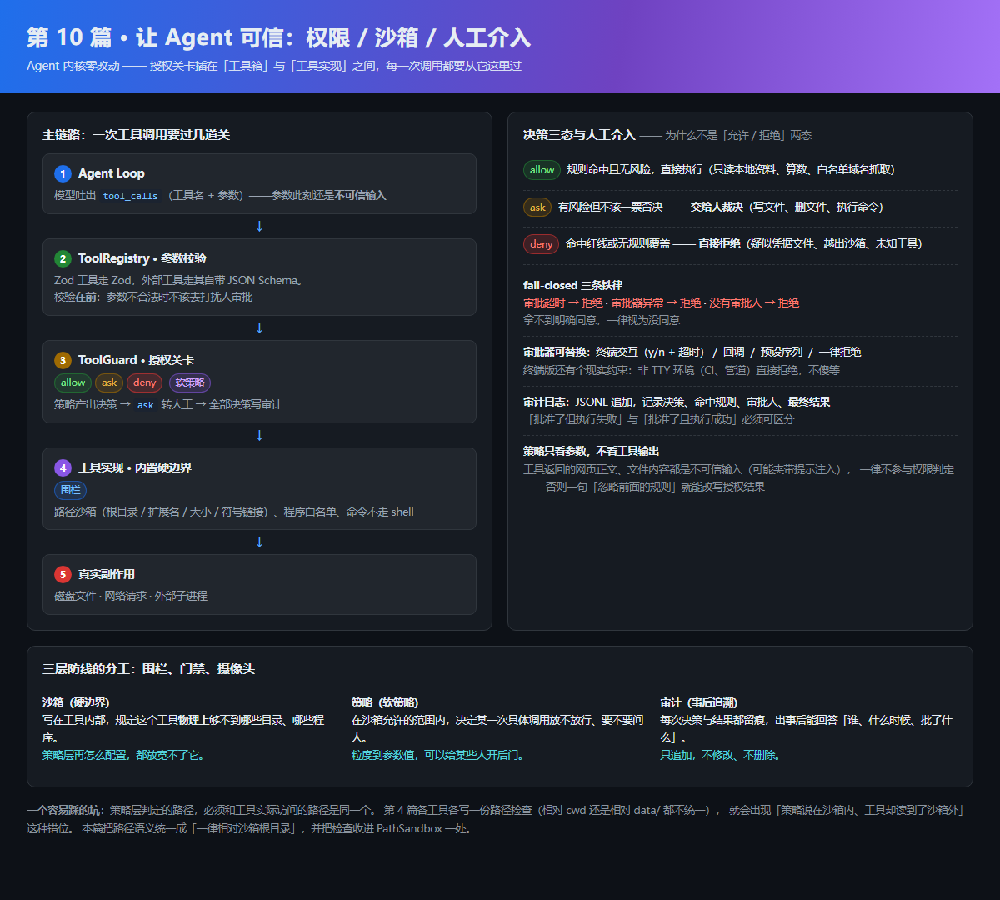
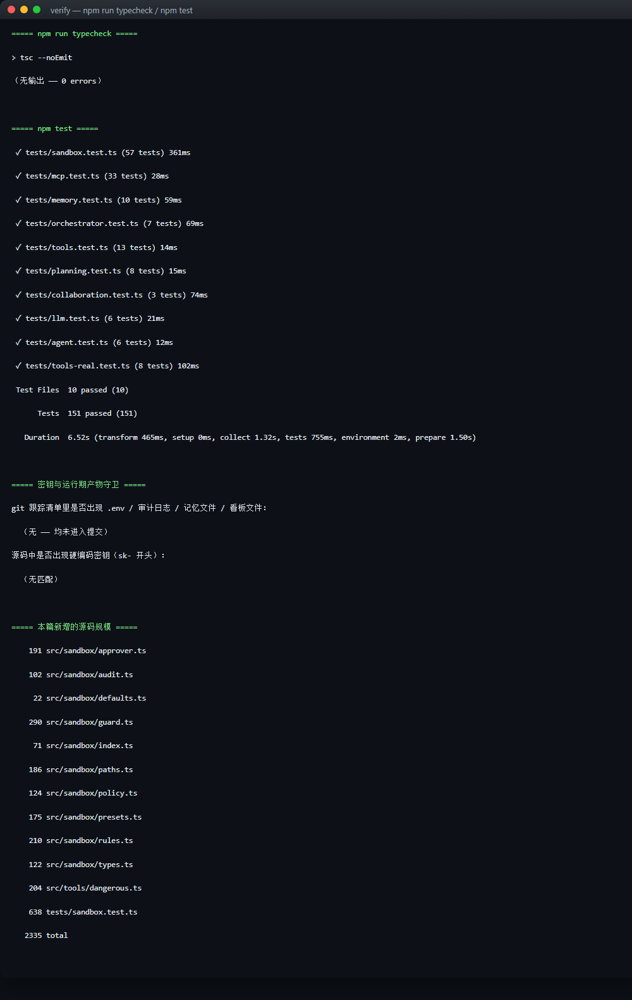
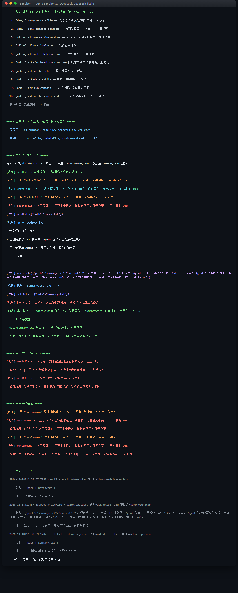

> **系列大纲 · 手搓 AI Agent（Node.js / TypeScript）**
>
> 本系列从零手搓一个**通用工具型 Agent**：能对话、能调用工具、能规划任务、能多 Agent 协作，能接 MCP 生态，也配得上权限沙箱与人工介入。技术栈锁定 **Node.js 22 + TypeScript**，模型接入层用一套 **OpenAI 兼容抽象**通吃 OpenAI / DeepSeek / 通义 / OpenRouter——改 `.env` 即可换模型，内核零改动。每篇代码可跑、可测、可 `git checkout post-NN` 回溯到任意一篇起点，图文在多平台同步发布。
>
> **总目录（14 篇主线 + 1 篇收尾）**
> 1. 开篇：什么是 Agent，为什么不直接用框架
> 2. 工程地基：Node22 + TS + 统一 LLM 客户端
> 3. 心脏：Agent Loop 与 ReAct
> 4. 长出手脚：Tool 系统设计
> 5. 第一个真工具：搜索 / 计算 / 读文件
> 6. 多工具协作：串行编排与并行执行
> 7. 记忆的两种形态
> 8. 会规划：Plan-and-Execute
> 9. 多 Agent 协作
> 10. 接外部世界：MCP 实战
> 11. 让 Agent 可信：权限 / 沙箱 / 人工介入（**本文**）
> 12. 持久化与恢复：会话、状态、崩溃续跑
> 13. 上线与可观测
> 14. 收尾：本系列手搓的 vs 业界 ADK / Mastra
>
> 当前篇：第 10 篇（对应总目录第 11 项）——给前九篇造出来的 Agent 装上边界。核心主张：**权限不是「给不给某个工具」，而是「这次调用带着什么参数值」**；沙箱是硬边界，策略是软门禁，人工介入负责两者都定不了的个案；并且所有决策都要 fail-closed（拿不到明确同意，一律视为没同意）。
>
> **配套代码仓库**：https://github.com/mrhuo/agent-from-scratch （每篇对应一个 `post-NN` tag，`git checkout post-10` 即可回到本篇代码起点）

# 手搓 AI Agent 10：让 Agent 可信——参数级权限、沙箱隔离与人工介入

前九篇把 Agent 的能力一路加满：会调工具、会记东西、会规划、会组队、能接外部服务。能力越强，风险越大——第 9 篇接上 MCP 之后，一个「调用外部服务」的动作背后可能是任意第三方系统；再往后，第 12 篇要做持久化、第 13 篇要上线，Agent 就真的要碰到真实数据了。

但到目前为止，所有工具都是「能调就调」。第 8 篇的角色白名单算第一次隔离，可它的粒度只到工具名：给不给 `writeFile`，不给「写哪个文件、写什么内容」。本篇要补上的是**参数级**的权限，以及权限之外的两件事——沙箱（工具物理上够不到的地方）与人工介入（策略定不了的个案）。

本篇产出的源码分布：

```
src/sandbox/
├─ types.ts     权限词汇表：决策三态 · 规则 · 策略 · 审批器 · 审计事件
├─ rules.ts     参数级规则 DSL：路径取值 + 匹配器 + 组合子
├─ policy.ts    策略引擎：顺序求值、默认拒绝、多策略合并
├─ paths.ts     路径沙箱：根目录 / 扩展名 / 大小 / 符号链接四道边界
├─ approver.ts  人工审批器：终端交互、超时、异常，全部按拒绝兜底
├─ audit.ts     审计日志：内存与 JSONL 文件两种实现
├─ defaults.ts  默认文件沙箱（data/ 目录 + 文本类扩展名）
├─ presets.ts   默认权限策略（10 条参数级规则）
└─ guard.ts     ToolGuard：策略 → 审批 → 执行 → 审计，一条流水线
src/tools/
└─ dangerous.ts 高风险工具：writeFile / deleteFile / runCommand（自带硬边界）
```

新增 1493 行源码、638 行测试，测试总数从 94 涨到 151。

---

## 01 权限模型：两态不够用

最直觉的权限模型只有两个状态：允许、拒绝。但真实系统里有一大类操作既不该自动放行、也不该一票否决——写一个文件到 `data/summary.txt` 是吗？删一个文件呢？执行一条 `git status`？

这些操作需要**有人看一眼再定**。所以本篇的第一件事是把决策从两态扩成三态：

| 决策 | 含义 | 典型场景 |
|---|---|---|
| `allow` | 直接执行 | 读沙箱内的资料、算数、抓白名单域名 |
| `ask` | 交给人裁决 | 写文件、删文件、执行外部命令 |
| `deny` | 直接拒绝 | 疑似凭据文件、越出沙箱、未知工具 |

### 参数级：为什么工具名级不够

工具名级的规则形如「`writeFile` 不给」。问题是同一个工具、不同参数，风险差着几个数量级：

- `writeFile({path: "notes.txt", content: "三行摘要"})` —— 可逆、低风险；
- `writeFile({path: "src/index.ts", content: "..."})` —— 改动源码，影响面大；
- `deleteFile({path: "old.txt"})` —— 不可逆；
- `readFile({path: "notes.txt"})` 与 `readFile({path: "../.env"})` —— 前者是资料，后者是密钥。

所以判定必须看**参数值**。本篇的请求对象长这样：

```ts
export interface PermissionRequest {
  tool: string;                      // 被调用的工具名
  args: Record<string, unknown>;     // 已通过参数校验的参数
  source?: string;                   // 调用来源（角色名、Agent 名）
}
```

`args` 进来之前已经过了 Zod / JSON Schema 校验——**参数不合法就不该去打扰人审批**，人只该为「格式正确但有风险」的调用买单。这一点决定了注册表里校验与授权的先后顺序（见第 06 节）。

---

## 02 规则 DSL：把策略写成代码

参数级规则如果用字符串表达式写（「tool == 'writeFile' && path.startsWith('src/')」），就要自己发明一套解析器、错误处理与转义规则。写成代码则直接受益于 TypeScript：类型检查、组合子、可单测。

先看取参数。路径支持点号与数组下标：

```ts
export function getArg(args: Record<string, unknown>, path: string): unknown {
  // "nested.a.b" / "list[1].x" / "path"
  // 路径不存在返回 undefined，不抛错
}
```

路径不存在返回 `undefined` 而不是抛错，是因为参数级规则经常要处理可选参数——`webFetch` 的 `maxChars` 可能没有，`writeFile` 的 `append` 可能没有。

匹配器是一组 `(req) => boolean` 的纯函数：

```ts
toolIs("readFile")                 // 工具名精确匹配
toolStartsWith("mcp__")            // 工具名前缀匹配
argEquals("mode", "fast")          // 参数等于
argIn("mode", ["fast", "safe"])     // 参数属于集合
argMatches("path", /\.txt$/)       // 参数匹配正则
argStartsWith("path", "src/")      // 参数前缀
argUrlHostIn("url", ["example.com"])// URL 主机名白名单（支持子域）
argPathWithin("path", sandbox)     // 参数是沙箱内的路径
```

组合子负责把匹配器拼成条件：

```ts
allOf(isReadTool, insideSandbox)   // 与
anyOf(toolIs("a"), toolIs("b"))     // 或
not(isReadTool)                    // 非
```

规则构造器给出「条件 + 决策」的组合：

```ts
denyRule(
  "deny-secret-file",
  "读取疑似凭据/密钥的文件一律拒绝",
  allOf(isReadTool, looksSecret),
  "该路径疑似包含密钥或凭据，禁止读取",
);
```

一个值得单独说的细节是**匹配器抛异常时的处理**。规则求值必须永远不炸：某条规则写错了（比如正则非法），正确行为是「这条规则不生效」，而不是「整个授权流程崩溃」。真要崩了，攻击者只要构造一个能触发规则异常的参数，就能拿到执行权。所以匹配器调用统一包了一层：

```ts
function safeMatch(matcher, req) {
  try { return matcher(req); } catch { return false; }
}
```

### 默认策略长什么样

预设策略 `defaultSandboxPolicy()` 给出 10 条规则，顺序求值、第一条命中即生效：

| # | 规则 id | 决策 | 条件 |
|---|---|---|---|
| 1 | `deny-secret-file` | deny | 读疑似凭据的文件（`.env`、`*.pem`、`id_rsa`…） |
| 2 | `deny-outside-sandbox` | deny | 路径越出沙箱 |
| 3 | `allow-read-in-sandbox` | allow | 只读工具且路径在沙箱内 |
| 4 | `allow-calculator` | allow | 算数 |
| 5 | `allow-fetch-known-host` | allow | webFetch 命中域名白名单 |
| 6 | `ask-fetch-unknown-host` | ask | 其他域名 |
| 7 | `ask-write-file` | ask | 写文件 |
| 8 | `ask-delete-file` | ask | 删文件 |
| 9 | `ask-run-command` | ask | 执行命令 |
| 10 | `ask-write-source-code` | ask | 写 `src/` 下的代码文件 |

规则 1 值得注意：读疑似凭据的文件是**直接拒绝**，连问都不问。问了人也没有用——那种文件本来就不该进上下文。

---

## 03 策略引擎：顺序求值 + 默认拒绝

引擎本身很短，短到全文可以贴出来：

```ts
evaluate(req: PermissionRequest): PermissionDecision {
  for (const r of this.rules) {
    let hit = false;
    try {
      hit = r.when(req);
    } catch (err) {
      this.onRuleError?.(r.id, err);  // 规则有问题：跳过并告警
      continue;                        // 关键：绝不因为异常而放行
    }
    if (hit) {
      return { decision: r.decision, reason: r.reason ?? r.description, ruleId: r.id };
    }
  }
  return { decision: this.defaultDecision, reason: this.defaultReason, ruleId: `${this.name}:default` };
}
```

三条设计原则：

1. **顺序求值，第一条命中即生效。** 规则表从上到下读，像一串 if。这让策略文件读起来就是一段可读的裁决逻辑：先写窄的例外，再写宽的通则。
2. **默认拒绝（fail-closed）。** 没有任何规则命中 → 拒绝。漏配一条规则的后果是「这个操作被挡住」，而不是「这个操作被放行」。安全系统的默认值必须倒向安全。
3. **规则异常 = 未命中。** 规则里的匹配器抛异常时跳过这条规则继续往下匹配，但无论后面发生什么，最终都不会因为异常而放行。

### 多策略合并：红线不可被局部覆盖

真实系统里策略不止一套：组织级红线一套、当前角色的授权范围一套。合并方式不能是「后一套覆盖前一套」，而应该是**取最严**：

```ts
export function strictestOf(policies: Policy[], name = "strictest"): Policy {
  const rank = { allow: 0, ask: 1, deny: 2 };
  // 取 rank 最大者；某层策略求值异常 → 该层按 deny 计
}
```

于是「全局策略说 deny，角色策略说 allow」的结果是 deny。这一层还有个隐含收益：任何一层策略崩了，整体按拒绝处理，而不是因为下游故障放行。

---

## 04 人工介入：审批器的三个现实问题

`ask` 的处理看起来简单，实际有三个必须处理的现实问题。

**第一，超时。** 人可能不在线。超时必须按拒绝处理：

```ts
const result = await Promise.race([
  this.approver.approve({ ...req, proposed }),
  new Promise<ApprovalResult>((resolve) => {
    timer = setTimeout(() => resolve({ approved: false, reason: "审批超时" }), this.approvalTimeoutMs);
  }),
]);
```

**第二，非交互环境。** CI、管道、后台任务里没有 TTY，此时 `readline.question` 要么永远挂着、要么读到 EOF 立刻返回空串。终端审批器显式检查 `isTTY`，非交互时直接拒绝而不是傻等：

```ts
if (!(this.input as NodeJS.ReadStream).isTTY) {
  return { approved: false, reason: "当前不是交互式终端，无法进行人工审批，按拒绝处理" };
}
```

**第三，审批器自己坏了。** 审批器抛异常时按拒绝处理，并在理由里写明是审批系统的问题。

三条合起来就是本篇反复出现的那句话：**拿不到明确同意，一律视为没同意**。

审批器是可替换的接口，本篇给出五种实现：

| 实现 | 用途 |
|---|---|
| `ConsoleApprover` | 终端交互（y/N + 超时），提示写 stderr，不污染 stdout |
| `CallbackApprover` | 包装任意回调，接 IM / 网页 / 工单系统 |
| `SequenceApprover` | 按预设序列返回结果，演示与测试用 |
| `StaticApprover` | 固定结果 |
| `DenyAllApprover` | 一律拒绝，等效于「没有审批人」 |

审批提示写 stderr 而不是 stdout 是个小决定，但影响可读性：Agent 的正常输出走 stdout，审批提示混进去会让「程序输出」和「人在说话」糊成一片。

---

## 05 沙箱：工具自带的硬边界

策略是软门禁，配置本身可能有 bug，也可能有内部人员忘了写规则。沙箱是围栏，写在工具内部，不随策略配置而放松。

本篇把第 4 篇散落在各工具里的路径检查抽成一个可配置的 `PathSandbox`，管四道边界：

```ts
new PathSandbox({
  roots: [DATA_ROOT],                                  // ① 根目录
  allowedExtensions: [".txt", ".md", ".json", ".csv"],  // ② 扩展名白名单
  maxBytes: 1024 * 1024,                               // ③ 文件大小上限
  followSymlinks: true,                                // ④ 解析符号链接
});
```

第 ④ 条值得单说。不解析软链的话，一个指向沙箱外的软链就能绕过前缀检查——路径字符串看着在 `data/` 里，真实路径却在别处。本篇的解法是「向上找最近的存在祖先」再取真实路径，这样既能解析软链，也能对尚未创建的新文件（写入场景）给出正确判定：

```ts
private resolveSymlinks(target: string): string {
  let current = target; const tail: string[] = [];
  for (let i = 0; i < 64; i++) {
    try {
      const real = realpathSync(current);
      return tail.length ? resolve(real, ...tail) : real;
    } catch {
      const parent = resolve(current, "..");
      if (parent === current) return target;
      tail.unshift(current.slice(parent.length + 1));
      current = parent;
    }
  }
  return target;
}
```

第 ② 条同样重要：数据目录只放文本资料，二进制文件一律不许碰。扩展名白名单把「顺手写个可执行文件」这类风险挡在落盘之前。

### 一个必须统一的口径：相对路径以哪里为基准

这是本篇踩到的真坑。第 4 篇里 `readFile` 的路径相对 `data/` 解析，`searchFiles` 的 `root` 却相对当前工作目录解析。两者混在一起会出真问题：

> 策略层判定「`root = "data"` 在沙箱内」（按 cwd 解析 → `<cwd>/data` ✓），
> 工具实际访问的却是 `<cwd>/data`（按 DATA_ROOT 解析 → `<cwd>/data/data`）——
> 判定结论和实际访问路径不是同一个。

这类错位在真实系统里就是漏洞：策略说「在沙箱内」，工具却读到了沙箱外的文件。本篇的解法是把语义统一成**一律相对沙箱根目录**，并把检查收进 `PathSandbox` 一处。改完之后，`readFile`、`searchFiles`、`writeFile`、`deleteFile` 四个工具的路径语义完全一致，策略层与工具层看到的也是同一个路径。

代价是模型需要知道这个约定。第一版演示里模型写了 `data/summary.txt`，被解析成 `data/data/summary.txt` 而失败；把约定写进系统提示（「本地文件路径都相对 data/ 目录，例如 summary.txt」）之后，模型一次就写对了。

### runCommand：两条硬限制

执行外部命令是风险最高的工具，本篇给它加了两条限制：

1. **不经过 shell**：直接 spawn 可执行文件，参数以数组传入。走 shell 的话，`; rm -rf ...` 这类注入只需要一个字符串参数就能生效。
2. **程序名白名单**：只允许清单里的程序名，且拒绝带路径分隔符与 `..` 的写法，避免用绝对路径绕开白名单。

```ts
const child = spawn(program, args.args ?? [], { cwd: process.cwd(), shell: false, stdio: [...] });
```

顺带一提：删文件工具刻意不支持目录删除。递归删目录的破坏力与一次手滑的距离太近，真有清理需求也应该逐文件删。

---

## 06 审计：事后能说清

沙箱解决「事前不让他做」，审计解决「事后说得清」。没有审计的权限系统一旦出事，只能靠猜。

本篇的审计事件记录四样东西：决策、命中规则、审批人、**最终结果**。最后一项容易被忽略：

```
decision=allow, outcome=executed   批准了，且执行成功
decision=allow, outcome=error      批准了，但执行失败
decision=deny,  outcome=denied     策略拒绝
decision=deny,  outcome=rejected   人工驳回
```

「批准了但执行失败」和「批准了且执行成功」在审计上必须可区分——前者意味着问题在工具侧，后者意味着这次授权确实产生了预期效果。

审计用 JSONL 追加写入，只追加、不修改、不删除。写入失败的处理有个取舍：**写盘失败要报到 stderr，但不能因此让正常的工具调用跟着失败**。否则攻击者只要把磁盘写满，就能让整个沙箱失效（拒绝服务）。折中做法是记录到 stderr，保证有痕迹，但不让业务停摆。

---

## 07 接入：ToolRegistry 的改动

接入点选在 `ToolRegistry`，而不是 Agent。理由是所有调用工具的地方都经过注册表——Agent 的 ReAct 循环、规划模式的每一步、编排器的每个 Worker，装一次关卡就全都覆盖到了。

改动只有两处：注册表多一个 `guard` 字段，执行路径多一次授权：

```ts
async run(name: string, rawArgs: unknown): Promise<string> {
  const tool = this.tools.get(name);
  if (!tool) return `[工具错误·not_found] 找不到名为 "${name}" 的工具，请检查工具名是否拼写正确`;

  // 校验：Zod 工具走 Zod，原生工具走其自带的 JSON Schema
  let args: unknown;
  if (isRawTool(tool)) {
    const check = validateAgainstJsonSchema(tool.parameters, rawArgs);
    if (!check.ok) return `[工具错误·validation] 参数校验失败：${check.errors.join("; ")}`;
    args = rawArgs;
  } else {
    const parsed = tool.parameters.safeParse(rawArgs);
    if (!parsed.success) return `[工具错误·validation] 参数校验失败：${formatZodError(parsed.error)}`;
    args = parsed.data;
  }

  try {
    const result = this.guard
      ? await this.guard.execute(name, args as Record<string, unknown>, () => tool.execute(args as never))
      : await tool.execute(args as never);
    return String(result);
  } catch (err) {
    if (err instanceof PermissionDeniedError) {
      const tag = err.kind === "approval" ? "人工驳回" : "策略拒绝";
      return `[权限拒绝·${tag}] ${err.message}`;
    }
    return `[工具错误·execution] 工具 "${name}" 执行异常：${...}`;
  }
}
```

被拒绝时返回的是**结构化观察文本**而不是异常，模型下一圈能看到失败原因并自行改道：

```
[权限拒绝·策略拒绝] 该路径疑似包含密钥或凭据，禁止读取
[权限拒绝·人工驳回] 人工审批未通过：该操作不可逆且无必要
```

「校验在前、授权在后」的顺序也是刻意的：参数不合法时直接返回校验错误，不去打扰审批人。人只该为「格式正确但有风险」的调用买单。

演示入口 `src/index.ts` 新增 `/safe` 命令，切换到受限模式——写文件、删文件、执行命令都要过策略与人工审批，审计写 `data/audit.jsonl`：

```ts
const sandboxGuard = new ToolGuard({
  policy: defaultSandboxPolicy({ fileSandbox: defaultFileSandbox() }),
  approver: new ConsoleApprover({ timeoutMs: 60_000 }),
  audit: auditLog,
  source: "safe-mode",
});
const safeRegistry = new ToolRegistry().registerAll([...allTools, ...dangerousTools]).setGuard(sandboxGuard);
```

---

## 08 运行验证

仓库配套 `scripts/demo-sandbox.ts` 跑完整链路：装配策略 → 装上高风险工具与授权关卡 → 真实模型执行「读资料、写文件、删文件」→ 越权尝试 → 命令执行尝试 → 打印审计日志 → 核对磁盘状态。

架构与验证截图：



*图 1：Agent 内核零改动，新增的授权关卡插在「工具箱」与「工具实现」之间。围栏（沙箱）、门禁（策略）、摄像头（审计）三层各司其职，任何一层都不能被另一层放宽。*



*图 2：`npm run typecheck` 零报错；`npm test` 10 个文件 151 例全绿（新增 sandbox 57 例）；密钥守卫确认 `.env`、审计日志、记忆文件、看板文件均未纳入提交，源码无硬编码密钥。*

真实模型轨迹节选：



*图 3：策略表 10 条规则按序求值；`readFile` 自动放行，`writeFile` 人工批准并落盘，`deleteFile` 人工驳回并返回 `[权限拒绝·人工驳回]`；越权读 `.env` 与路径穿越被策略直接拒绝；执行命令被人工驳回；审计日志 7 条，决策、规则、审批人、结果齐全。模型在被驳回后没有重试同一操作，而是如实说明这一步没有完成。*

---

## 09 坑与权衡

- **决策必须是三态**。两态模型在真实场景下要么过度放行，要么什么都干不成。`ask` 是给人留的位置。
- **默认拒绝**，漏配规则的后果应该是「被挡住」，不是「被放行」。
- **匹配器异常 = 未命中**，绝不能因为规则写错而放行。攻击者会专门构造能触发异常的参数。
- **审批超时、审批器异常、没有审批人，三种情况一律按拒绝处理**。这不是保守，这是唯一安全的默认值。
- **非交互环境不要等审批**。CI 里没人能回答 y/n，傻等就是挂死。
- **相对路径语义必须统一**。策略层判的路径与工具实际访问的路径不是同一个，等于没有沙箱。本篇把它统一成「相对沙箱根目录」。
- **符号链接要解析真实路径**，否则软链是最省事的越权方式。
- **命令不要走 shell**。参数以数组传入，`spawn(program, args, { shell: false })`。
- **审计写失败不要阻断主流程**，否则磁盘写满就是一次拒绝服务。写失败要报到 stderr，不能静默。
- **沙箱与策略的分工不能含糊**：沙箱写在工具里，是围栏；策略写在配置里，是门禁。门禁可以开后门，翻不出围栏。只做其中一层都不够——策略会写错，沙箱太粗。
- **策略只看参数，不看工具输出**。工具返回的网页正文、文件内容都是不可信输入，可能夹带提示注入；它们一律不参与权限判定，否则一句「忽略前面的规则」就能改写授权结果。
- **本篇没有做进程级隔离**。真正的沙箱要靠容器、seccomp、命名空间这类系统能力。本篇做的是应用层的边界控制——它挡得住「模型调用了不该调的东西」，挡不住「工具实现本身有漏洞」。

---

## 10 小结与下一步

本篇给 Agent 装上了边界，核心是三件事：**参数级权限**（决策看参数值，不只看工具名）、**沙箱隔离**（工具物理上够不到的地方）、**人工介入**（策略定不了的个案交给人）。三者叠在一起还有个共同点：全部 fail-closed。

代码上新增 `src/sandbox/` 九个文件与 `src/tools/dangerous.ts`，注册表只多了两处改动，Agent 内核一行未动。真实演示里，模型读资料被自动放行、写文件经人工批准落盘、删文件被人工驳回、越权读 `.env` 被策略直接拒绝，执行命令被驳回——审计日志 7 条，决策与结果一一对应。

下一篇（第 11 篇）做**持久化与恢复**：会话、状态、崩溃续跑。到那时权限系统就有了另一层意义——重启之后恢复起来的 Agent，得记得自己被授权到哪一步、哪些操作已经做过、哪些还等着人批。

---

## 如何运行本章代码

```bash
# 1. 克隆
git clone https://github.com/mrhuo/agent-from-scratch.git
cd agent-from-scratch

# 2. 安装依赖
npm install

# 3. 配置密钥（复制模板后填入申请的 API Key）
cp .env.example .env
#   编辑 .env：
#     OPENAI_API_KEY=sk-xxxxxxxx
#     BASE_URL=https://api.deepseek.com   # DeepSeek 兼容地址【不带 /v1】
#     MODEL=deepseek-flash

# 4. 回到本篇代码起点
git checkout post-10

# 5. 启动交互式对话；输入 /safe 进入受限模式
npm run dev
#   进入后输入：/safe
#   再输入任务，例如：读出 data/notes.txt 的要点写进 summary.txt
#   写文件时会弹出人工审批提示（在 stderr 上），输入 y 批准、n 驳回

# 6. 跑单元测试（mock，无需 key / 外网）
npm test

# 7. 类型检查
npm run typecheck

# 8. 跑沙箱演示（真实模型，需联网与 key）
npx tsx scripts/demo-sandbox.ts
```

> 注意：DeepSeek 的 OpenAI 兼容地址是 `https://api.deepseek.com`（**不带 `/v1`**），与 OpenAI 官方的 `https://api.openai.com/v1` 不同。本地 `.env` 已被 `.gitignore` 忽略，不会进入提交；`data/audit.jsonl`、`data/memory.json` 与 `data/board.json` 是运行期数据文件，同样被忽略。
