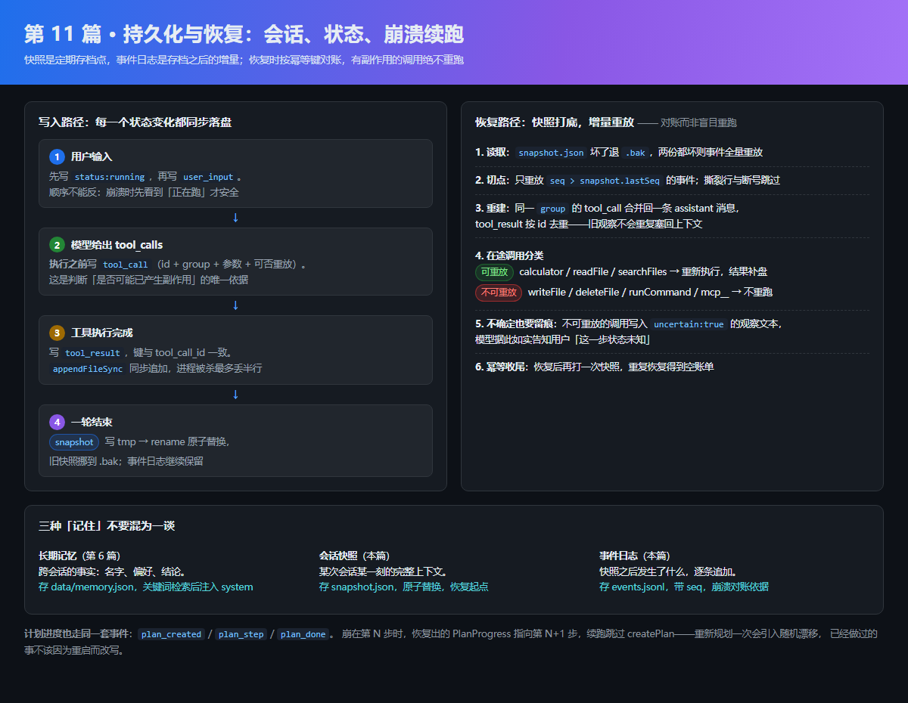
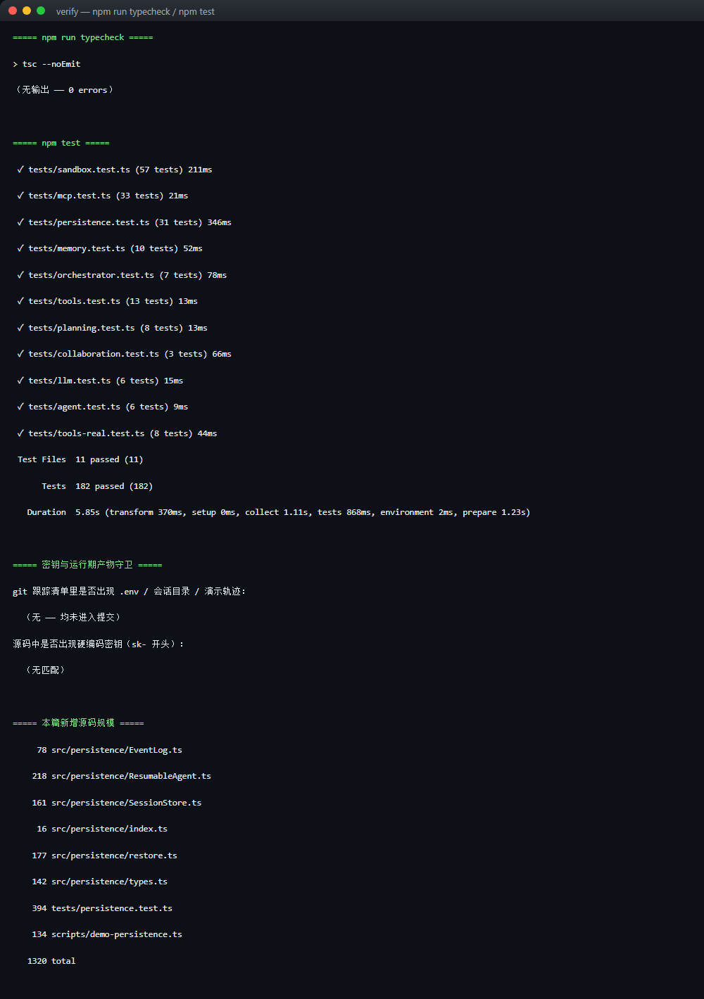
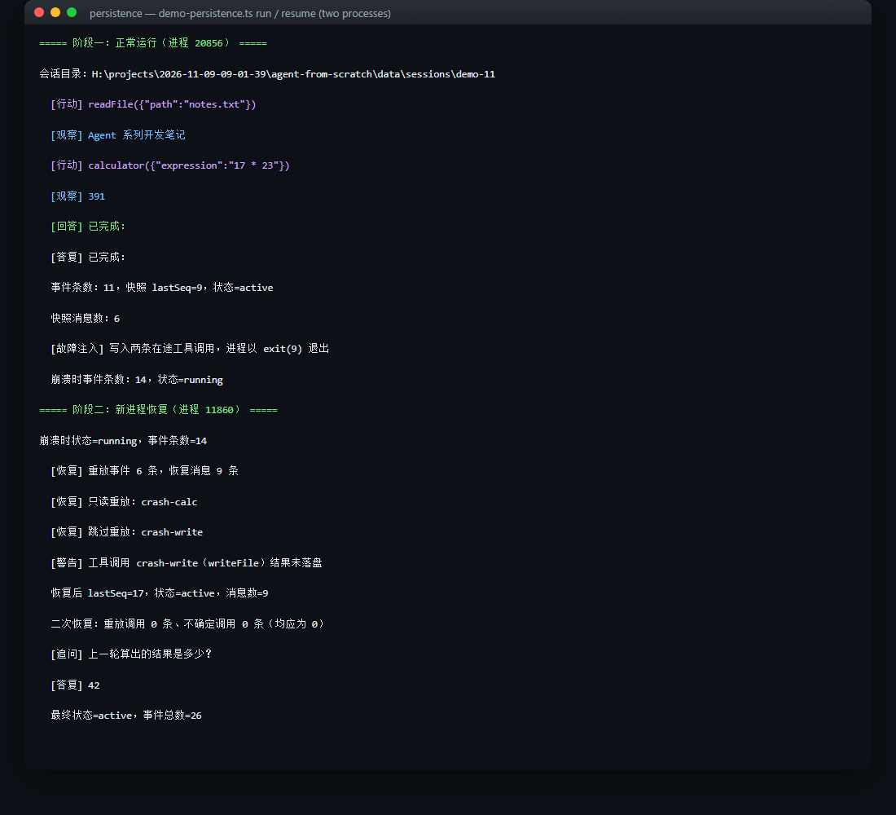

> **系列大纲 · 手搓 AI Agent（Node.js / TypeScript）**
>
> 本系列从零手搓一个**通用工具型 Agent**：能对话、能调用工具、能规划任务、能多 Agent 协作，能接 MCP 协议，也配得上权限沙箱与人工介入。技术栈锁定 **Node.js 22 + TypeScript**，模型接入层用一套 **OpenAI 兼容抽象**通吃 OpenAI / DeepSeek / 通义 / OpenRouter——改 `.env` 即可换模型，内核零改动。每篇代码可跑、可测、可 `git checkout post-NN` 回溯到任意一篇起点，图文在多平台同步发布。
>
> **总目录（14 篇主线 + 1 篇收尾）**
> 1. 开篇：什么是 Agent，为什么不直接用框架
> 2. 工程地基：Node22 + TS + 统一 LLM 客户端
> 3. 心脏：Agent Loop 与 ReAct
> 4. 长出手脚：Tool 系统设计
> 5. 第一个真工具：搜索 / 计算 / 读文件
> 6. 多工具协作：串行编排与并行执行
> 7. 记忆的两种形态
> 8. 会规划：Plan-and-Execute
> 9. 多 Agent 协作
> 10. 接外部世界：MCP 实战
> 11. 让 Agent 可信：权限 / 沙箱 / 人工介入
> 12. 持久化与恢复：会话、状态、崩溃续跑（**本文**）
> 13. 上线与可观测
> 14. 收尾：本系列手搓的 vs 业界 ADK / Mastra
>
> 当前篇：第 11 篇（对应总目录第 12 项）。核心主张：**持久化不是把对话存下来就结束**。快照解决「接在哪儿」，事件日志解决「崩在哪儿」，幂等键解决「哪些事已经做过」。三者缺一，重启后的 Agent 就会失忆、重复执行，或者把不确定当成成功。
>
> **配套代码仓库**：https://github.com/mrhuo/agent-from-scratch （每篇对应一个 `post-NN` tag，`git checkout post-11` 即可回到本篇代码起点）

# 手搓 AI Agent 11：持久化与恢复——会话快照、事件日志与崩溃续跑

前一篇给 Agent 装上权限、沙箱和审计，能挡住越权操作。但进程仍然是一次性的：关掉终端，上下文消失；跑到第 7 步被强杀，下次只能从头再来。第 6 篇的长期记忆只存事实，不存「这次任务进行到哪儿」。

真实系统里这不是小麻烦。一个已经写了文件的 Agent 被重启后若从头执行，会再写一遍；一个已经批准过 `writeFile` 的会话恢复后若重新走审批，人会被问第二次；一个崩在模型请求发出之后的步骤，既不知道结果，也不知道有没有产生副作用。本篇要解决的正是这类问题：**把状态写到进程之外，并在重启后做对账**。

本篇产出的源码分布：

```
src/persistence/
├─ types.ts            持久化词汇表：会话状态 · 事件 · 快照 · 恢复账单
├─ EventLog.ts         只追加 JSONL：单调序号 · 同步落盘 · 撕裂行容错
├─ SessionStore.ts     快照存储：tmp + rename 原子替换 · .bak 回滚 · 会话枚举
├─ restore.ts          重放引擎：消息重建 · 工具调用分组 · 幂等去重 · 重放判定
└─ ResumableAgent.ts   写入与恢复的编排：钩子装配 · 检查点 · 在途调用对账
src/agent/Agent.ts     新增 8 个状态钩子与两个上下文口子，循环判断未改
src/index.ts           新增 /persist 与 /resume 两个入口
scripts/demo-persistence.ts  真实模型 + 真实进程退出的两阶段演示
```

新增 792 行产品代码、394 行测试，测试总数从 151 涨到 182。

---

## 01 三种「记住」不是一回事

先把词分开，后面所有设计才有讨论基础。

| 类型 | 存什么 | 生命周期 | 载体 | 解决的问题 |
|---|---|---|---|---|
| 长期记忆（第 6 篇） | 事实、偏好、结论 | 跨会话，永久 | `data/memory.json` | 「上次说过名字叫什么」 |
| 会话快照（本篇） | 某一刻的完整消息上下文 | 单次会话 | `snapshot.json` | 「重启后从哪一句接上」 |
| 事件日志（本篇） | 快照之后发生的状态变化 | 单次会话，只追加 | `events.jsonl` | 「崩在哪个工具调用上」 |

三者的写入频率差着几个数量级。长期记忆每次 `remember` 写一次；会话快照每轮结束写一次；事件日志在每次输入、每次工具调用发起与完成时都写。混在一个文件里，要么写放大，要么恢复慢。

本篇的磁盘布局是 `data/sessions/<sessionId>/` 下一个快照文件加一个事件文件。会话之间物理隔离，删一个会话不会碰其他会话。

---

## 02 崩溃点到底在哪儿

把一轮 ReAct 拆开，能崩的位置有六个：

1. 用户输入已到 Agent，还没落盘；
2. 模型请求已发出，响应没回来；
3. 模型给出了 `tool_calls`，工具还没执行；
4. 工具执行完毕，观察结果还没写回上下文；
5. 观察已回模型，最终答复还没生成；
6. 一轮结束，快照还没打。

第 2 类崩溃最廉价：没有副作用，重新问一次模型即可。第 3、4 类最危险：工具可能已经碰过磁盘或外部系统，而结果没落盘。恢复器无从得知「到底做没做」，只能靠事前写下的在途记录判断。

因此本篇定了一条硬规则：**工具调用的在途记录必须写在工具执行之前**。如果这条记录写盘失败，整轮执行直接失败，不允许带着「没记录」的状态继续往下跑。权限系统里的 fail-closed 在这里换成同一套逻辑：拿不到确定的执行记录，就不执行。

---

## 03 快照 + 事件日志：为什么两个都要

只用快照，每次工具调用都要把整段对话重写一遍。一段 60 条消息的上下文，单次写盘几十 KB；一轮里调 4 次工具就写 4 遍。更要命的是崩溃点落在写入过程中：`writeFile` 直接覆盖时，进程被杀可能留下半截 JSON。

只用事件日志，每次启动都要从空消息开始重放全部历史。会话跑满 200 轮，恢复时间与会话长度成正比，而且每一次 `user_input`、`tool_call` 都要重新过一遍。

组合方案把两者切开：

- 快照记录完整消息、已完成的工具结果表、在途调用、计划进度，以及 `lastSeq`——这份快照覆盖到哪一条事件；
- 事件日志只记增量，每条带单调递增的 `seq`；
- 恢复时只读 `seq > lastSeq` 的事件，把快照之后发生的事补上。

快照写盘用 `tmp → rename`：`writeFileSync` 先写 `snapshot.json.tmp`，再用 `renameSync` 原子替换正式文件。同一文件系统内 rename 是原子的，进程在任意时刻被杀，正式文件非旧即新。覆盖前把旧文件挪到 `snapshot.json.bak`，多一层回滚机会。主快照解析失败就退备份；两份都坏了就丢弃快照，从事件日志全量重放。

事件日志这边用 `appendFileSync` 同步追加。异步写会在进程被强杀时丢掉缓冲区数据，而事件日志的价值恰恰在最后一条。读的时候对两层损坏容错：JSON 解析失败的行跳过，序号不连续的行也跳过。前者对应写了一半的尾行，后者对应日志断裂后还残留的旧字节。

---

## 04 事件模型：把「在途」写成一等公民

事件类型一共十种。与崩溃恢复直接相关的重点是 `tool_call` 与 `tool_result`：

```ts
{
  seq: 12,
  ts: "2026-11-20T15:23:56.985Z",
  type: "tool_call",
  id: "call_9f3a",             // 与模型返回的 tool_call_id 一致，幂等键
  group: "7c1e...",            // 同一轮多个调用共用一个组
  content: "先算一下",
  tool: "calculator",
  args: { expression: "40+2" },
  replayable: true             // 结果丢失时能否安全重放
}
```

三个字段值得单独说。

`id` 用模型给的 `tool_call_id`，不另造一套。观察消息回写上下文时本来就要带这个 id，它天然就是「这次调用」的唯一标识。恢复时按 id 查结果表，就能判断调用是否已经完成。

`group` 解决一轮多调用的结构问题。模型一次可能吐出两个 `tool_calls`，运行时它们属于同一条 assistant 消息。逐条写事件会把它们拆成两条；恢复时按 `group` 合并，模型看到的结构与崩溃前一致。

`replayable` 是给恢复器看的判定结果。只读工具为 `true`，写文件、删文件、执行命令和外部 MCP 工具为 `false`。这个判断放在写事件时做一次，恢复时直接读，避免两处规则漂移。

`tool_result` 用同一个 id 回配。同一 id 的第二条结果会被恢复器丢弃——幂等不只是「不重复执行」，也包括「不重复往上下文里塞观察」。

---

## 05 恢复算法：对账，不是重跑

`restoreSession()` 是纯函数：吃快照与事件，产出消息、在途调用表、完成结果表、计划进度和一份恢复账单。

流程分六步：

1. 从快照拷贝消息与结果表，不修改原对象；
2. 只处理 `seq > lastSeq` 的事件；
3. `user_input` 与 `assistant_message` 按序回填，用户输入与快照末尾重复时跳过；
4. `tool_call` 进在途表，并把同一 `group` 的调用合并成一条 assistant 消息；
5. `tool_result` 写入结果表，同时补一条 `role: tool` 的观察消息——崩溃点可能落在 assistant 消息写盘之前，这里兜底；
6. 计划事件重建 `PlanProgress`，指向下一个未完成步骤。

`ResumableAgent.resume()` 在这之上处理未决调用：

- 可重放的调用：通过注册表重新执行一次，结果写回事件日志。模型不知道发生过崩溃。
- 不可重放的调用：不执行，写一条 `uncertain: true` 的观察文本：

```
[恢复提示·结果未落盘] 工具 "writeFile" 在上次进程退出前没有写下结果。
该工具可能已产生副作用，为避免重复执行已跳过重放；请如实告知用户这一步状态未知。
```

这条文本会作为工具观察回到上下文。模型下一轮看到的是「状态未知」，而不是一个伪造的成功结果。安全系统里最忌讳的就是把不知道伪装成知道；这里宁可给一个不确定的结论，也不给一个错误的确定。

恢复结束后再打一次快照。第二次调用 `resume()` 得到空账单：没有重放调用，也没有不确定调用。幂等在账单上直接可见。

---

## 06 计划进度也走同一套事件

第 7 篇的 `runPlan` 把任务拆成有序步骤，逐步执行后汇总。崩在第 N 步时，重跑整个计划有两个问题：已完成步骤的副作用会重复；重新调用 `createPlan` 会产生新的步骤划分，前后两次任务不再是同一个计划。

本篇给规划器加了三个事件：`plan_created`、`plan_step`、`plan_done`。重放后得到 `PlanProgress`：目标、全部步骤、下一个待执行下标、已完成步骤的结果列表。

`Agent.runPlan()` 增加一个可选的 `resume` 参数。传入时跳过 `createPlan`，直接用磁盘上的计划与进度，从 `index` 指向的步骤继续。测试里用两步骤计划验证：崩溃后只调用了终步合成一次模型请求，规划器本身没有重跑，结果列表里第一步保留原结果、第二步补上新结果。

这不是复杂的分布式事务，只是一份可重放的进度表。但它把「重启」从任务失败变成任务暂停。

---

## 07 接入：一组钩子与两个口子

能力全部通过组合接入。`Agent` 新增 `AgentHooks`，只在状态变化的边界上留点：

| 钩子 | 触发时机 | 用途 |
|---|---|---|
| `onUserInput` | 用户输入追加前 | 标记 running，写输入事件 |
| `onToolCalls` | 模型给出调用、工具执行前 | 写在途记录 |
| `onToolResult` | 工具返回观察后 | 写结果事件 |
| `onAssistantMessage` | 答复消息写入上下文后 | 写 assistant 消息 |
| `onFinalAnswer` | 最终答复生成后 | 供上层做完成标记与通知 |
| `onPlanCreated` / `onPlanStep` / `onPlanDone` | 规划节点 | 写计划进度 |

另有 `exportMessages()` 与 `loadMessages()` 两个纯读写口子，给快照灌入和导出完整上下文。循环判断、工具执行、错误分类、压缩与记忆注入逻辑一行未改。不挂钩子时，行为与前 10 篇完全一致。

`ResumableAgent` 把钩子接到 `SessionStore`，对外只暴露 `run()`、`runPlan()`、`resume()`、`checkpoint()`。演示入口新增 `/persist` 进入持久化模式，`/resume [会话ID]` 在新进程里恢复；不带 id 时取最近更新的会话。

这里有个顺序细节：钩子收到用户输入时，先 `mark("running")` 再写 `user_input`。反过来写，崩溃后会看到「有输入但状态是 active」，恢复器就无法分辨这是一轮完整结束还是一轮崩在中间。状态事件是恢复入口的判断依据，必须先到。

---

## 08 运行验证

配套脚本分两个阶段，中间用真实的 `process.exit(9)` 隔开。第一阶段跑真实模型完成任务，落快照，注入两条在途调用后退出；第二阶段在新进程里恢复，分类处理在途调用，再用恢复后的上下文向模型追问。

架构与验证截图：



*图 1：写入路径四步与恢复路径六步。在途记录写在工具执行之前；恢复时按 id 对账，可重放的重新执行，有副作用的只标记不确定。*



*图 2：`npm run typecheck` 零报错；`npm test` 11 个文件 182 例全绿（新增 persistence 31 例）；`.env`、会话目录与演示中间产物均未进入提交，源码无硬编码密钥。*

真实轨迹节选：



*图 3：第一阶段真实模型调用 `readFile` 与 `calculator`，得到 391，落 11 条事件、快照 `lastSeq=9`；注入两条在途调用后事件增至 14 条、状态 running。第二阶段新进程重放 6 条事件，`calculator` 调用被安全重放，`writeFile` 调用被跳过并标记不确定；二次恢复账单为空。恢复后追问「上一轮算出的结果」，模型回答 42——来自重放的观察，不是重新调用工具。*

轨迹里有一个容易忽略的细节：追问回答的 42 来自注入的 `40+2`，不是上一轮真实任务算出的 391。恢复出的上下文与崩溃前逐条对齐，模型引用的是对账后的结果，而不是凭空推测。

---

## 09 坑与权衡

- **快照的 lastSeq 必须在写快照那一刻取**。取早了会漏掉并发写入的事件，取晚了会把尚未写盘的事件算作已覆盖。本篇在序列化快照前一次性读取 `log.currentSeq`。
- **checkpoint 事件写在快照之后**。这样快照本身不包含这条事件，恢复时会把 checkpoint 当成空操作重放一遍，不会破坏状态。`status:active` 则要在快照前写，否则磁盘上会留下一个「快照说 active、事件说 running」的矛盾状态。
- **备份文件可能被初始化时的空快照占据**。构造器第一次见面会写一份空快照，之后第一次 save 才把它挪进 `.bak`。测试备份回滚时必须显式准备内容，否则退化成空快照。
- **appendFileSync 不等于 fsync**。字节已经交给内核，但掉电时仍可能丢失页缓存里的数据。本篇处理的是进程崩溃，不是机器掉电。要扛掉电，得在每条事件后显式 `fsync`，代价是吞吐显著下降。
- **只支持单进程写**。日志序号在实例内存里维护，两个进程同时写同一个会话会撞号。多进程场景要换成带租约的存储，或者让一个 Writer 进程串行化写入。
- **撕裂行只能跳过，不能修复**。恢复器跳过 JSON 解析失败的行与断号之后的行；这意味着最后一条事件可能永久丢失。设计上要求每条事件自包含，不能依赖「上一条事件的内容」才能解释。
- **不重放外部 MCP 工具**。MCP 服务端可能改数据库、发消息、建工单，副作用范围未知。默认按有副作用处理，是保守但正确的选择。
- **不确定观察必须显式**。合成一条「结果未落盘」的工具消息，比静默丢弃调用更安全：模型能看到缺口，审计里也有痕迹。
- **schemaVersion 是硬门槛**。版本不匹配直接拒绝加载，不做字段级兼容。持久化格式变更时，宁可让恢复失败并报警，也不要静默读错字段。
- **枚举会话时会创建 SessionStore 实例**。构造器发现目录存在但快照缺失时会补写空快照，这会改变磁盘状态。生产实现应把枚举与初始化拆开。

---

## 10 小结与下一步

本篇把进程内状态搬到磁盘，核心是三件事：**快照打底**、**事件增量**、**幂等对账**。三者合起来，重启后的 Agent 知道上下文接到哪一句、哪些工具已经完成、哪些调用结果未知、计划进行到第几步。

代码上新增 `src/persistence/` 五个文件，`Agent` 只多了几个钩子调用与两个上下文口子，循环判断一处没动。真实演示用两个进程验证：只读调用重放成功，有副作用调用不重跑，二次恢复空账单，恢复后的模型引用的是对账结果。

下一篇（第 12 篇）做**上线与可观测**：并发请求、超时与取消、指标与链路追踪。届时本篇的事件日志会多一层用途——它不只是崩溃恢复的数据源，也是观察 Agent 每一步行为的原始信号。

---

## 如何运行本章代码

```bash
# 1. 克隆
git clone https://github.com/mrhuo/agent-from-scratch.git
cd agent-from-scratch

# 2. 安装依赖
npm install

# 3. 配置密钥（复制模板后填入申请的 API Key）
cp .env.example .env
#   编辑 .env：
#     OPENAI_API_KEY=sk-xxxxxxxx
#     BASE_URL=https://api.deepseek.com   # DeepSeek 兼容地址【不带 /v1】
#     MODEL=deepseek-flash

# 4. 回到本篇代码起点
git checkout post-11

# 5. 跑单元测试（mock，无需 key / 外网）
npm test

# 6. 类型检查
npm run typecheck

# 7. 交互式入口：/persist 进入持久化模式，之后每轮落快照
npm run dev
#   输入 /persist
#   再输入任务，例如：读 data/notes.txt，用 calculator 算 17*23
#   退出后重新 npm run dev，输入 /resume 恢复（不带 id 时取最近会话）

# 8. 两阶段真实演示（需联网与 key）
npx tsx scripts/demo-persistence.ts run
#   ↑ 以 exit(9) 结束，这是预期行为；随后：
npx tsx scripts/demo-persistence.ts resume
```

会话数据写在 `data/sessions/`，已加入 `.gitignore`。删除整个目录即可清空全部会话；单独删除某个子目录只影响该会话。本地 `.env` 不进入提交。
