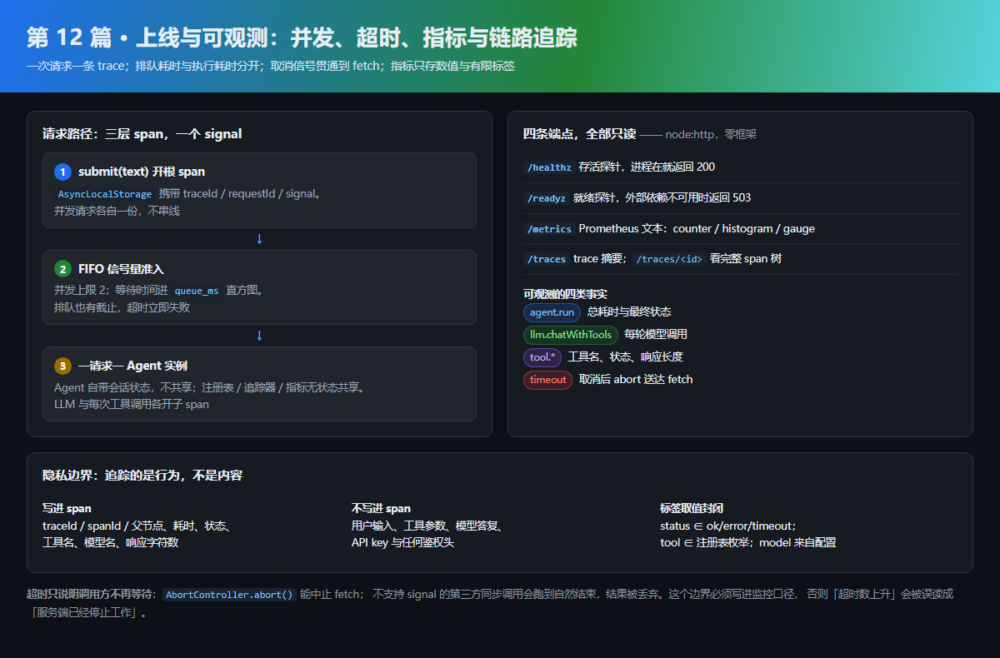
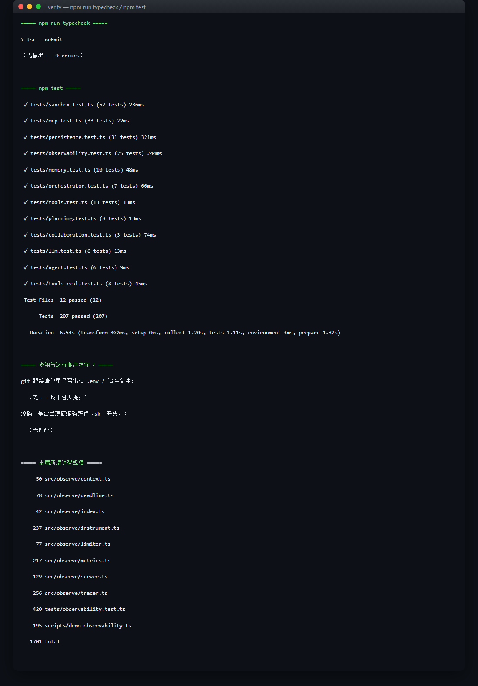
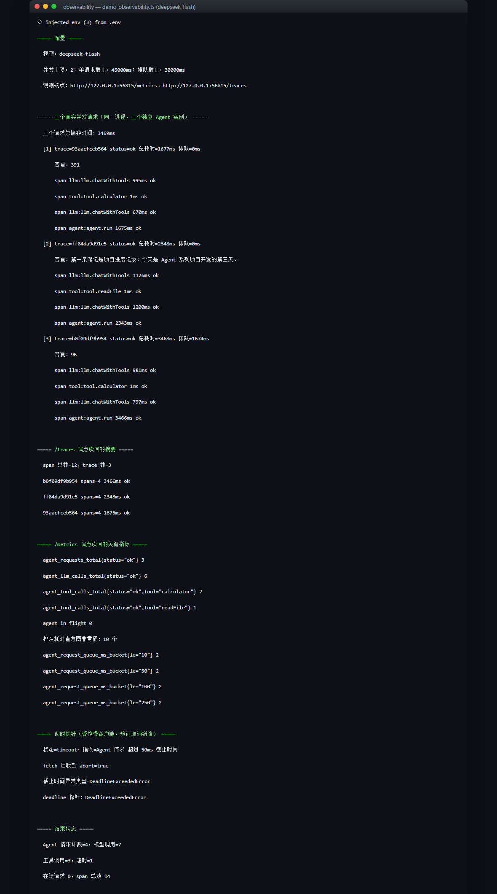

> **系列大纲 · 手搓 AI Agent（Node.js / TypeScript）**
>
> 本系列从零手搓一个**通用工具型 Agent**：能对话、能调用工具、能规划任务、能多 Agent 协作，能接 MCP 协议，也配得上权限沙箱与人工介入。技术栈锁定 **Node.js 22 + TypeScript**，模型接入层用一套 **OpenAI 兼容抽象**通吃 OpenAI / DeepSeek / 通义 / OpenRouter——改 `.env` 即可换模型，内核零改动。每篇代码可跑、可测、可 `git checkout post-NN` 回溯到任意一篇起点，图文在多平台同步发布。
>
> **总目录（14 篇主线 + 1 篇收尾）**
> 1. 开篇：什么是 Agent，为什么不直接用框架
> 2. 工程地基：Node22 + TS + 统一 LLM 客户端
> 3. 心脏：Agent Loop 与 ReAct
> 4. 长出手脚：Tool 系统设计
> 5. 第一个真工具：搜索 / 计算 / 读文件
> 6. 多工具协作：串行编排与并行执行
> 7. 记忆的两种形态
> 8. 会规划：Plan-and-Execute
> 9. 多 Agent 协作
> 10. 接外部世界：MCP 实战
> 11. 让 Agent 可信：权限 / 沙箱 / 人工介入
> 12. 持久化与恢复：会话、状态、崩溃续跑
> 13. 上线与可观测：并发、超时、指标与链路追踪（**本文**）
> 14. 收尾：本系列手搓的 vs 业界 ADK / Mastra
>
> 当前篇：第 12 篇（对应总目录第 13 项）。核心主张：**可观测性不是加几行 `console.log`**。一次请求要有一条能完整还原的 trace；排队耗时与执行耗时必须分开；超时必须把取消信号送到还在跑的 I/O 上；指标只存数值与封闭标签，不存请求正文。
>
> **配套代码仓库**：https://github.com/mrhuo/agent-from-scratch （每篇对应一个 `post-NN` tag，`git checkout post-12` 即可回到本篇代码起点）

# 手搓 AI Agent 12：上线与可观测——并发、超时、指标与链路追踪

前十一篇解决的是「Agent 能不能做事、做对事、做完后还能恢复」。到上线这一步，问题换了性质：一个请求失败，要能在几十秒内定位到是模型超时、工具报错，还是卡在并发队列里；一个请求耗时 3 秒，要能拆出其中多少花在等待、多少花在推理；一个请求被取消，要确认底层 HTTP 真的停了，而不是调用方单方面不等了。

控制台日志回答不了这些问题。日志是人类写的散文，格式自由、字段随意、无法聚合。本篇给 Agent 补上三种机器可读的信号：**trace**（一次请求里发生了什么）、**metric**（有多少、多慢、多少在失败）、**probe**（进程是否活着、是否就绪）。再把并发准入与截止时间做成显式组件，让「慢」和「失败」有明确归属。

本篇产出的源码分布：

```
src/observe/
├─ context.ts      AsyncLocalStorage 上下文：traceId / requestId / spanId / signal
├─ tracer.ts       span 数据模型、JSONL 导出器、内存收集器
├─ metrics.ts      counter / histogram / gauge + Prometheus 文本渲染
├─ deadline.ts     withDeadline：超时与 AbortSignal 同步触发
├─ limiter.ts      FIFO 信号量：并发上限 + 排队截止
├─ instrument.ts   TracedLLMClient / TracedToolRegistry / ObservedAgent
├─ server.ts       四个只读 HTTP 端点，node:http 实现
└─ index.ts        统一导出
src/llm/types.ts       新增 ChatClient 接口与 ChatOptions.signal
src/llm/LLMClient.ts   signal 透传给 fetch
src/agent/Agent.ts     run 接受 signal，循环边界检查取消
src/index.ts           新增 /obs 观测模式
scripts/demo-observability.ts  真实模型并发 + 超时探针
```

新增 1086 行产品代码、420 行测试，测试总数从 182 涨到 207。

---

## 01 一次请求 = 一条 trace

链路追踪的最小单位是 span。本篇的 span 结构只有十几个字段：traceId、spanId、parentSpanId、name、kind、起止时间、状态、属性、事件。字段对齐 OpenTelemetry 的核心语义，但没有引入它的 SDK——整套实现不到 260 行，依赖为零，每个字段的写入位置都能在源码里一眼定位。

一次请求对应三个层级：

- `agent.run` 是根 span，记录端到端耗时与最终状态；
- `llm.chatWithTools` 是每轮模型调用的子 span，记录耗时与成功/失败；
- `tool.calculator`、`tool.readFile` 等是每次工具调用的子 span，记录工具名、状态与响应字符数。

父 span 的传递没有靠手工参数。Node 的 `AsyncLocalStorage` 让同一个异步调用链里的所有函数自动读到同一份上下文，并发请求各自一份，不会串线。Agent Loop 里有 `Promise.all` 并行工具、有钩子回调、有客户端内部调用；若把 traceId 一层层参数化穿下去，前十一篇的内核会布满观测专用参数，代码可读性和可测试性都会退化。

`withRoot` 开根 span 并把上下文注入 ALS；`withSpan` 从 ALS 取当前 span 作为父节点；异常自动标记 `error`，`finally` 保证 `end()` 一定被调用。追踪数据同时写入内存收集器与 JSONL 文件。JSONL 采用同步追加，与第 11 篇事件日志同一策略：进程被强杀时最多丢半行，读侧跳过撕裂行。

**隐私边界必须在设计阶段定死**。span 只记标识、耗时、状态、工具名、模型名、响应字符数；用户输入、工具参数、模型答复、API key 与鉴权头一律不进追踪。工具 span 里写的是 `chars: observation.length`，而不是观察文本本身。标签取值来自有限集合：status 只有 `ok / error / timeout`，tool 来自注册表枚举，model 来自配置。这条边界让追踪数据可以安全地进入公共看板。

## 02 并发：Agent 有状态，实例不能共享

Agent 内部持有完整对话上下文。两个请求共用同一个实例，第二轮的模型会看到第一轮的消息，回答会被污染。这是并发化的第一原则：**一请求一 Agent 实例**。

可以共享的是无状态组件：工具注册表、记忆存储、追踪器、指标注册表、并发信号量。`ObservedAgent` 接受一个 `agentFactory`，每次 `submit` 调工厂造一个新 Agent，再把装饰过的客户端塞进去。这样既保证请求隔离，又不必把注册表等组件复制多份。

并发上限用 FIFO 信号量实现。为什么不用「计数加随机唤醒」：后到的请求若先被放行，等待时间分布会不可预测，指标里的排队耗时失去意义。信号量维护一个先进先出的等待队列，名额直接交接给队首，避免释放瞬间出现空位被后到者抢占。

排队也有截止时间。请求在队列里等待超过 `queueTimeoutMs` 就直接失败，而不是排了三十秒才被放行、再由模型层超时。队列超时与请求超时分别计数：前者说明容量不足，后者说明外部依赖慢，两种故障的处置方向完全不同。

## 03 超时：取消信号必须到达 I/O

很多实现的「超时」只是 `Promise.race`：到点返回错误，底层请求继续跑。调用方以为已经止损，服务端还在烧 token、还在写文件。本篇的 `withDeadline` 同时做两件事：到点 reject 一个 `DeadlineExceededError`，并调用 `AbortController.abort()`。

信号传递链路是完整的：`ObservedAgent.submit` 创建截止时间 → `Agent.run(text, { signal })` 接收 → 循环每圈开始检查 `signal.aborted` → `chatWithTools` 把 signal 放进 `ChatOptions` → `LLMClient.rawCompletions` 把它交给原生 `fetch`。工具执行前也检查一次，取消后不再触发新的副作用。

`ChatOptions` 新增 `signal` 字段，`Agent` 的客户端类型从具体的 `LLMClient` 放宽为 `ChatClient` 接口。这是本篇唯一一处对内核的实质性改动，且只是类型层面的抽象：循环判断、工具执行与错误分类逻辑保持原样。装饰客户端 `TracedLLMClient` 正是靠这个接口插进来的。

边界需要写进监控口径：`abort()` 能中止支持 signal 的 fetch；纯 CPU 计算或不支持 signal 的第三方调用无法被强制中断，只会跑到自然结束，结果被丢弃。因此「超时数上升」只说明调用方不再等待，不等于服务端已经停止工作。真实演示里用受控慢客户端验证这一点，打印 `fetch 层收到 abort=true` 作为证据。

## 04 指标：四类事实，四个端点

指标注册表实现四种形态：counter 累计次数，histogram 记录分布，gauge 记录瞬时值，注册表负责按名字复用与 Prometheus 文本渲染。直方图默认桶是 10/50/100/250/500/1000/2500/5000/10000 毫秒，末尾自动补 `+Inf`。

本篇定义七个指标：

| 指标 | 类型 | 关键标签 | 回答的问题 |
|---|---|---|---|
| `agent_requests_total` | counter | status | 成功/失败/超时各多少 |
| `agent_request_duration_ms` | histogram | status | 端到端耗时分布 |
| `agent_request_queue_ms` | histogram | — | 排队耗时分布 |
| `agent_in_flight` | gauge | — | 当前在途请求数 |
| `agent_llm_calls_total` | counter | status | 模型调用次数与失败率 |
| `agent_tool_calls_total` | counter | tool, status | 哪个工具在报错 |
| `agent_timeouts_total` | counter | phase | 取消发生在哪个阶段 |

把排队耗时从总耗时里单独拆出来，是本篇最重要的指标设计。总耗时 3 秒可能意味着模型慢，也可能意味着前面两个请求占着名额；两者混在一个数字里，扩容与换模型两种截然不同的处置无法区分。

HTTP 端点只用 `node:http` 写了四个只读路由：`/healthz` 存活、`/readyz` 就绪、`/metrics` 指标文本、`/traces` 与 `/traces/<id>` 链路查询，根路径是一个极简仪表盘。就绪探针接受外部注入的判断函数，依赖不可用时返回 503，避免流量打进还没准备好的实例。不引入 Web 框架的理由很实际：上线排障时依赖越少越好，这四个端点不到 130 行。

第 11 篇的事件日志在这里多了一层用途。它记录的是「业务状态发生了什么」，span 记录的是「一次调用花了多久、成功与否」；前者用于恢复，后者用于诊断。两者共用同一条请求线索时，可以从一条失败 trace 找到对应会话，再从事件日志还原当时的上下文。



## 05 运行验证

三个真实并发请求提交给同一个 `ObservedAgent`，并发上限设为 2。模型是 deepseek-flash，三个请求总墙钟时间 3469 毫秒：

- 请求一，trace `93aacfceb564`：总耗时 1677 毫秒，排队 0 毫秒。两次模型调用 995 与 670 毫秒，中间 `calculator` 1 毫秒，答复 391。
- 请求二，trace `ff84da9d91e5`：总耗时 2348 毫秒，排队 0 毫秒。`readFile` 读取 `notes.txt` 后给出一句话摘要。
- 请求三，trace `b0f09df9b954`：总耗时 3468 毫秒，其中 **1674 毫秒在队列里**。模型与工具耗时与前两次接近，慢的原因是并发名额被占。

三条 trace 各四个 span，共 12 个；全部 `status=ok`。端点读回的计数是：请求 3、模型调用 6、工具调用 3（calculator 两次、readFile 一次）、在途 0。排队耗时直方图的 `le=10/50/100/250` 桶各有 2 次记录——两次请求几乎无需等待。

超时探针用受控慢客户端，把截止时间设为 50 毫秒。结果是 `status=timeout`、错误文本 `Agent 请求 超过 50ms 截止时间`、fetch 层收到 abort。单测另有一条用例直接断言 `LLMClient` 把同一个 `AbortSignal` 传给了注入的 `fetchImpl`。





## 06 坑与权衡

**Agent 实例共享是最容易踩的并发坑。** 第一轮对话残留的消息会进入第二轮上下文，表现是「偶尔答非所问」，且只在并发压力下出现。本篇用工厂强制每请求一个实例，并把这条约束写进类型注释。

**工具失败文本没有统一前缀。** `ToolRegistry` 把校验与执行失败转成 `[工具错误·…]`，但业务工具自身也会返回以「错误：」开头的正常字符串。追踪层因此用三种前缀共同判定失败状态。更彻底的做法是让所有工具统一抛 `ToolError`，那会改动前几篇的既有工具与测试，本篇选择兼容。

**追踪数据无采样。** 本篇完整记录每个 span，保证演示轨迹可解释。生产环境应在 exporter 层加采样，而不是在上层代码里加条件判断；采样策略变化不应触碰业务逻辑。

**JSONL 追加不等于 fsync。** span 文件扛得住进程崩溃，扛不住机器掉电。需要更强持久性时，替换 exporter 实现即可，收集器与上层代码无需改动。

**histogram 桶边界需要按真实分布调。** 本篇默认值面向秒级 Agent 调用；若上层接入的是百毫秒级工具链，桶边界应下调，否则 `+Inf` 之外的分布分辨率不够。

## 07 小结与下一步

本篇把「上线之后怎么排障」拆成四件可落地的事：用 `AsyncLocalStorage` 让一次请求自带 trace 上下文；用 FIFO 信号量限制并发并把排队耗时单独计量；用 `AbortSignal` 把超时穿透到 fetch；用四个只读端点暴露指标与链路。所有观测数据只包含行为与数值，不包含用户输入与密钥。

代码上的改动集中在 `src/observe/`，对内核的侵入只有 `ChatClient` 接口与 `Agent.run` 的 signal 参数。207 个测试覆盖了 span 层级、并发隔离、指标渲染、取消语义、队列公平性与 HTTP 端点。

下一篇（第 13 篇）做系列收尾：把这套手搓实现与业界 ADK、Mastra 等框架逐项对照，看哪些抽象值得保留，哪些是重复造轮子，以及从零实现的真正价值落在哪一层。

---

## 如何运行本章代码

```bash
# 1. 克隆
git clone https://github.com/mrhuo/agent-from-scratch.git
cd agent-from-scratch

# 2. 安装依赖
npm install

# 3. 配置密钥（复制模板后填入申请的 API Key）
cp .env.example .env
#   编辑 .env：
#     OPENAI_API_KEY=sk-xxxxxxxx
#     BASE_URL=https://api.deepseek.com   # DeepSeek 兼容地址【不带 /v1】
#     MODEL=deepseek-flash

# 4. 回到本篇代码起点
git checkout post-12

# 5. 跑单元测试（mock，无需 key / 外网）
npm test

# 6. 类型检查
npm run typecheck

# 7. 真实模型演示（需联网与 key）：并发请求 + 指标抓取 + 超时探针
npx tsx scripts/demo-observability.ts

# 8. 交互式入口：/obs 打开观测模式并启动 HTTP 端点
npm run dev
#   输入 /obs
#   再输入任务，例如：23乘以17等于多少
#   另一个终端抓取：curl http://127.0.0.1:9464/metrics

# 9. 单独启动观测端点（不需要 key）
npm run observe
#   浏览器打开 http://127.0.0.1:9464/
```

追踪写入 `data/traces.jsonl`，演示轨迹写入 `data/observability-trace.txt`，两者都已加入 `.gitignore`。本地 `.env` 不进入提交。
