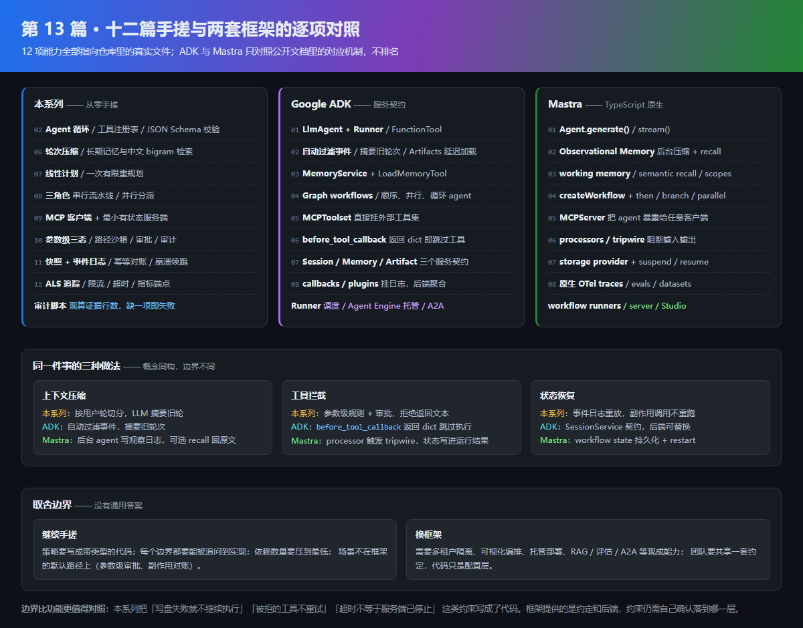
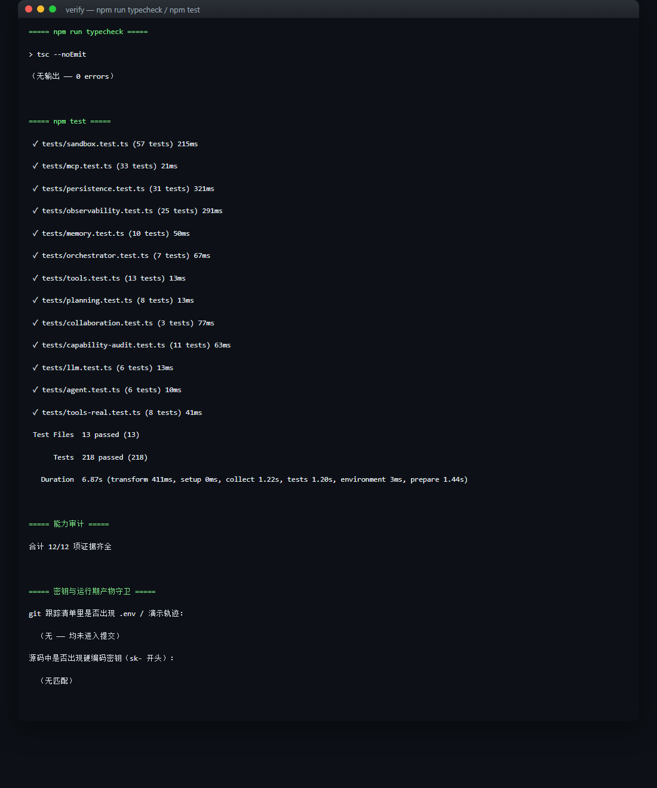
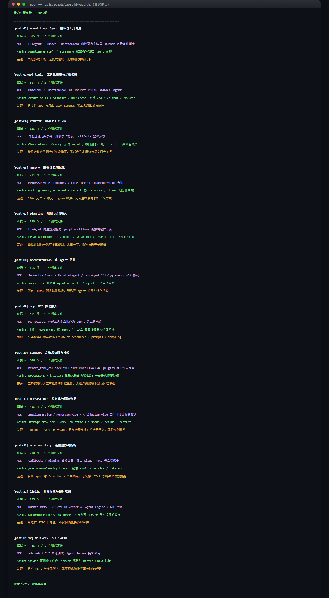

> **系列大纲 · 手搓 AI Agent（Node.js / TypeScript）**
>
> 本系列从零手搓一个**通用工具型 Agent**：能对话、能调用工具、能规划任务、能多 Agent 协作，能接 MCP 协议，也配得上权限沙箱与人工介入。技术栈锁定 **Node.js 22 + TypeScript**，模型接入层用一套 **OpenAI 兼容抽象**通吃 OpenAI / DeepSeek / 通义 / OpenRouter——改 `.env` 即可换模型，内核零改动。每篇代码可跑、可测、可 `git checkout post-NN` 回溯到任意一篇起点，图文在多平台同步发布。
>
> **总目录（14 篇主线 + 1 篇收尾）**
> 1. 开篇：什么是 Agent，为什么不直接用框架
> 2. 工程地基：Node22 + TS + 统一 LLM 客户端
> 3. 心脏：Agent Loop 与 ReAct
> 4. 长出手脚：Tool 系统设计
> 5. 第一个真工具：搜索 / 计算 / 读文件
> 6. 多工具协作：串行编排与并行执行
> 7. 记忆的两种形态
> 8. 会规划：Plan-and-Execute
> 9. 多 Agent 协作
> 10. 接外部世界：MCP 实战
> 11. 让 Agent 可信：权限 / 沙箱 / 人工介入
> 12. 持久化与恢复：会话、状态、崩溃续跑
> 13. 上线与可观测：并发、超时、指标与链路追踪
> 14. 收尾：本系列手搓的 vs 业界 ADK / Mastra（**本文**）
>
> 当前篇：第 13 篇（对应总目录第 14 项）。核心主张：**对照要落到代码上**。12 项能力逐条指向真实文件，证据行数现算；ADK 与 Mastra 只对齐公开文档里的对应机制，不排名，不换算成优劣。取舍落在边界上：哪些约束被写成了代码，哪些被交给了框架约定。
>
> **配套代码仓库**：https://github.com/mrhuo/agent-from-scratch （每篇对应一个 `post-NN` tag，`git checkout post-13` 即可回到本篇代码起点）

# 手搓 AI Agent 13：收尾对照——本系列手搓的 vs ADK / Mastra

十二篇正文落下 12 项能力，4551 行可追溯的源码证据，218 个通过的测试。收尾篇不再加新机制，改为回答一个更硬的问题：这套手搓实现放到 Google ADK 与 Mastra 旁边，哪些地方同构，哪些地方各走各路，哪些地方根本没做。

对照的入口不是印象，是一条命令。`npx tsx scripts/capability-audit.ts` 扫仓库，输出 12 行对照；任一证据文件缺失，退出码 1。文章里的表格来自这条命令，改代码后再跑一次，行数自动跟着变。



## 01 给对照表装上证据

框架对比最容易滑向主观描述。写“记忆支持完善”不需要成本，核对“哪一行代码在做这件事”才有成本。

`src/audit/capabilities.ts` 为每项能力存五个字段：证据文件、测试文件、ADK 对应、Mastra 对应、未覆盖部分。审计函数读文件算行数，检查测试是否存在，缺一项就把 `present` 置为 `false`。`scripts/capability-audit.ts` 提供三种输出：终端、Markdown、JSON，另可按 `--only=sandbox` 只看一项。

结果是 12/12 项证据齐全，累计 4551 行，14 个测试文件被引用（同一文件可支撑多项能力，故不等于测试总数）。审计模块自身有 11 个单测，覆盖行数统计、缺失文件判定、渲染格式。

这一层工程量的意义不在数字。对照表成了可复跑的检查：某篇删掉一个证据文件，下一轮审计直接失败，文档不会留下一句失去支撑的结论。

## 02 工具层：三种写法，一个共同边界

本系列的工具入口是 `ToolRegistry`。Zod 工具走 Zod 校验，MCP 原生工具走 JSON Schema 校验，两条路径汇成同一种观察文本；校验失败返回 `[工具错误·validation]`，执行异常返回 `[工具错误·execution]。

ADK 的对应物是 `BaseTool` 与 `FunctionTool`，外部工具集通过 `MCPToolset` 挂进 agent。Mastra 用 `createTool()`，参数 schema 接受 Zod、Valibot、ArkType 等 Standard JSON Schema 实现。三套实现共享一条设计约束：**schema 交给模型，校验留在入口**。

差异在拒绝动作发生在哪一层。ADK 的 `before_tool_callback` 返回 `dict` 即跳过真实工具，返回值作为工具结果回传模型；`after_tool_callback` 只能替换已经产生的结果，拦不住执行。Mastra 的 processor 可触发 `tripwire`，工作流运行结果里带 `processorId` 与 `reason`，状态是 `tripwire` 而非 `success`。本系列把策略前置到 `ToolRegistry` 与工具实现之间，拒绝时返回 `[权限拒绝·策略拒绝]` 或 `[权限拒绝·人工驳回]`，并写一条审计事件。

共同结论只有一句：输出过滤太晚。邮件发出、扣款完成以后再判断内容是否合规，没有意义。三套实现都把拦截点放在动作之前，区别只是拦截表达成回调返回值、工作流状态，还是策略引擎的三态决策。

## 03 上下文压缩：同构的三条路径

`src/memory/ContextCompressor.ts` 只有 106 行。触发条件是可压缩的用户轮次超过保留窗口，超出的旧轮交给 `Summarizer` 压成一条 system 消息。切分按用户轮边界，不按消息条数——一轮工具调用是 `user → assistant(tool_calls) → tool → tool` 的连续序列，从中间硬切会把调用与观察拆到摘要两侧，`tool_call_id` 对不上。本地完整历史一直留着，压缩只作用于发往模型的上下文。

ADK 官方文档把上下文当源码管理：自动过滤无关事件、摘要较旧轮次、Artifacts 延迟加载、跟踪 token 使用。Mastra 的 Observational Memory 走得更远：后台 agent 把旧消息写成密集观察日志，原文回查工具 `recall` 默认关闭，设置 `retrieval: true` 才开启；配向量库与 embedder 后支持按语义检索，但命中单位是观察组，不是原始消息。官方文档明确写着，压缩会丢失原始措辞，存储适配器不支持时 Observational Memory 静默关闭。

三条路径解决同一个问题：上下文窗口有限，历史不能全塞。本系列在发送路径上同步摘要，代价是超阈值时多一次模型调用；Mastra 把压缩挪到后台，代价是引入存储适配器约束与回查工具；ADK 把策略交给框架默认行为，代价是细节由框架版本决定。代码量差两个数量级，边界透明度也差两个数量级。

## 04 持久化：服务契约与手写日志

ADK 把状态拆成三个可替换的服务契约：`SessionService` 管会话与事件，`MemoryService` 管跨会话检索，`ArtifactService` 管文件与二进制产物。实现可换成内存、Firestore、Vertex AI Session API、GCS。框架只规定接口，落盘语义由后端负责。

Mastra 把持久化绑在存储 provider 与工作流状态上。工作流运行结果是可辨识联合类型：`success`、`failed`、`suspended`、`tripwire`、`paused`；状态经 `setState` 写入，跨 suspend / resume 保留；`restart()` 从中断时所在的活跃步骤重跑。这一步能恢复工作流内部状态，文档没有说明对外部副作用的去重口径——这一点需要自行验证，不能默认框架已经处理。

本系列选了第三条路。`EventLog` 写只追加 JSONL，事件带单调 `seq`；`SessionStore` 用 tmp → rename 原子替换快照，保留 `.bak` 回滚；恢复只读 `seq > snapshot.lastSeq` 的事件，重放时按 `tool_call_id` 去重，同组调用合并回一条 assistant 消息。只读工具结果丢失时安全重放，`writeFile`、`deleteFile`、`runCommand`、`mcp__` 一律不重跑，只写 `uncertain: true` 的观察，把“状态未知”摆在模型面前。

边界写得很清楚：`appendFileSync` 不等于 `fsync`，只扛进程崩溃，不扛掉电；单进程写入，多进程要加租约或单一 Writer。框架把这部分成本转给后端服务，手搓把成本留在代码里。两种选择都要有人负责。

## 05 人工介入：拦截点决定可信度

默认沙箱有 10 条参数级规则，决策三态 `allow / deny / ask`。规则写成 TypeScript 代码，参数路径支持 `a.b[0].c`，匹配器可组合。fail-closed 三条铁律：审批超时等于拒绝，审批器异常等于拒绝，没有审批人等于拒绝。终端审批器额外处理非 TTY 环境——CI 里直接拒绝，不挂死。

ADK 的对应能力是回调与插件。`before_tool_callback` 能在工具执行前拦截，返回 `dict` 跳过真实执行；官方 Java 1.0 示例用 `request_confirmation` 工具在执行前请求确认。框架提供的是钩子位置，三态策略、审批人、审计日志都要在钩子里自己写。Mastra 把人工介入做成工作流原语：步骤可 `suspend()`，状态持久化，等人批准后用 `resume()` 继续；`tripwire` 是另一种中断，由 processor 触发。

本系列多出来的一层是审计。每次决策记录命中规则、审批人、执行结果；“批准了但执行失败”与“批准了且执行成功”分开存。这一层不来自框架对比，来自一次具体追问：出事以后拿什么还原当时的授权状态。三套实现都能拦住动作，只有把决策过程写下来才能回答这个问题。

## 06 可观测：数值事实与后端体系

第 12 篇用 `AsyncLocalStorage` 携带 `traceId / requestId / spanId / signal`，一次请求一条 trace，模型调用与工具调用是子 span。三个真实并发请求的总墙钟 3469ms，第三个请求有 1674ms 花在队列里；三条 trace 共 12 个 span，全部 `ok`。指标端点输出请求数 3、模型调用 6、工具调用 3。span 只记标识、耗时、状态、工具名与响应长度，用户输入、工具参数、密钥一律不进。

ADK 用 callbacks 与 plugins 挂日志，聚合交给 Cloud Trace 等后端。Mastra 原生发 OpenTelemetry traces，旁边配 evals、metrics、datasets，可在 Studio 里逐条看模型调用、工具调用与交接。

本系列缺三样东西：采样、OTel 导出、评估数据集。自研 span 够查一次具体问题，不够做长期质量回归；Prometheus 文本端点够看延迟分布，不够给模型输出打分。框架在这里的优势不在实现更难，而在后端已经接通—— traces 能直接进查询系统，评测结果能进版本比较。手搓要补的不是几行代码，是一整条数据链。

## 07 没有做的部分

向量检索没做。Mastra 提供统一的向量存储接口、元数据过滤、embed 与 rerank；本系列的中文 bigram 只做关键词匹配，查不了同义表述。

评估没做。218 个测试验证行为是否符合预期，不验证回答质量是否下降。Mastra 的 evals 与 datasets 把线上 trace 和用户反馈沉淀成可重跑的检查集，这一层完全缺席。

远程 Agent 协议没做。ADK 通过 Agent2Agent 协议发现远端 AgentCard，把远程 agent 当本地节点用；本系列的多 Agent 只有固定三角色与两条编排路径，进程外通信为零。

产物管理没做。ADK 的 `GcsArtifactService` 提供版本化的文件与二进制管理；本系列的文件工具限 `data/` 目录、限文本扩展名、限 1MB。

图分支、循环节点、多租户隔离、跨实例租约、掉电持久化，同样没做。这些不是遗漏，是边界。把它们列出来，比写一句“功能完善”有用。

## 08 运行验证

类型检查 0 错误；13 个测试文件共 218 例全绿；能力审计 12/12 项证据齐全。密钥守卫检查 git 跟踪清单与源码里的 `sk-` 前缀，两者都为空。本地 `.env` 未进入提交。





## 09 取舍边界

继续手搓的条件很具体：策略必须写成带类型的代码；每个边界都要能追问到实现；依赖数量要压到最低；场景不在框架的默认路径上，比如参数级审批与副作用对账。

换框架的条件同样具体：需要多租户隔离、可视化编排、托管部署；需要 RAG、评估、A2A 这些现成能力；团队要共享一套约定，代码退成配置层。

两条路之间没有胜负。手搓的价值不在省依赖，在于每个边界都能被追问到底。框架的代价是把边界交给约定——约定通常可靠，但版本升级时会变，出问题时要去文档里找答案。

这一套实现停在单进程边界。跨实例租约、掉电持久化、OTel 导出，是下一个工程问题。

## 如何运行本章代码

```bash
# 1. 克隆
git clone https://github.com/mrhuo/agent-from-scratch.git
cd agent-from-scratch

# 2. 安装依赖
npm install

# 3. 配置密钥（跑审计与单测不需要；跑真实模型演示才需要）
cp .env.example .env
#   编辑 .env：
#     OPENAI_API_KEY=sk-xxxxxxxx
#     BASE_URL=https://api.deepseek.com   # DeepSeek 兼容地址【不带 /v1】
#     MODEL=deepseek-flash

# 4. 回到本篇代码起点
git checkout post-13

# 5. 跑能力审计（不需要 key / 外网）
npx tsx scripts/capability-audit.ts
npx tsx scripts/capability-audit.ts --md
npx tsx scripts/capability-audit.ts --only=sandbox

# 6. 跑单元测试（mock，无需 key / 外网）
npm test

# 7. 类型检查
npm run typecheck

# 8. 回溯任意一篇的代码
git checkout post-06   # 记忆的两种形态
git checkout post-09   # MCP 实战
git checkout post-12   # 上线与可观测
```

审计输出写入 `data/audit-run.out`，配图中间产物写入 `data/audit-*.html`，均已加入 `.gitignore`。本地 `.env` 不进入提交。
